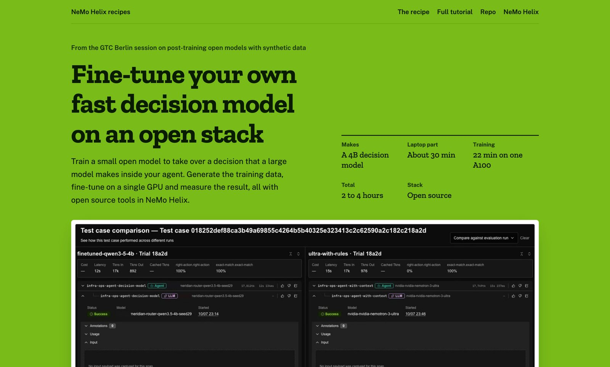
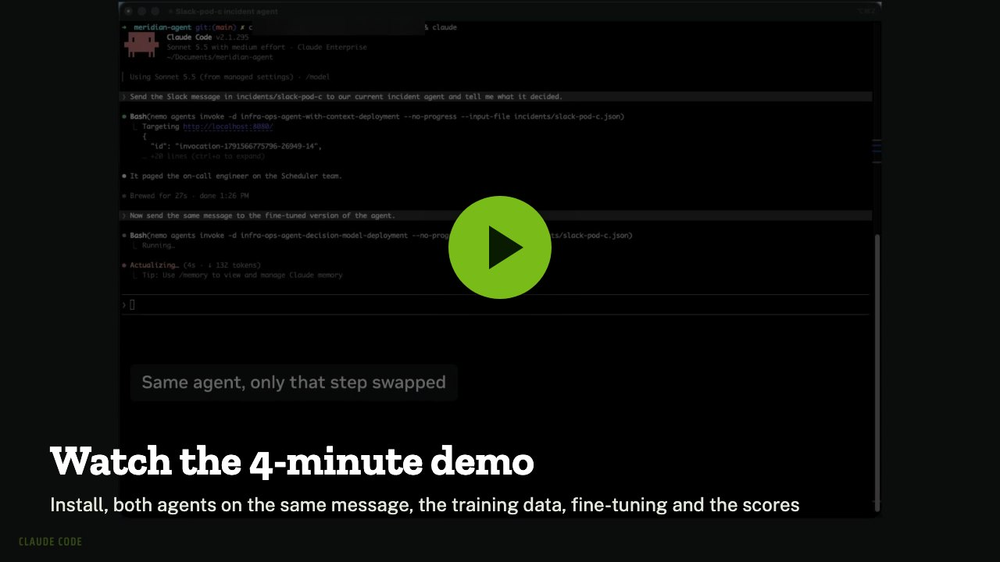

<p align="center">
  <a href="https://nvidia-nemo.github.io/nemo-helix/gtc-berlin-2026-tutorial/"></a>
</p>

# Fine-tune your own fast decision model on an open stack

Train a small open model to take over a decision that a large model makes inside your agent. Generate the training data, fine-tune on a single GPU and measure the result, all with open source tools in NeMo Helix.

**[Open the walkthrough site](https://nvidia-nemo.github.io/nemo-helix/gtc-berlin-2026-tutorial/)** • [Watch the demo](https://nvidia-nemo.github.io/nemo-helix/gtc-berlin-2026-tutorial/#watch-h) • [Read the tutorial](docs/tutorial.md) • [See the results](RESULTS.md)

> [!NOTE]
> **Draft for review.** Steps 7 to 9 haven't been run end to end on a single local GPU machine yet. The walkthrough site is at [nvidia-nemo.github.io/nemo-helix/gtc-berlin-2026-tutorial](https://nvidia-nemo.github.io/nemo-helix/gtc-berlin-2026-tutorial/).

## What you'll build

Meridian Compute is a made-up company that runs GPU clusters. Its incident agent gets this message on Slack:

> dispatch queue on pod-c is lagging. jobs stuck pending, cli commands hanging or timing out after 30s. nothing is actually broken for users yet, but the scheduler controller seems to have stopped answering.

The agent has to decide what happens next. Meridian's policy for a dispatch queue problem that isn't hurting users yet is to open a ticket for business hours. Here's what each model decided:

| Who makes the decision | What it did |
|---|---|
| Nemotron 3 Ultra (550B), with Meridian's policy pasted into its prompt | Paged the on-call engineer |
| Qwen3.5-4B, fine-tuned on Meridian's past incidents | **Opened a ticket for the morning** |

You'll build the second one. The agent itself keeps running on Nemotron 3 Super, and only this one decision moves to the model you train.

## How it turned out

| | Nemotron 3 Ultra 550B, policy in the prompt | Qwen3.5-4B, fine-tuned |
|---|---|---|
| Picks the right action | 70% | **82%** |
| Picks the right action inside the running agent | 74% | **81%** |
| Time to answer the decision | 670 ms | **301 ms** |

Training took 22 minutes on one A100. We scored both models on 416 incidents held back from training, and on 200 more inside the running agent. A whole agent run takes about as long either way, because the rest of the agent's work still runs on Nemotron 3 Super. The data is synthetic, so your numbers will differ. [RESULTS.md](RESULTS.md) has every number and caveat.

## Watch it first

<a href="https://nvidia-nemo.github.io/nemo-helix/gtc-berlin-2026-tutorial/#watch-h"></a>

Four minutes, narrated: the install, both agents on the same message, the training data, fine-tuning and the scores.

## What you'll do

| | What happens | Open source tool | Our time |
|---|---|---|---|
| **1. [Run the agent as it is](docs/tutorial.md#step-0-preflight)** | Install NeMo Helix, deploy the agent and see what a large general model decides | NeMo Helix | About 20 min |
| **2. [Make the training data](docs/tutorial.md#step-3-get-the-incident-history)** | Generate labeled incidents with a writer model and a judge model, then check that none give away the answer. Or use the packaged data | Data Designer | 1 min packaged, 21 min to generate |
| **3. [Fine-tune](docs/tutorial.md#step-6-register-the-base-model)** | Train a LoRA adapter on Qwen3.5-4B on one GPU | Helix post-training plugin with Unsloth | About 30 min |
| **4. [Measure it](docs/tutorial.md#step-8-deploy-the-base-model-and-the-adapter)** | Serve the base and fine-tuned models, score both, then put yours inside the agent | Deployments and the Helix Evals plugin | 1 to 3 hours |

## Get started

You need a laptop for stages 1 and 2, and a Linux machine with one NVIDIA GPU (40 GB or more) for stages 3 and 4. You also need Python 3.12 or 3.13, [uv](https://docs.astral.sh/uv/), Docker and an API key for an inference provider. Plan on 2 to 4 hours end to end.

```bash
git clone -b gtc-berlin-2026-tutorial --single-branch https://github.com/NVIDIA-NeMo/nemo-helix.git helix-specialized-agent-tutorial
cd helix-specialized-agent-tutorial
bash scripts/preflight.sh --no-gpu
```

The preflight tells you what's missing. Then follow the [walkthrough site](https://nvidia-nemo.github.io/nemo-helix/gtc-berlin-2026-tutorial/) or [docs/tutorial.md](docs/tutorial.md). Every step shows the commands, what you should see and what to do if it fails.

**Prefer to have your coding agent guide you?** Open the repo in Claude Code, Codex, Cursor or Pi and ask:

```
Walk me through the Helix specialized-agent tutorial, one step at a time.
```

The repo ships a skill that knows what each step should print and which fix goes with which error. It asks before anything that spends money or holds a GPU.

**Just want to see our numbers?** No GPU or Helix needed:

```bash
python3 eval/analyze_results.py results/small-models/C-qwen-finetuned.action.rows.jsonl.gz \
  --calibration results/small-models/cal-C-qwen-finetuned.action.rows.jsonl.gz
```

## Use it on your own agent

Pick a decision your agent makes often from a fixed list of answers, where past examples teach more than documents do. Then change three things and rerun from step 4:

1. **The answers and the policy** in [`taxonomy.json`](taxonomy.json).
2. **The training data.** Edit the Data Designer recipe in [`data/incidents.py`](data/incidents.py), or [bring your own labeled tickets](docs/tutorial.md#bring-your-own-labeled-tickets).
3. **The agent's tool** in [`agent/`](agent/), so the decision is a tool whose model you can swap with a setting.

[Step 11](docs/tutorial.md#step-11-adapt-it-to-your-own-agent) walks through each change.

<details>
<summary><b>What's in the repo</b></summary>

| Path | What it is |
|---|---|
| `docs/` | The walkthrough site (`index.html`), the full tutorial (`tutorial.md`, built into `tutorial.html` by `scripts/build_site.py`) and the demo video |
| `taxonomy.json` | Meridian's 12 runbooks, 4 actions, response policy and the scenario types for the training data. Edit this to make it yours |
| `agent/` | The Helix agent in three versions (no policy, policy in the prompt, fine-tuned model) and its tool server |
| `data/` | The Data Designer recipe and the exact dataset behind our results |
| `training/` | Job specs for the Helix post-training plugin (Qwen3.5-4B and Nemotron Nano 9B v2), plus base model registration and deployment |
| `eval/` | Helix Evals plugin specs and the analysis scripts |
| `results/` | Our scores for every model, row by row |
| `scripts/` | Preflight, data checks and the glue between steps |
| `skills/` | The agent skill that guides a coding agent through the tutorial |
| `RESULTS.md`, `KNOWN-ISSUES.md` | What we measured, and every problem we hit with its fix |

</details>

## Star NeMo Helix

Everything here runs on [NeMo Helix](https://github.com/NVIDIA-NeMo/nemo-helix): Data Designer, the Helix post-training plugin, Deployments and the Helix Evals plugin. If this tutorial helped, give it a star so you can find it again.

Made for the GTC Berlin session **Post Training Open Models with Synthetic Data for Specialized Agents** by Yamini Kagal and Stefan Gavrilovic, NVIDIA. Slides and the recording will be linked here after the session.

Licensed under [Apache 2.0](LICENSE).
