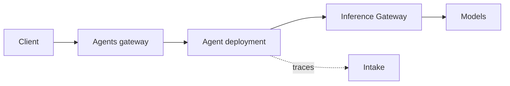

An agent on NeMo Helix is an `agent` entity in a workspace. Once registered, the
platform can deploy it, route requests to it, collect its traces, evaluate it,
and optimize it. Agents run through
[NeMo Fabric](https://docs.nvidia.com/nemo/fabric/about-nemo-fabric/overview/),
which gives every supported harness (DeepAgents, Claude Code, Codex, Hermes,
NOOA, or a remote agent endpoint) the same configuration, lifecycle, and
telemetry.

## How It Works

1. **Register.** `nemo agents create` stores the agent's `agent.yaml` and uploads the
   files beside it to the agent's `<name>-ethos` fileset.
1. **Deploy.** `nemo agents deploy` runs the agent as a local subprocess, a Docker
   container, or a Kubernetes Deployment.
1. **Invoke.** The Agents gateway routes each request to the agent's active deployment
   and exposes it as an OpenAI-compatible endpoint, whatever the runtime.
1. **Call models.** Model traffic from the agent goes through the
   [Inference Gateway](/documentation/models-and-inference), which resolves model and
   [virtual model](/documentation/models-and-inference/virtual-models) names and attaches
   provider credentials. Agent configs never carry provider API keys for platform-routed models.
1. **Trace.** Deployed agents export trajectories to Intake under the agent's name by default, which
   feeds [Insights](/documentation/agents/traces-and-insights/insights-from-traces),
   evaluation, and [optimization](/documentation/agents/optimize-agents).

## Agent Lifecycle

| Stage | Command |
|---|---|
| Register | `nemo agents create --name <name> --agent-config <path>` |
| Deploy | `nemo agents deploy --agent <name>` |
| Invoke | `nemo agents invoke --agent <name> --input "..."` |
| Chat | `nemo agents chat --agent-deployment <deployment>` |
| Run once as a job | `nemo agents execute --agent <name> --input "..."` |
| Analyze traces | `nemo compass analysis-runs create --agent <name>` |
| Optimize | `nemo agents optimize run-strategy --strategy <strategy> --agent <name>` |
| Update in place | `nemo agents redeploy --agent <name> --agent-config <path>` |
| Tear down | `nemo agents undeploy --agent <name>`, then `nemo agents delete <name>` |

To try an `agent.yaml` without registering it, run `nemo agents invoke --agent-config <path> --input "..."`.

## Next Steps

- [Register Agents](/documentation/agents/register-agents): from code, a container image, a
  remote endpoint, or traces.
- [Deploy Agents](/documentation/agents/deploy-agents): choose a runtime, and build and publish
  agent images.
- [Execute Agents as Jobs](/documentation/agents/execute-agents-as-jobs): run an agent once, to
  completion.
- [Collect Agent Traces](/documentation/agents/traces-and-insights/collect-agent-traces) and
  [Insights from Traces](/documentation/agents/traces-and-insights/insights-from-traces): find out
  what your agent does and where it fails.
- [Optimize Agents](/documentation/agents/optimize-agents): generate, evaluate, and compare
  candidate agents.
- [Agent Governance](/documentation/agents/governance): attack a sandboxed copy of an agent, then
  generate and validate guardrail and sandbox-policy fixes.
