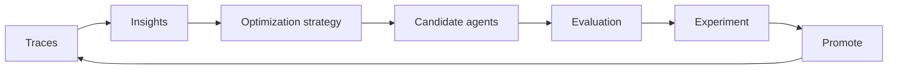

<a id="agents-optimization"></a>

Optimization turns a registered agent into candidate agents (a rewritten prompt, tuned model settings,
routed model traffic, and more) that you evaluate against the original before you promote one.
Strategies never modify the original agent.

## Optimization Strategies

Each strategy is a plugin, so the strategies you can run depend on what the platform has installed:

```bash
nemo agents optimize list-strategies
```

| Strategy | Plugin | What it changes | Availability |
|---|---|---|---|
| [`config-tuning`](#config-tuning) | `nemo-optimization-plugin` | Model settings and prompts, through hyperparameter search and genetic algorithms scored against an eval set | Installed by default |
| [`switchyard`](#switchyard) | `nemo-switchyard-plugin` | Model routing: the agent's model calls are split across a pair of models | Installed by default |
| [`prompt-master`](#prompt-master-experimental) | `prompt-master-plugin` | The system prompt, rewritten by the Prompt Master skill | Experimental; source checkout only |

Every strategy runs as a platform job through one command:

```bash
nemo agents optimize run-strategy --strategy <strategy> --agent <agent> [options]
```

The job runs on the platform, so it cannot read your filesystem: configuration files go in a
fileset. Strategy jobs run in the platform host's environment when a `subprocess` execution profile
is registered, and otherwise in the `nhx-tasks` image under the `cpu` profile. Follow a run with
`nemo jobs watch <job>`, and download its results with `nemo jobs results download`.

To add your own strategy, see
[Optimization Strategy Plugins](/documentation/reference/plugin-architecture#optimization-strategy-plugins).

### config-tuning

`config-tuning` runs a study: it tries values from a search space, scores each trial against an eval
dataset, and keeps the best. Enable a numeric phase (Optuna search over model settings), a prompt
phase (genetic prompt optimization), or both. The study is described by an optimize YAML that sits
in a bundle directory with the dataset and anything else it references:

```yaml
optimizer:
  numeric:
    enabled: true
    n_trials: 20
  eval_metrics:
    average_score:          # score reported by the evaluator below
      direction: maximize
  search_space:
    temperature:
      type: fabric
      path: models.default.temperature
      values: [0.0, 0.2, 0.6]
eval:
  general:
    dataset:
      file_path: dataset.json
  evaluators:
    accuracy:
      _type: tunable_rag_evaluator
      llm_name: judge       # a model declared under the agent's models
```

Validate and upload the bundle, then run the study against a registered agent:

```bash
nemo agents optimize prepare-fileset \
  --source ./my-optimize-bundle \
  --optimize-config optimize.yaml \
  --fileset my-agent-optimize \
  --agent my-agent

nemo agents optimize run-strategy \
  --strategy config-tuning \
  --agent my-agent \
  --optimize-config-fileset default/my-agent-optimize \
  --optimize-config optimize.yaml
```

`prepare-fileset` checks that every path the config references is relative and inside the bundle;
add `--dry-run` to validate without uploading. The job's `optimizer_results` result holds the study
summary and, on success, `final_optimized_config.yml`. Add `--output <fileset>` to also publish the
artifacts, including per-trial ATIF evidence. The **Optimizations** tab of an agent in
[NeMo Studio](/documentation/studio/agents) launches this strategy.

For complete, runnable bundles, including the judge model and an MCP-backed agent, see the
[hermes-optimize examples](https://github.com/NVIDIA-NeMo/nemo-helix/tree/main/plugins/nemo-optimization/examples/hermes-optimize).

### switchyard

`switchyard` tests whether cheaper models can carry some of the agent's traffic. Give it the models
you accept, most capable first, and the routing strategies to try. For every model pair and routing
strategy, it creates a Switchyard [virtual model](/documentation/models-and-inference/virtual-models#route-across-models-with-switchyard)
named `<agent>-<digest>` and writes a copy of the agent config that uses it. The digest is a short
hash of the routing strategy, the pair's models, and the middleware config. An exact rerun reuses
the same virtual models; changed routing content produces new digest-based names alongside the old
ones. Combinations whose routing content is unchanged keep their names.

An existing virtual model with a matching name is reused only if its models and middleware config
match the request. Otherwise, the run fails and asks you to delete the conflicting virtual model
before rerunning.

```bash
nemo agents optimize run-strategy --strategy switchyard --agent my-agent \
  --spec '{"models": ["default/model-a", "default/model-b"], "routing_strategies": ["random_routing", "stage_router"]}'

nemo jobs results download switchyard --job <job> -o switchyard.tar.gz
mkdir -p switchyard-results && tar -xzf switchyard.tar.gz -C switchyard-results --strip-components=1
```

The results hold one `agent-<virtual-model>.yaml` per combination and `switchyard-result.json`, which
maps each virtual model to its models and routing config. Obtain generated names from
`switchyard-result.json`, then use the corresponding `agent-<virtual-model>.yaml`; do not construct
positional names such as `<agent>-<routing-strategy>-<pair-index>` in automation.

| Field | Default | Meaning |
|---|---|---|
| `models` | Required | At least two model entities, most capable first |
| `routing_strategies` | `["random_routing"]` | Any of `random_routing`, `stage_router`, `llm_classifier` |
| `strong_probability` | `0.5` | `random_routing`: share of requests sent to the more capable model |
| `confidence_threshold` | `0.5` | `stage_router` threshold |
| `base_threshold` | `0.5` | `llm_classifier` threshold |
| `judge_model` | The pair's capable model | `llm_classifier` judge |

The agent must use the `nemo-agents-spec-v1` format. Each candidate config points the agent's models at
its virtual model through the Inference Gateway.

### prompt-master (Experimental)

`prompt-master` rewrites the agent's system prompt (`instructions.system.content`) with the
[Prompt Master](https://github.com/nidhinjs/prompt-master) skill, run once by a bundled optimizer
agent. It is not installed by default. From a source checkout, install it into the platform
environment and restart the platform:

```bash
uv pip install -e plugins/prompt-master
nemo services run
```

Re-run the install after `uv sync`, which removes packages the lockfile does not list.

```bash
nemo agents optimize run-strategy --strategy prompt-master --agent my-agent

nemo jobs results download prompt_master --job <job> -o prompt_master.tar.gz
mkdir -p prompt-master-results && tar -xzf prompt_master.tar.gz -C prompt-master-results --strip-components=1
```

The result holds a complete `agent.yaml` with the new prompt, and `prompt-master-result.json` with
the original and optimized prompts. To change the optimizer's model or instructions, upload a partial
`agent.yaml` to a fileset and pass it with `--optimize-config-fileset` and `--optimize-config`.

## Run from Studio

The **Optimizations** tab on an agent's detail page in NeMo Studio runs the same strategies without the CLI. The tab lists the agent's optimization runs with their **Name**, **Config**, **Status**, and **Created** columns, and you can search them by name. Select a run to open it. A finished run can be deleted from its row actions. Select **Optimize** in the page header, or the call to action in the empty list, to start a new run. See [Studio Agents](/documentation/studio/agents) for the rest of the agent page.

The launch flow starts with a strategy picker. It shows one tile per strategy the platform has installed, titled and described by the plugin that provides it, plus an **Upload a config** tile when `config-tuning` is installed. What happens next depends on the strategy:

| Choice | What opens |
|---|---|
| **Upload a config** | A dialog to choose a `config-tuning` optimize bundle from your computer or a fileset. |
| **Hyperparameter optimization** (`config-tuning`) | A guided form on the tab. |
| **Model routing using Switchyard** | The routing form described below. |
| Any other installed strategy | A dialog titled with the strategy's title. Its bundle section is labeled **Config bundle**, or **Config bundle (optional)** when the strategy runs without one. |

<Note>

The **Optimizations** tab is enabled by default. An administrator can hide it by setting `studio.feature_flags.agent_optimizations_enabled: false`. The strategy picker and in-tab forms are also on by default; with `studio.feature_flags.agent_optimization_form_enabled: false`, **Optimize** opens only the dialog for uploading a `config-tuning` bundle, and the Switchyard form isn't available. Restart Studio after changing either flag.

</Note>

### Set Up a Switchyard Run

The Switchyard form takes the same inputs as the `switchyard` strategy's `--spec`:

1. Enter a **Name** for the run. It defaults to a name built from the agent's name and a timestamp, and the form shows the entity name it will create.
2. Under **Which models can it use?**, add the models to route between from the workspace's models, most capable first. The first and last models carry **Most capable** and **Most efficient** badges. Use the arrows to reorder and the remove button to drop one. You need at least two models, and each can be added once. Every model is paired with each model below it, so the first model of a pair is its capable model and the second is its efficient model.
3. Under **How should each pair route?**, pick one or more routing strategies (Random routing is selected by default) and set each one's threshold with its slider or text box, a number from 0 to 1 that defaults to 0.5. A strategy's settings appear once you select it:

   | Strategy | Threshold |
   |---|---|
   | Random routing | **Capable model share**: the share of requests sent to the capable model. |
   | Stage router | **Confidence threshold**: the confidence below which a request escalates to the capable model. |
   | LLM classifier | **Capability threshold**: the capability score above which a request escalates to the capable model. Optionally select a **Judge model**; by default each pair's capable model judges. The judge setting only appears for this strategy. |

The summary beside the form shows the model pairs and how many routed models the run will build, which is the number of pairs times the number of strategies. **Run optimization** stays disabled, with the reason shown above it, until the form is valid. Selecting it submits a `switchyard` run-strategy job for the agent, shows an "Optimization submitted" toast, and returns you to the **Optimizations** tab, where the new run appears in the list. The stored agent is never modified. The agent must have a registered configuration in the `nemo-agents-spec-v1` format, or the run fails. A virtual model name that would exceed the name length limit is rejected, so use a shorter agent name if the job fails for that reason.

### Review Switchyard Results

Select a run in the list to open its page at `/agents/optimizations/<run>`. The breadcrumb shows the agent's name and links back to its **Optimizations** tab. While the run is in progress the page shows the submitted models and routing strategies and the job's step progress. A run that fails shows its error. In every state the page also shows the run's **Logs** and **Artifacts**.

When the run completes, the page shows the number of virtual models and routing strategies it built, then lists one row per virtual model with its **Virtual model**, **Routing strategy**, **Capable model**, **Efficient model**, and **Setting** (the strategy's threshold, plus the judge model when it differs from the capable model). You can search and sort the list. From a row you can:

- **Test routing**: select the row to open the **Test routing** panel, and the row is marked **Testing**. The panel is a chat that sends requests through that virtual model, with a popover for inference parameters, with a **Routing split** that tallies how many responses came from the capable model, the efficient model, or neither (**Other**). **Clear** resets the tally, and **How this route decides** explains the selected strategy so you can read the observed split against it. Selecting the virtual model's name opens its [virtual model](/documentation/studio/virtual-models) page instead.
- **Deploy**: select **Deploy** to open **Deploy route as a new agent**. The dialog summarizes the route, and the **New agent name** defaults to the virtual model's name. It creates a new agent whose models all call that virtual model, and, with **Deploy after creating** selected (the default, shown when deployment is available), deploys it as soon as it's created. The original agent isn't changed. The new agent uses the agent configuration the run captured, so the dialog warns you if the original agent changed after the run. **Deploy** is unavailable for a route whose agent config the run didn't save.

## The Optimization Loop

A strategy only produces candidates. Optimization is the loop around it: find a problem, generate
candidates, evaluate them against the original, and keep the winner.



### 1. Find What to Fix (optional)

You do not need traces or insights for all optimization strategies, but they can be invaluable if you have them.

[Collect the agent's traces](/documentation/agents/traces-and-insights/collect-agent-traces) and
[generate Insights](/documentation/agents/traces-and-insights/insights-from-traces) from them:

```bash
nemo compass analysis-runs create --agent my-agent --wait
```

Each Insight names a recurring problem and the traces that show it, which points to a strategy: a
prompt problem to `config-tuning` or `prompt-master`, a cost or latency problem to `switchyard`.

### 2. Generate Candidates

Run a strategy, download its results, and register each candidate config as a new agent. The
original stays untouched, so it remains your baseline. For Switchyard, pick a virtual model name
from `switchyard-result.json`. The example below assumes the result contains `my-agent-3f2a9c1e`;
replace it with the name from your run in both the registration command and evaluation target.

```bash
nemo agents register \
  --name my-agent-3f2a9c1e \
  --agent-config ./switchyard-results/agent-my-agent-3f2a9c1e.yaml
```

### 3. Evaluate the Baseline and Candidates

Run the same tasks and metrics against every agent with
[Agent Evaluation](/documentation/evaluate-models/agent-eval).

- **Registered agents.** A Fabric target that names the agent, such as
  `{"kind": "fabric", "source": {"agent": "my-agent-3f2a9c1e"}}`, runs the agent fresh for
  each task, so you do not need to deploy candidates. See
  [Evaluate with a NeMo Fabric Harness](/documentation/evaluate-models/agent-eval/fabric-runner#evaluate-an-agent-registered-on-the-platform).
- **Deployments.** To evaluate a running deployment, point an HTTP target at the Agents gateway:
  `<base-url>/apis/agents/v2/workspaces/default/deployments/<deployment>/-/v1/chat/completions`. See
  [Evaluate a Deployed Agent over HTTP](/documentation/evaluate-models/agent-eval/evaluate-deployed-agent).

### 4. Compare Results in an Experiment

Create an [Experiment](/documentation/evaluate-models/experiments) for the investigation, linked to the
Insight with `insight_id`, and an Evaluation in it for each agent you evaluate. Set
`publication.intake.evaluation_id` on each agent-evaluate job to publish its trials and scores to that
Evaluation. The Experiment's leaderboard and Pareto view then rank the baseline and candidates on
quality, cost, and latency. Pin the baseline to keep it at the top.

### 5. Promote the Winner

Replace the agent with the winning config, then resolve the Insight in [NeMo Studio](/documentation/studio/insights):

```bash
nemo agents redeploy --agent my-agent --agent-config ./winner/agent.yaml
```

New traces from the promoted agent start the next round.
