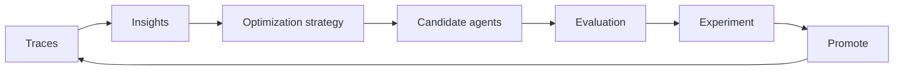

<a id="agents-optimization"></a>

Optimization turns a registered agent into candidate agents (a rewritten prompt, tuned model settings,
routed model traffic, and more) that you evaluate against the original before you promote one.
Strategies never modify the original agent.

## Optimization Strategies

Each strategy is a plugin, so the strategies you can run depend on what the platform has installed:

```bash
nemo agents optimize list-strategies
```

| Strategy | Plugin | What it changes | Availability |
|---|---|---|---|
| [`config-tuning`](#config-tuning) | `nemo-optimization-plugin` | Model settings and prompts, through hyperparameter search and genetic algorithms scored against an eval set | Installed by default |
| [`switchyard`](#switchyard) | `nemo-switchyard-plugin` | Model routing: the agent's model calls are split across a pair of models | Installed by default |
| [`prompt-master`](#prompt-master-experimental) | `prompt-master-plugin` | The system prompt, rewritten by the Prompt Master skill | Experimental; source checkout only |

Every strategy runs as a platform job through one command:

```bash
nemo agents optimize run-strategy --strategy <strategy> --agent <agent> [options]
```

The job runs on the platform, so it cannot read your filesystem: configuration files go in a
fileset. Strategy jobs run in the platform host's environment when a `subprocess` execution profile
is registered, and otherwise in the `nhx-tasks` image under the `cpu` profile. Follow a run with
`nemo jobs watch <job>`, and download its results with `nemo jobs results download`.

To add your own strategy, see
[Optimization Strategy Plugins](/documentation/reference/plugin-architecture#optimization-strategy-plugins).

### config-tuning

`config-tuning` runs a study: it tries values from a search space, scores each trial against an eval
dataset, and keeps the best. Enable a numeric phase (Optuna search over model settings), a prompt
phase (genetic prompt optimization), or both. The study is described by an optimize YAML that sits
in a bundle directory with the dataset and anything else it references:

```yaml
optimizer:
  numeric:
    enabled: true
    n_trials: 20
  eval_metrics:
    average_score:          # score reported by the evaluator below
      direction: maximize
  search_space:
    temperature:
      type: fabric
      path: models.default.temperature
      values: [0.0, 0.2, 0.6]
eval:
  general:
    dataset:
      file_path: dataset.json
  evaluators:
    accuracy:
      _type: tunable_rag_evaluator
      llm_name: judge       # a model declared under the agent's models
```

Validate and upload the bundle, then run the study against a registered agent:

```bash
nemo agents optimize prepare-fileset \
  --source ./my-optimize-bundle \
  --optimize-config optimize.yaml \
  --fileset my-agent-optimize \
  --agent my-agent

nemo agents optimize run-strategy \
  --strategy config-tuning \
  --agent my-agent \
  --optimize-config-fileset default/my-agent-optimize \
  --optimize-config optimize.yaml
```

`prepare-fileset` checks that every path the config references is relative and inside the bundle;
add `--dry-run` to validate without uploading. The job's `optimizer_results` result holds the study
summary and, on success, `final_optimized_config.yml`. Add `--output <fileset>` to also publish the
artifacts, including per-trial ATIF evidence. The **Optimizations** tab of an agent in
[NeMo Studio](/documentation/studio/agents) launches this strategy.

For complete, runnable bundles, including the judge model and an MCP-backed agent, see the
[hermes-optimize examples](https://github.com/NVIDIA-NeMo/nemo-helix/tree/main/plugins/nemo-optimization/examples/hermes-optimize).

### switchyard

`switchyard` tests whether cheaper models can carry some of the agent's traffic. Give it the models
you accept, most capable first, and the routing strategies to try. For every model pair and routing
strategy, it creates a Switchyard [virtual model](/documentation/models-and-inference/virtual-models#route-across-models-with-switchyard)
named `<agent>-<routing-strategy>-<pair-index>` and writes a copy of the agent config that uses it.

```bash
nemo agents optimize run-strategy --strategy switchyard --agent my-agent \
  --spec '{"models": ["default/model-a", "default/model-b"], "routing_strategies": ["random_routing", "stage_router"]}'

nemo jobs results download switchyard --job <job> -o switchyard.tar.gz
mkdir -p switchyard-results && tar -xzf switchyard.tar.gz -C switchyard-results --strip-components=1
```

The results hold one `agent-<virtual-model>.yaml` per combination and `switchyard-result.json`, which
maps each virtual model to its models and routing config.

| Field | Default | Meaning |
|---|---|---|
| `models` | Required | At least two model entities, most capable first |
| `routing_strategies` | `["random_routing"]` | Any of `random_routing`, `stage_router`, `llm_classifier` |
| `strong_probability` | `0.5` | `random_routing`: share of requests sent to the more capable model |
| `confidence_threshold` | `0.5` | `stage_router` threshold |
| `base_threshold` | `0.5` | `llm_classifier` threshold |
| `judge_model` | The pair's capable model | `llm_classifier` judge |

The agent must use the `nemo-agents-spec-v1` format. Each candidate config points the agent's models at
its virtual model through the Inference Gateway.

### prompt-master (Experimental)

`prompt-master` rewrites the agent's system prompt (`instructions.system.content`) with the
[Prompt Master](https://github.com/nidhinjs/prompt-master) skill, run once by a bundled optimizer
agent. It is not installed by default. From a source checkout, install it into the platform
environment and restart the platform:

```bash
uv pip install -e plugins/prompt-master
nemo services run
```

Re-run the install after `uv sync`, which removes packages the lockfile does not list.

```bash
nemo agents optimize run-strategy --strategy prompt-master --agent my-agent

nemo jobs results download prompt_master --job <job> -o prompt_master.tar.gz
mkdir -p prompt-master-results && tar -xzf prompt_master.tar.gz -C prompt-master-results --strip-components=1
```

The result holds a complete `agent.yaml` with the new prompt, and `prompt-master-result.json` with
the original and optimized prompts. To change the optimizer's model or instructions, upload a partial
`agent.yaml` to a fileset and pass it with `--optimize-config-fileset` and `--optimize-config`.

## The Optimization Loop

A strategy only produces candidates. Optimization is the loop around it: find a problem, generate
candidates, evaluate them against the original, and keep the winner.



### 1. Find What to Fix

[Collect the agent's traces](/documentation/agents/traces-and-insights/collect-agent-traces) and
[generate Insights](/documentation/agents/traces-and-insights/insights-from-traces) from them:

```bash
nemo insights analysis-runs create --agent my-agent --wait
```

Each Insight names a recurring problem and the traces that show it, which points to a strategy: a
prompt problem to `config-tuning` or `prompt-master`, a cost or latency problem to `switchyard`.

### 2. Generate Candidates

Run a strategy, download its results, and register each candidate config as a new agent. The
original stays untouched, so it remains your baseline.

```bash
nemo agents create \
  --name my-agent-random-routing-1 \
  --agent-config ./switchyard-results/agent-my-agent-random-routing-1.yaml
```

### 3. Evaluate the Baseline and Candidates

Run the same tasks and metrics against every agent with
[Agent Evaluation](/documentation/evaluate-models/agent-eval).

- **Registered agents.** A Fabric target that names the agent, such as
  `{"kind": "fabric", "source": {"agent": "my-agent-random-routing-1"}}`, runs the agent fresh for
  each task, so you do not need to deploy candidates. See
  [Evaluate with a NeMo Fabric Harness](/documentation/evaluate-models/agent-eval/fabric-runner#evaluate-an-agent-registered-on-the-platform).
- **Deployments.** To evaluate a running deployment, point an HTTP target at the Agents gateway:
  `<base-url>/apis/agents/v2/workspaces/default/deployments/<deployment>/-/v1/chat/completions`. See
  [Evaluate a Deployed Agent over HTTP](/documentation/evaluate-models/agent-eval/evaluate-deployed-agent).

### 4. Compare Results in an Experiment

Create an [Experiment](/documentation/evaluate-models/experiments) for the investigation, linked to the
Insight with `insight_id`, and an Evaluation in it for each agent you evaluate. Set
`publication.intake.evaluation_id` on each agent-evaluate job to publish its trials and scores to that
Evaluation. The Experiment's leaderboard and Pareto view then rank the baseline and candidates on
quality, cost, and latency. Pin the baseline to keep it at the top.

### 5. Promote the Winner

Replace the agent with the winning config, then resolve the Insight in [NeMo Studio](/documentation/studio/insights):

```bash
nemo agents redeploy --agent my-agent --agent-config ./winner/agent.yaml
```

New traces from the promoted agent start the next round.
