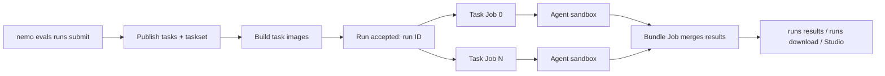

`nemo evals runs` runs a Harbor task suite on a NeMo Helix deployment on Kubernetes.

- Each task runs as its own Kubernetes Job, in parallel.
- The agent runs in an OpenSandbox sandbox pod. [Sandbox profiles](/documentation/kubernetes-deployment/setup/helm/harbor-sandbox-profiles) set by a cluster admin limit sandbox pod network access and resources.
- One run ID returned upon evaluation submission covers all tasks. When all the tasks finish, their results are merged into a single bundle.
- A failed task doesn't stop the others. See [Handle failures](#handle-failures).

| Aspect | [Local Harbor runner](/documentation/evaluate-models/agent-eval/harbor-runner) | Kubernetes taskset run (this page) |
| --- | --- | --- |
| Interface | Python SDK (`HarborAgentTaskRunner`) | `nemo evals runs` CLI, or the REST API: `POST /apis/evals/v2/workspaces/<ws>/agent-evaluate/runs` |
| Sandbox | Docker on your machine | OpenSandbox pod in the cluster |
| Parallelism | Your machine's resources | One Job per task in the cluster |
| Network policy | Task's own | Task's own, narrowed by the [sandbox profile](/documentation/kubernetes-deployment/setup/helm/harbor-sandbox-profiles) set by a cluster admin |

- The Python SDK publishes tasks and tasksets (`Evaluator.tasks`, `Evaluator.tasksets`). It has no method to submit or track a Kubernetes run.



**Verifier**, set in each task's `task.toml`:

- `verifier.environment_mode` unset or `"shared"` → verification runs in the agent sandbox.
- `verifier.environment_mode = "separate"`, or a `[verifier.environment]` table → the task gets its own verifier sandbox.

## Before you begin

- A CLI context for the deployment: see [Connect to Deployments](/documentation/reference/cli-reference/connect-to-deployments).
- The evals plugin in your CLI environment: `pip install 'nemo-helix[nemo-evals-plugin]'`.
- A source checkout of this repository for the quickstart's example suite, and `git` on your `PATH` for `--harbor-git`.
- A workspace you can write to. The examples use `WS`:

  ```bash
  WS=default
  ```

<Note>

Your operator must enable OpenSandbox (`sandboxClusterCapable: true`) and Builder (`builder.enabled: true`) in the Helm values. The chart then enables taskset runs with the `harbor-standard` sandbox profile. See [OpenSandbox](/documentation/kubernetes-deployment/setup/helm/open-sandbox) and [Configure Harbor Taskset Runs](/documentation/kubernetes-deployment/setup/helm/harbor-sandbox-profiles).
With platform auth on, a model-calling agent also needs [Scoped Access Keys](/documentation/access-control/deployment#scoped-access-keys) enabled.

</Note>

- **Sandbox profile names:** omit `--sandbox-profile` to use the deployment's default profile. An unknown name returns a 422 error that lists the valid names.
- **Network access:** `harbor-standard` lets the sandbox reach only the platform API.
  - The profile's hosts limit every task's own network policy. See [how they combine](/documentation/kubernetes-deployment/setup/helm/harbor-sandbox-profiles#network). Ask a cluster admin for a profile that matches your taskset's egress needs.
  - Symptoms of a blocked host:
    - During agent setup: the trial ends with an install error, before the agent runs.
    - While the agent runs: its commands fail to resolve or connect to the host. The trial trace shows the failed tool calls.

<Warning>

Harbor task packages contain build, solution and verifier code that runs in your cluster. Submit only packages you trust.

</Warning>

## Quickstart: one task with `oracle`

`oracle` applies each task's reference solution. It calls no model, so it checks only the pipeline: publishing, image builds, Jobs, sandboxes and results. It takes about 3 minutes the first time, while the task image builds; reruns skip the build.

1. Copy the hello-world suite (one task) from a source checkout:

   ```bash
   SUITE_DIR="$(mktemp -d)/hello-world-suite"
   cp -R packages/nhx_evals_sdk/examples/harbor/hello_world_dataset "$SUITE_DIR"
   ```

2. List its tasks. This uploads nothing:

   ```bash
   nemo evals runs submit --workspace "$WS" --harbor-dir "$SUITE_DIR" --list-tasks
   ```

   `nemo evals runs submit --help` lists every option.

3. Submit task `0`:

   ```bash
   nemo evals runs submit --workspace "$WS" --harbor-dir "$SUITE_DIR" --tasks 0 --agent oracle
   ```

   ```console
   Published task default/hello-world-suite-hello-world#…
   Published taskset default/hello-world-suite-…#… (1 of 1 tasks)
   …
   Run run-0123456789abcdef accepted: 1 tasks, queued; the run controller starts their task Jobs
   Rerun these tasks: nemo evals runs submit --taskset 'default/hello-world-suite-…#…'

   View evaluation run: nemo evals runs status run-0123456789abcdef --watch
   ```

   - The CLI publishes the task and a taskset pinned by content digest.
   - It builds the task's images and waits until they are ready. Images that are already built return at once.
   - It submits the run and prints the run ID, and a `--taskset` command that reruns the same tasks with the same settings, without uploading or building.
   - `<run> is already running <taskset>` means another of your active runs uses the same taskset. It doesn't block yours.

4. Watch the run until it finishes:

   ```bash
   RUN_ID=run-0123456789abcdef  # the ID submit printed
   nemo evals runs status "$RUN_ID" --workspace "$WS" --watch
   ```

   - Run phase: `accepted` → `running` → `completed`, `failed`, `cancelled` or `expired`. A run can also end straight from `accepted`.
   - Result aggregation state, separate from the phase:
     - `pending`: the merged result isn't saved yet.
     - `ready`: the merged result is saved; `results` and `download` work.
     - `failed`: merging didn't finish. Per-task scores are still in `runs results`.
     - `none`: there is nothing to merge, because no task succeeded.
   - The run is done when its phase is terminal: the result state is final at the same time. A `completed` run can still have a `failed` result.

5. Read the scores, then download the bundle:

   ```bash
   nemo evals runs results "$RUN_ID" --workspace "$WS"
   nemo evals runs download "$RUN_ID" --workspace "$WS"
   ```

   - `oracle` scores 1.0 on every task.
   - `download` writes `./$RUN_ID/agent-eval-results/`, including `report.html`.

## Choose tasks

Each source flag takes a whole dataset; `--tasks` narrows it. The source flags are mutually exclusive.

| Flag | Source | Repeatable runs |
| --- | --- | --- |
| `--harbor-dir <dir>` | Local Harbor dataset directory | Keep the directory unchanged |
| `--harbor-hub <org>/<name>[@<ref>]` | [Harbor Hub](https://hub.harborframework.com/datasets) dataset | Pin `@sha256:<digest>`; without a ref, Hub uses the latest version |
| `--harbor-git <url>@<tag-or-commit>` | `tasks/` in a public Git repository; for another directory, use `https://github.com/<org>/<repo>/tree/<ref>/<dir>` | Pass a tag or commit; a source without `@<ref>` is rejected. With `--experiment`, the resolved commit is the Evaluation's dataset version |
| `--taskset <ws>/<name>#<digest>` | Stored taskset from `nemo evals tasksets create` | Already pinned |

- `--list-tasks` prints the selectable tasks with their zero-based indexes and exits.
- `--tasks` takes zero-based indexes or names, comma-separated: `--tasks 0,2` or `--tasks anko-default-function-arguments,geo-shapeindex-serialization`. Omit it to run every task.

```bash
nemo evals runs submit --workspace "$WS" --harbor-hub datacurve/deep-swe --list-tasks
```

## Publish taskset once, run many times

Every submit runs against a stored taskset:

- `runs submit --harbor-*` reads the source again on each submit. Unchanged tasks aren't republished (`Unchanged task …`), and built images are reused.
- `runs submit --taskset <ref>` skips reading the source and building. The run's taskset ref is in `nemo evals runs status "$RUN_ID" --json` as `run.taskset_ref`.

To prepare a taskset without submitting a run:

1. Publish the tasks and a taskset:

   ```bash
   nemo evals tasksets create --workspace "$WS" --harbor-hub datacurve/deep-swe \
     --tasks anko-default-function-arguments,geo-shapeindex-serialization
   ```

   The last line printed is the taskset ref, `<ws>/<name>#<digest>`.

2. Build its images:

   ```bash
   TASKSET='<ws>/deep-swe-…#…'  # the ref tasksets create printed above
   nemo evals tasksets build-images "$TASKSET" --wait
   ```

   - `--wait` follows the builds until each is `ready` or `failed`.
   - Rerun the command to retry failed builds.

3. Submit runs against it. No upload, no build:

   ```bash
   nemo evals runs submit --workspace "$WS" --taskset "$TASKSET" --agent oracle
   ```

   - Submit rejects the run if any task's image isn't built yet.
   - To keep the source dataset's name in the Experiment leaderboard, add `--experiment` and `--intake-dataset`. See [Label the dataset](#label-the-dataset).

## Run with a model-calling agent (openhands)

Harbor agents fall into two kinds:

- **Model-calling agent:** runs an LLM to attempt the task, such as `openhands`, `codex` or `mini-swe-agent`. Its score measures that model and agent together. It bills tokens to your provider key.
- **Non-calling agent:** never calls a model, so there is no model to name, no key and no token cost:
  - `oracle` applies the task's reference solution. Use it to check the pipeline, as in the [`oracle` quickstart](#quickstart-one-task-with-oracle).
  - `nop` does nothing.

`--agent` takes only a [built-in Harbor agent name](https://docs.harborframework.com/agents/pre-integrated-agents#available-agents). That is enough for a non-calling agent.
A model-calling agent also needs a request file (`--spec-file`), because the command line has no way to say which model it calls or which secret authenticates it.

### 1. Register your model

This uses Nemotron 3.5 Super on [build.nvidia.com](https://build.nvidia.com), an OpenAI-compatible endpoint, with your own key (`custom-provider` in the [DeepSWE notebook](https://github.com/NVIDIA-NeMo/nemo-helix/tree/main/plugins/nemo-evals/examples/deepswe_k8s_demo)). Calls are billed to your key.

- **Model:** pick one from the [build.nvidia.com catalog](https://build.nvidia.com/models). This page uses `nvidia/nemotron-3.5-super-vl-120b-a12b`. For another model, replace that ID, and the model name step 3 prints (`default/nvidia-nemotron-3-5-super-vl-120b-a12b`), wherever this page uses them.
- **API key:** create one at [build.nvidia.com API keys](https://build.nvidia.com/settings/api-keys).

1. Store your key in a secret. Export it in your shell first; don't put the key in a command:

   ```bash
   printenv NVIDIA_BUILD_API_KEY | nemo secrets create nvidia-build-api-key --workspace "$WS" --from-file -
   ```

2. Create a provider for the endpoint, with that secret, serving one model. `--default-extra-body` turns on the model's reasoning:

   ```bash
   nemo inference providers create nvidia-build --workspace "$WS" \
     --host-url https://integrate.api.nvidia.com \
     --api-key-secret-name nvidia-build-api-key \
     --enabled-models nvidia/nemotron-3.5-super-vl-120b-a12b \
     --default-extra-body '{"chat_template_kwargs": {"enable_thinking": true}}'
   ```

3. Read the model the gateway registers for it. Retry until `served_models` lists it:

   ```bash
   nemo inference providers get nvidia-build --workspace "$WS" --output-format json \
     | jq -r '.served_models[] | select(.served_model_name == "nvidia/nemotron-3.5-super-vl-120b-a12b") | .model_entity_id'
   ```

   ```console
   default/nvidia-nemotron-3-5-super-vl-120b-a12b
   ```

   The prefix is your workspace (`$WS`). The examples below assume `default`.

<Note>

To use a model the deployment already serves, skip these steps. Use that model's name, `<ws>/<model>`, below. List them with `nemo models list --workspace "$WS"`.

</Note>

### 2. Give the agent a gateway key

Each trial calls the gateway with its own key, which evals creates for it and revokes when the trial ends. Submit still checks for a gateway key of your own:

- **Platform auth on:** create an inference-scoped access key and store it in a secret. Without it, submit fails. Trials don't use it.

  ```bash
  nemo auth access-keys create --name evals-inference-key --scope inference --expires-in 604800 \
    | nemo secrets create evals-inference-key --workspace "$WS" --from-file -
  ```

  - The key acts on your behalf, can only call models, and expires after 7 days (`--expires-in` is in seconds).
  - When it expires, run the same command with `nemo secrets update` in place of `nemo secrets create`.
  - Each trial's own key is a Scoped Access Key owned by you, so `nemo auth access-keys list` shows it while the trial runs.
- **Platform auth off:** skip this step and drop `env_secrets` from the request file. Evals sets a placeholder key.

### 3. Write the request file

Save as `openhands-run.json`:

```json
{
  "spec": {
    "target": {
      "kind": "harbor",
      "source": {"name": "openhands", "model": {"ref": "default/nvidia-nemotron-3-5-super-vl-120b-a12b"}},
      "agent_kwargs": {"version": "1.6.0", "temperature": "1", "top_p": "0.95", "disable_vision": true},
      "env_secrets": {"LLM_API_KEY": "evals-inference-key"},
      "n_attempts": 1,
      "max_retries": 1
    }
  },
  "execution": {}
}
```

- `model.ref`: evals sets openhands' base URL (`LLM_BASE_URL`) and model name to the gateway route for this model. Don't set them yourself.
- `agent_kwargs`:
  - `version` pins the `openhands-ai` release. Use 1.6.0: later releases drop the `openhands.core.main` module that Harbor's `openhands` agent runs, so the agent install fails.
  - `temperature` and `top_p` set the model's sampling. Without them, openhands uses `0.0` and `1.0`, which is greedy decoding. Set the values your model's provider recommends.
  - `disable_vision` sends text only.
- `env_secrets`: maps an environment variable to a secret name. openhands reads its key from `LLM_API_KEY`. Never put a key value in this file.
- `max_retries: 1`: a trial that errors, such as a failed agent install, reruns once in a new sandbox. Agent or verifier timeouts, auth errors and unknown models aren't retried.
- `execution` is required. `{}` uses the deployment's defaults.
- The task source on the command line supplies `spec.tasks`.

<Note>

Harbor's built-in agents aren't guaranteed to work with every agent release, model or Harbor version. Before a large run, try your combination on one task, and pin `version` in `agent_kwargs` once it works, as this example does for openhands.

</Note>

### 4. Submit

Three DeepSWE tasks. Expect 5–20 minutes: the tasks run in parallel, and openhands installs itself in each sandbox first.

```bash
nemo evals runs submit --workspace "$WS" --harbor-hub datacurve/deep-swe \
  --tasks anko-default-function-arguments,csstree-shorthand-expansion-compression,geo-shapeindex-serialization \
  --spec-file openhands-run.json
```

Under `harbor-standard`:

- The sandbox reaches only the API, which hosts the Inference Gateway.
- Package and installer hosts (uv, PyPI, Debian, GitHub) open only while the agent installs itself, then close before it runs.
- An agent that needs other hosts at run time needs another [profile](/documentation/kubernetes-deployment/setup/helm/harbor-sandbox-profiles). Ask your operator.

DeepSWE tasks are no-network, and this run is open-book: submit prints a warning that the model provider may still use hosted tools such as web search. To prevent that, [run closed-book](#optional-run-closed-book).

<Tip>

The [DeepSWE notebook](https://github.com/NVIDIA-NeMo/nemo-helix/tree/main/plugins/nemo-evals/examples/deepswe_k8s_demo) runs 10 tasks the same way, with codex. It shows each task's progress while you wait, then charts which tasks the agent solved and why the others failed.

</Tip>

### Optional: run closed-book

A no-network task cuts the sandbox off from the network, but not the model: the provider can still run hosted tools such as web search. Closed-book strips those tools.

1. Create a virtual model in front of your model, with the closed-book middleware as the last `request_middleware` entry:

   ```bash
   nemo inference virtual-models create nemotron-super-closed-book --workspace "$WS" \
     --default-model-entity "$WS/nvidia-nemotron-3-5-super-vl-120b-a12b" \
     --request-middleware '[{"name": "nemo-evals-closed-book", "config_type": "closed_book", "config": {}}]'
   ```

   To record trials too, add the trial-recording entries as in [Optional: record trials](#optional-record-trials), closed-book still last.

2. In the request file's `spec.target`, set `closed_book` and point the agent at the virtual model:

   ```json
   {"closed_book": true, "source": {"name": "openhands", "model": {"ref": "default/nemotron-super-closed-book"}}}
   ```

- Submit refuses a closed-book run with a 422 `closed_book_required` unless every virtual model the agent can reach ends its `request_middleware` with `nemo-evals-closed-book`.
- It holds against an agent that tries to get around it only with platform auth on. With auth off, an agent can forge its trial credential or call a model that isn't closed-book.

### Optional: record trials

Trial recording records each trial's model calls in Intake, with token usage, in the trial's trace. Without it, the run still works: the job logs a warning and the calls aren't recorded.

Create a virtual model with the trial-recording middleware in both middleware lists, and point `model.ref` at it. With closed-book, use one virtual model and put closed-book last in `request_middleware`:

```bash
nemo inference virtual-models create nemotron-super-closed-book --workspace "$WS" \
  --default-model-entity "$WS/nvidia-nemotron-3-5-super-vl-120b-a12b" \
  --request-middleware '[{"name": "nemo-evals-trial-recording", "config_type": "trial_recording", "config": {}},
                         {"name": "nemo-evals-closed-book", "config_type": "closed_book", "config": {}}]' \
  --response-middleware '[{"name": "nemo-evals-trial-recording", "config_type": "trial_recording", "config": {}}]'
```

- If you already created `nemotron-super-closed-book` in [Optional: run closed-book](#optional-run-closed-book), run the same command with `patch` in place of `create`.
- With platform auth off, a trial-recording model refuses calls without the credential an evaluation issues (401). To chat with it yourself, call `$WS/nvidia-nemotron-3-5-super-vl-120b-a12b` instead.
- See [Record Evaluation Trials](/documentation/models-and-inference/virtual-models#record-evaluation-trials) for details.

## Size sandboxes and limit concurrency

Without a request file, use flags:

```bash
nemo evals runs submit \
  --workspace "$WS" \
  --harbor-dir "$SUITE_DIR" \
  --tasks 0 \
  --agent oracle \
  --sandbox-profile harbor-standard \
  --cpus 2 \
  --memory-mb 4096 \
  --storage-mb 10240
```

- `--cpus`, `--memory-mb` and `--storage-mb` replace `task.toml`'s values for the agent sandbox. A separate verifier sandbox keeps `task.toml`'s values.
- If the profile sets a ceiling (`max_cpus`, `max_memory_mb`, `max_storage_mb`), values above it return a 422 error. Without one, the value is used as given, except that `--storage-mb` above the profile's `max_disk_mb` (128 GiB by default) also returns a 422.
- The ceilings also apply to `task.toml`. A task that asks for more fails the submit with 422 `tasks without images: <task>: resources_exceed_policy: …`. The flags above lower the agent sandbox. A separate verifier sandbox can only be lowered in `task.toml`.

With `--spec-file`, the sandbox flags are rejected. Set them in `execution`:

```json
{
  "execution": {
    "sandbox": {"profile": "harbor-standard", "cpus": 2, "memory_mb": 4096, "storage_mb": 10240},
    "max_concurrent_task_jobs": 5
  },
  "timeout_seconds": 7200
}
```

- `max_concurrent_task_jobs`: the most task Jobs of this run running at once. If unset, the deployment's [per-run cap](/documentation/kubernetes-deployment/setup/helm/harbor-sandbox-profiles#concurrency) applies (20 by default); a value above the cap has no effect.
- `timeout_seconds`: the run's time budget, counted from when its first task gets a slot, so scheduling and starting task Jobs count against it. Image builds don't count against it. If unset, the deployment's [default](/documentation/kubernetes-deployment/setup/helm/harbor-sandbox-profiles#run-time-limits) applies (24 hours). A value above the deployment's maximum (72 hours by default) returns a 422.
- Until its first task gets a slot, a run waits at most the deployment's [queue timeout](/documentation/kubernetes-deployment/setup/helm/harbor-sandbox-profiles#run-time-limits) (48 hours by default), then expires.
- The trials within one task Job run one after another.
- Each trial's gateway key expires 24 hours after its task Job starts. A trial still waiting after that can't call the model.

## Intake integration

A run can publish its trials and scores to an Intake Experiment, so you can compare runs in Studio.

| Intake term | What it holds for a run |
| --- | --- |
| Experiment | A leaderboard you create once. One row per run |
| Evaluation | One per run, named after the run ID. Holds the scores and one session per trial |
| Dataset name and version | A label on the Evaluation, shown in the leaderboard's dataset columns. It doesn't change which tasks run |

### Publish to an Experiment

1. Create the Experiment once:

   ```bash
   nemo experiments create harbor-runs --workspace "$WS" --exist-ok
   ```

2. Add `--experiment` to any submit:

   ```bash
   nemo evals runs submit --workspace "$WS" --harbor-dir "$SUITE_DIR" --tasks 0 --agent oracle \
     --experiment harbor-runs
   ```

- Submit creates the Evaluation before any task starts.
- Each task's trial appears as soon as its task Job finishes.
- `--experiment` replaces the request file's `publication`.

### Label the dataset

The Evaluation's dataset label depends on the task source:

- `--harbor-hub`, `--harbor-git` → the source dataset and version, set automatically.
- `--harbor-dir` → the taskset name and digest.
- `--taskset` → the taskset name and digest, unless you pass `--intake-dataset <name>[@<version>]`.

Use `--intake-dataset` so that runs on a stored taskset show the same dataset as runs from the source:

1. Publish the taskset and save its reference and source Intake label (requires `jq`):

   ```bash
   TASKSET_INFO="$(nemo evals tasksets create --workspace "$WS" --harbor-hub datacurve/deep-swe \
     --tasks anko-default-function-arguments,geo-shapeindex-serialization --json)"
   TASKSET="$(printf '%s\n' "$TASKSET_INFO" | jq -er '.taskset_ref')"
   INTAKE_DATASET="$(printf '%s\n' "$TASKSET_INFO" | jq -er '.intake_dataset')"
   ```

   Without `--json`, copy the complete value after `Intake label: --intake-dataset` for a Hub or Git source.
   It is the source label, not the taskset digest.

2. Build its images, then submit with both flags:

   ```bash
   nemo evals tasksets build-images "$TASKSET" --wait
   nemo evals runs submit --workspace "$WS" --taskset "$TASKSET" --agent oracle \
     --experiment harbor-runs --intake-dataset "$INTAKE_DATASET"
   ```

- `--intake-dataset` requires both `--taskset` and `--experiment`.
- The version is everything after the last `@`: a digest, a tag or a commit. Without `@<version>`, the version is the taskset's digest.

### View in Studio

| Page | URL |
| --- | --- |
| Leaderboard: one row per run | `<deployment-url>/studio/workspaces/<ws>/experiment/harbor-runs` |
| The run's Evaluation | `…/experiment/harbor-runs/<run-id>` |
| One trial's trace | `…/experiment/harbor-runs/<run-id>/sessions/<run-id>-task-<i>%3A<trial>` |

- The trace shows the agent's model calls, tool calls and tokens.
- With [trial recording](#optional-record-trials), the trial's trace also holds one span per gateway call, with the token usage the provider reported. Usage is counted once.
- The cost column is empty when the agent reports no cost, as for a model without a known price.

## Track and cancel runs

```bash
nemo evals runs list --workspace "$WS" --mine --active
nemo evals runs tasks "$RUN_ID" --workspace "$WS" --phase failed
nemo evals runs status "$RUN_ID" --workspace "$WS" --json
nemo evals runs cancel "$RUN_ID" --workspace "$WS"
```

- `runs list --mine` lists the runs you submitted. With platform auth off, every run has the same user, so it lists all runs.
- `runs tasks --phase` filters by task phase: `image_ready`, `registered`, `succeeded`, `failed`, `cancelled` or `expired`.
- `runs status --json` has the run's `run.phase`, `run.result_state` and `run.taskset_ref`.
- `runs cancel` cancels the remaining task Jobs. Tasks that already succeeded are still merged into the bundle.

## Read results

| Command | Output |
| --- | --- |
| `runs results "$RUN_ID"` | One row per task with every Harbor reward (`-` until it finishes), then the run's merged scores, or a rollup computed by the CLI until the result is `ready` |
| `runs results "$RUN_ID" --json` | The same as JSON: one summary per task (`tasks[].result.summary.trial_count`), the merged `result.summary` and `result.bundle_ref`. No trial records |
| `runs download "$RUN_ID" [-o <dir>]` | The merged bundle in `<dir>/agent-eval-results/`; `<dir>` defaults to `./<run-id>` |

The bundle:

```console
agent-eval-results/
  report.html     # summary and every score; open in a browser
  summary.json    # the scores `runs results` shows
  tasks.jsonl  trials.jsonl  scores.jsonl  metadata.json  run.json
```

Read the trials in Python:

```python
from nhx_evals_sdk.agent_eval.persistence import read_trials

trials = read_trials("run-0123456789abcdef/agent-eval-results")
```

- Each task Job also keeps its own bundle: `nemo jobs results download agent-eval-results --job <run-id>-task-<i> --workspace "$WS" --output-file task.tar.gz`.
- See [Reading Results](/documentation/evaluate-models/agent-eval/reading-results) for the bundle format.

## Handle failures

| What fails | Effect | What to do |
| --- | --- | --- |
| A trial errors: the agent install fails, the agent crashes or times out | Recorded as that trial's error. The task Job still succeeds. `max_retries` reruns the trial in a new sandbox, except after agent or verifier timeouts, auth errors and unknown models | Read the error in the trial trace in Studio, or with `read_trials` |
| The agent doesn't solve the task | Reward 0. Not a failure | None |
| A task Job fails: its sandbox doesn't start, or the OpenSandbox server changed after submit | The task is `failed`; the other tasks keep running. Evals doesn't rerun it | Rerun the failed tasks (below) |
| Every task Job fails | Run `failed`, result `none` | Fix the cause, then resubmit |
| Tasks are still running when the run passes `timeout_seconds` | Run `expired`; the succeeded tasks are merged | Rerun the unfinished tasks |
| You cancel the run | Run `cancelled`; the succeeded tasks are merged | None |
| Merging fails 3 times | Result `failed`; per-task scores are still in `runs results` | `nemo jobs get-logs <bundle-job> --workspace "$WS"`; `runs status` shows the bundle Job |

- A run ends `completed` when at least one task succeeded, unless a cancel or the deadline stopped it first: then it ends `cancelled` or `expired`, as in the table. A run whose stored plan can't be read ends `failed` with a `plan_unreadable: …` error. Ask your operator.
- Rerun failed tasks on the same taskset:

  ```bash
  nemo evals runs tasks "$RUN_ID" --workspace "$WS" --phase failed --page-size 1000
  nemo evals runs status "$RUN_ID" --workspace "$WS" --json | jq -r .run.taskset_ref
  nemo evals runs submit --workspace "$WS" --taskset '<taskset_ref>' --tasks '<failed task indexes>' --spec-file openhands-run.json
  ```

  - Replace `<failed task indexes>` with comma-separated zero-based indexes from the failed-task listing;
    each is the `<i>` in the Job name, `<run-id>-task-<i>`, on this run's published taskset. If none failed, skip resubmission.
  - If the listing ends with `next: --page N`, list that page too and include its indexes.
  - This starts a new run. If the request file pins an `idempotency_key`, override it with a fresh key.

## Retry safely

An idempotency key is scoped to you and the workspace.

- Same key, identical request → returns the existing run. Nothing new starts.
- Same key, any change (agent, model, resources, Experiment, tasks) → HTTP 409.
- New key, or no key → a new run.

After a submit fails with an unclear result, such as a timeout, retry the already-published taskset with the
original settings and the key the error printed. Replace source and selection flags with `--taskset <published_ref>`;
do not import the source again. Preserve the original source Intake label and Experiment when publishing.
For the captured values from [Label the dataset](#label-the-dataset), recovery is:

```bash
nemo evals runs submit --workspace "$WS" --taskset "$TASKSET" --agent oracle \
  --experiment harbor-runs --intake-dataset "$INTAKE_DATASET" --idempotency-key '<original key>'
```

- Keep the original spec content and execution settings. If the spec came from stdin, supply the identical JSON again.
- Ctrl-C during submit, and a failure where the run may have been accepted, print a full recovery command with the key.
  Retain the published reference, settings and source label from the original submit; without them an identical replay
  is not guaranteed.
- You can choose `--idempotency-key` up front on the initial submit and reuse it for recovery.
- The key doesn't undo task uploads or image builds that ran before the run was accepted.

## Troubleshooting

| Symptom | Cause | Fix |
| --- | --- | --- |
| 422 `unknown execution.sandbox.profile '…'` | The profile isn't defined on this deployment | Use a name the error lists, or omit it |
| `Kubernetes taskset runs aren't configured in this deployment` | The operator hasn't enabled taskset runs | Ask your operator; see the Note in [Before you begin](#before-you-begin) |
| 422 `tasks without images: <task>: <code>: …` | Each rejected task is listed with a code | Unbuilt image: `nemo evals tasksets build-images <taskset> --wait`, then resubmit. `resources_exceed_policy`: lower the task's `task.toml` resources or use a profile with higher ceilings. `gpu_unsupported`, `invalid_task_config`, `invalid_compose_file`: fix the task |
| 422 `closed_book_required` | A run with `closed_book: true` whose `model.ref` isn't a closed-book virtual model | [Run closed-book](#optional-run-closed-book) |
| `platform auth is on, so the agent needs a key to call the Inference Gateway` | No gateway key in `env_secrets` | [Step 2](#2-give-the-agent-a-gateway-key) |
| Task Job fails with `could not issue … trials their own Inference Gateway key` | Platform auth is on and Scoped Access Keys are off, you can't create them, or `auth.access_keys.max_expires_in_seconds` is under 86400 (trial keys last 24 h) | Ask your operator to enable [Scoped Access Keys](/documentation/access-control/deployment#scoped-access-keys) with a maximum lifetime of at least 24 h |
| 401 `… records evaluation trials, so calls to it must carry the credential the evaluation issued` | You called a trial-recording virtual model directly, with platform auth off | Call the model it serves, or a virtual model without trial recording |
| 422 `Intake Experiment … doesn't exist` | `--experiment` names a missing Experiment | `nemo experiments create <name> --workspace "$WS"` |
| HTTP 409 | The idempotency key was used for a different request | Use a new key |
| Trials error during the agent install | The profile blocks an install host | Ask your cluster admin to add the host to the profile's [`agent_setup_egress`](/documentation/kubernetes-deployment/setup/helm/harbor-sandbox-profiles#network) |
| Task Job fails with `sandbox_server_changed` | The deployment's OpenSandbox server changed after submit | Resubmit |
| Run stays `running` after every task finished | The run controller isn't merging results | Ask your operator |
| A task's trials are missing from Studio | Publishing that trial failed. The task Job still succeeds | `nemo evals runs status "$RUN_ID" --workspace "$WS"`: the `published` column shows the error |
| `nemo jobs results download` returns 404 | That bundle Job attempt didn't complete | Use `nemo evals runs download`, which picks the completed attempt |
| The CLI calls the wrong deployment | An environment variable or another context overrides yours | `nemo config current-context`, then `nemo config use-context <name>` |

## Next steps

- [DeepSWE notebook](https://github.com/NVIDIA-NeMo/nemo-helix/tree/main/plugins/nemo-evals/examples/deepswe_k8s_demo): 10 tasks with codex, with progress and result charts.
- [Reading Results](/documentation/evaluate-models/agent-eval/reading-results): the bundle format.
- [Experiments](/documentation/evaluate-models/experiments): compare runs.
- [Evaluate a Harbor Task Suite](/documentation/evaluate-models/agent-eval/harbor-runner): Harbor agents, rewards and the local runner.
