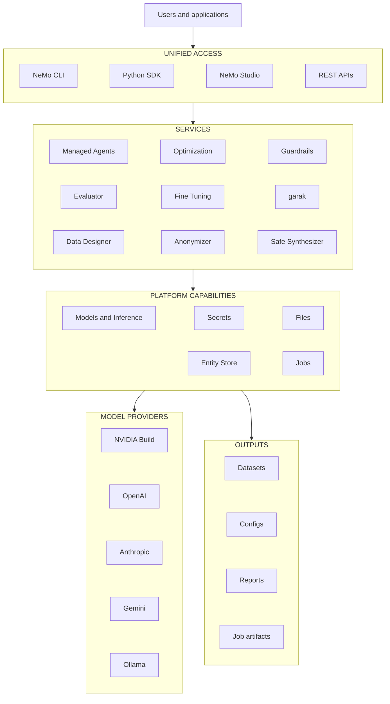

Make the agents you ship faster, more accurate, and safer.

NeMo Helix is an open source control plane for improving and hardening production agents. It runs on your infrastructure and plugs into your platform. Evaluate behavior, test changes and measure the results through repeatable workflows. Run Helix locally or on Kubernetes, and access it through REST APIs, a CLI or a Python SDK. Helix also includes NeMo Studio, a lightweight web UI for observability and orchestration.

NeMo Helix uses modular plugins for the infrastructure agents need to run at scale. Choose the capabilities you need, from agent execution and sandboxing to file storage, secrets, authentication, model management and inference middleware. Each comes with a default implementation that you can replace with your own infrastructure or tools.

## What is in the box

### Capabilities

| Domain | What it covers | Components |
|---|---|---|
| **Connectivity & Observability** | Connect agents to Helix and see what they actually do in production | NeMo Fabric (specialized agents, formerly NAT), NeMo Relay (black-box and general-purpose harnesses), trace ingestion, session and cost inspection |
| **Data** | Generate the training and evaluation data you do not have, and keep sensitive data out of it | Data Designer, Safe Synthesizer, Anonymizer|
| **Optimization** | Make the agent more accurate, faster or cheaper | Prompt-optimization, Hyper-Parameter Search with Optuna, model-routing with Switchyard|
| **Fine-tuning** | Make OSS models more accurate, faster, or cheaper|  LoRA, Full SFT, DPO, GRPO for LLMs, Embedding and Re-ranking models with Customizer plugin ( AutoModel, NeMoRL, Unsloth ) |
| **Evaluation** | Score candidates against your benchmarks before you ship them | NeMo Gym environments, Harbor eval suites, LLM-as-judge, deterministic, agentic, and RAG metrics, experiments |
| **Safety** | Catch unsafe behavior before and during production | Guardrails (content safety, jailbreak detection, PII redaction), garak red-teaming, OpenShell sandboxing |

### Built-in agents

Two agents work the loop with you rather than waiting for you to drive it.

- **Analyst.** Reads production traces and surfaces where and why the agent is failing.
- **Eval Author.** Turns observed behavior into evaluation tasks so the failure does not come back.

### Surfaces

Every capability is reachable from every surface. Pick the one that fits the moment.

| Surface | Use it for |
|---|---|
| **NeMo CLI** | The primary interface. Every service under one command, one config, one context. |
| **NeMo Skills** | Agent skills installed into Claude Code, Cursor, Codex, or OpenCode, so your coding agent drives Helix in natural language. |
| **Python SDK and REST APIs** | Programmatic access for pipelines, services, and products built on Helix. |
| **NeMo Studio** | Web UI for chat, job monitoring, optimization & evaluation results, traces, experiments, and governance review. |

### Foundations

Shared services every capability builds on: object and data storage, trace ingestion, model registry, experiments, jobs and session management, inference gateway, authentication and authorization, and secrets management. Workspaces and projects scope every artifact, so what your team produces can be shared, referenced, and governed instead of copied between laptops.

**These are defaults, not lock-in.** Each foundation is an interface with a working implementation attached, so `nemo setup` gets you running in minutes. When you move to your own environment, swap them: point storage at your object store, the database at your managed Postgres and ClickHouse, identity at your IdP over OIDC, and inference at any OpenAI-compatible gateway.

## Platform Capabilities

The platform provides several shared capabilities to NeMo libraries.

- [Models and Inference](/documentation/models-and-inference) for model providers, virtual
  models, and gateway calls.
- [Files](/documentation/get-started/core-concepts/manage-files), [Secrets](/documentation/get-started/core-concepts/manage-secrets),
  [Entities](/documentation/get-started/core-concepts/entities), and jobs for storing state and
  running local work.

## Architecture Diagram

## Where to Go Next

- [Setup](/documentation/get-started) - install, configure providers, and run
  local services.
- [About Agents](/documentation/agents) - learn the managed agent lifecycle.
- [Register Agents](/documentation/agents/register-agents) - bring an agent from code, a container
  image, a remote endpoint, or its traces.
- [Optimize Agents](/documentation/agents/optimize-agents) - improve cost, quality, and model
  routing.
- [Virtual Models](/documentation/models-and-inference/virtual-models) - route agent model traffic
  across models or through input and output rails.
