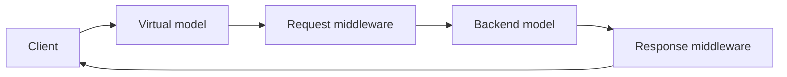

<a id="virtual-models"></a>

A virtual model is a named inference route in the Inference Gateway. Clients and agents call it like
any other model, and the virtual model decides what happens to each request: which backend model
serves it, and which middleware runs before and after.

Every model the gateway serves is reached through a virtual model. The Models controller creates a
passthrough virtual model for each model entity; you create your own to add routing or guardrails
without changing the clients that call them.



<Markdown src="/snippets/_snippets/tutorials/cli-sdk-setup.mdx" />

## Anatomy

| Field | Purpose |
|---|---|
| `default_model_entity` | Backend model entity (`workspace/name`) written into each request before middleware runs. Omit it when a request middleware picks the backend. |
| `models` | Model entities the virtual model uses, each with an optional `backend_format`. |
| `request_middleware` | Ordered middleware that runs before the request reaches the backend. |
| `response_middleware` | Ordered middleware that runs on the response before it returns to the caller. |
| `post_response_middleware` | Middleware that runs after the response is returned, for logging and analytics. |

Each middleware entry names a plugin, a `config_type`, and either an inline `config` or the
`config_id` of a stored configuration:

```json
{"name": "nemo-guardrails", "config_type": "guardrail_config", "config_id": "default/my-rails"}
```

NeMo Helix ships two middleware plugins: `nemo-switchyard` for
[routing](#route-across-models-with-switchyard) and `nemo-guardrails` for
[safety rails](#add-guardrails). To write your own, see
[Virtual Model Plugins](/documentation/reference/plugin-architecture#virtual-model-plugins).

## Call a Virtual Model

Call a virtual model by name through the gateway's OpenAI-compatible route:

<Tabs>

<Tab title="CLI">

```bash
nemo chat -m routed-model "What is the capital of France?"
```

</Tab>
<Tab title="curl">

```bash
curl -s "${NHX_BASE_URL:-http://localhost:8080}/apis/inference-gateway/v2/workspaces/default/openai/-/v1/chat/completions" \
  -H "Content-Type: application/json" \
  -d '{"model": "default/routed-model", "messages": [{"role": "user", "content": "What is the capital of France?"}]}'
```

</Tab>

</Tabs>

The `curl` example defaults to a local platform at `http://localhost:8080`. If your CLI context points
at a remote deployment, export its URL as `NHX_BASE_URL` first, and for an authenticated deployment add
`-H "Authorization: Bearer $(nemo auth token)"`.

The gateway resolves names in the workspace from the request path, so a virtual model must be in the
same workspace as its callers.

### Point an Agent at a Virtual Model

Set the agent's model to the virtual model, and leave `base_url` unset so the platform routes it
through the gateway:

```yaml
models:
  default:
    provider: nvidia
    model: default/routed-model
```

Register the updated config or [redeploy](/documentation/agents/deploy-agents#update-a-deployed-agent)
the agent. Its code is unchanged and unaware of the routing or rails behind the name.

## Route Across Models with Switchyard

The `nemo-switchyard` middleware routes each request to one of several models, for example to send
easy requests to a cheaper model. It runs in `request_middleware` and supports OpenAI Chat
Completions requests and backends.

| `config_type` | Routes | Required configuration |
|---|---|---|
| `random_routing` | A weighted random choice between two models | `strong`, `weak`, `strong_probability` |
| `stage_router` | Between capable and efficient models, by confidence | `confidence_threshold`, `models.capable`, `models.efficient` |
| `llm_classifier` | By a judge model's assessment of the request | `base_threshold`, `models.judge`, `models.capable`, `models.efficient` |

This virtual model sends 80% of requests to the strong model and 20% to the weak one:

<Tabs>

<Tab title="CLI">

```bash
nemo inference virtual-models create routed-model \
  --models '[{"model": "default/<strong-model>"}, {"model": "default/<weak-model>"}]' \
  --request-middleware '[{
    "name": "nemo-switchyard",
    "config_type": "random_routing",
    "config": {
      "strong": {"model": "default/<strong-model>"},
      "weak": {"model": "default/<weak-model>"},
      "strong_probability": 0.8
    }
  }]'
```

</Tab>
<Tab title="Python SDK">

```python
from nemo_helix_plugin.client.client import NemoClient
from nemo_helix_plugin.virtual_models.client import VirtualModelsClient
from nemo_helix_plugin.virtual_models.types import (
    CreateVirtualModelRequest,
    MiddlewareCall,
    VirtualModelInferenceConfig,
)

client = NemoClient.from_config()

VirtualModelsClient.from_client(client).create_virtual_model(
    body=CreateVirtualModelRequest(
        name="routed-model",
        models=[
            VirtualModelInferenceConfig(model="default/<strong-model>"),
            VirtualModelInferenceConfig(model="default/<weak-model>"),
        ],
        request_middleware=[
            MiddlewareCall(
                name="nemo-switchyard",
                config_type="random_routing",
                config={
                    "strong": {"model": "default/<strong-model>"},
                    "weak": {"model": "default/<weak-model>"},
                    "strong_probability": 0.8,
                },
            )
        ],
    )
)
```

</Tab>

</Tabs>

The other routers take a list of models per role:

```json
{
  "name": "nemo-switchyard",
  "config_type": "stage_router",
  "config": {
    "confidence_threshold": 0.5,
    "models": {"capable": ["default/<strong-model>"], "efficient": ["default/<weak-model>"]}
  }
}
```

`llm_classifier` adds `"mode": "capability"`, a `base_threshold`, and a `models.judge` list. Judge calls
go directly to the judge's provider.

### Classifier Output Token Limits

`max_output_tokens` controls the classifier's judge output, not the routed backend model's response.
It is optional in both classifier configurations:

| `config_type` | Location in the middleware entry |
|---|---|
| `llm_classifier` | `config.max_output_tokens` |
| `stage_router` with a classifier | `config.classifier.max_output_tokens` |

Omit the field or set it to JSON `null` to use the native Switchyard default. Both forms leave the
native constructor argument unset; `null` does not mean an unlimited output budget. An explicit
integer, such as `64`, overrides the native default.

For a top-level `llm_classifier`, this middleware entry uses the native default:

```json
{
  "name": "nemo-switchyard",
  "config_type": "llm_classifier",
  "config": {
    "mode": "capability",
    "base_threshold": 0.5,
    "max_output_tokens": null,
    "models": {
      "judge": ["default/<judge-model>"],
      "capable": ["default/<strong-model>"],
      "efficient": ["default/<weak-model>"]
    }
  }
}
```

For a `stage_router`, put the limit inside the optional `classifier` object. This example overrides
it with `64`; omitting only `max_output_tokens` or replacing `64` with `null` uses the native default
while keeping the classifier enabled:

```json
{
  "name": "nemo-switchyard",
  "config_type": "stage_router",
  "config": {
    "confidence_threshold": 0.5,
    "classifier": {"base_threshold": 0.5, "max_output_tokens": 64},
    "models": {
      "capable": ["default/<strong-model>"],
      "efficient": ["default/<weak-model>"]
    }
  }
}
```

These are virtual-model middleware settings, not fields in the optimization strategy's `--spec`.

To find a good split for an agent automatically, run the
[`switchyard` optimization strategy](/documentation/agents/optimize-agents#switchyard), which creates
one virtual model per model pair and routing strategy and evaluates them as candidate agents.

## Add Guardrails

The `nemo-guardrails` middleware runs a [guardrail configuration](/documentation/guardrail-models)
on every call: input rails in `request_middleware`, output rails in `response_middleware`. Pointing an
agent at a guarded virtual model secures its model path without changing the agent.

You need a guardrail configuration and a backend model entity. Common guardrail models in the catalog
include `nvidia-llama-3-1-nemoguard-8b-content-safety`,
`nvidia-llama-3-1-nemoguard-8b-topic-control`, and `nvidia-llama-3-1-nemotron-safety-guard-8b-v3`.

<Tabs>

<Tab title="CLI">

```bash
nemo inference virtual-models create guarded-model \
  --default-model-entity default/<model-entity> \
  --request-middleware '[{"name": "nemo-guardrails", "config_type": "guardrail_config", "config_id": "default/<guardrail-config>"}]' \
  --response-middleware '[{"name": "nemo-guardrails", "config_type": "guardrail_config", "config_id": "default/<guardrail-config>"}]'
```

</Tab>
<Tab title="Python SDK">

```python
from nemo_helix_plugin.client.client import NemoClient
from nemo_helix_plugin.virtual_models.client import VirtualModelsClient
from nemo_helix_plugin.virtual_models.types import CreateVirtualModelRequest, MiddlewareCall

client = NemoClient.from_config()

rails = MiddlewareCall(
    name="nemo-guardrails",
    config_type="guardrail_config",
    config_id="default/<guardrail-config>",
)

VirtualModelsClient.from_client(client).create_virtual_model(
    body=CreateVirtualModelRequest(
        name="guarded-model",
        default_model_entity="default/<model-entity>",
        request_middleware=[rails],
        response_middleware=[rails],
    )
)
```

</Tab>

</Tabs>

Omit either side when the configuration has no rails for it. Then
[point the agent at `guarded-model`](#point-an-agent-at-a-virtual-model).

Rails cover the agent's model calls only. They do not cover tool misuse or instructions injected
through tool output; to test an agent against those and generate fixes, see
[Agent Governance](/documentation/agents/governance).

For configuration structure, streaming, and the `guardrails` request options, see
[Guardrails Architecture](/documentation/guardrail-models/core-concepts/architecture) and
[Running Inference](/documentation/guardrail-models/core-concepts/running-inference).

## Manage Virtual Models

```bash
nemo inference virtual-models list
nemo inference virtual-models get routed-model
nemo inference virtual-models patch routed-model --request-middleware '[...]'
nemo inference virtual-models delete routed-model
```

To browse virtual models and chat through them, see
[NeMo Studio Virtual Models](/documentation/studio/virtual-models).
