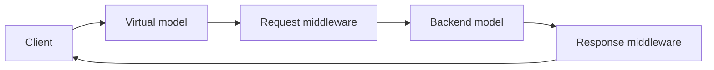

<a id="virtual-models"></a>

A virtual model is a named inference route in the Inference Gateway. Clients and agents call it like
any other model, and the virtual model decides what happens to each request: which backend model
serves it, and which middleware runs before and after.

Every model the gateway serves is reached through a virtual model. The Models controller creates a
passthrough virtual model for each model entity; you create your own to add routing or guardrails
without changing the clients that call them.



<Markdown src="/snippets/_snippets/tutorials/cli-sdk-setup.mdx" />

## Anatomy

| Field | Purpose |
|---|---|
| `default_model_entity` | Backend model entity (`workspace/name`) written into each request before middleware runs. Omit it when a request middleware picks the backend. |
| `models` | Model entities the virtual model uses, each with an optional `backend_format`. |
| `request_middleware` | Ordered middleware that runs before the request reaches the backend. |
| `response_middleware` | Ordered middleware that runs on the response before it returns to the caller. |
| `post_response_middleware` | Middleware that runs after the response is returned, for logging and analytics. |

Each middleware entry names a plugin, a `config_type`, and either an inline `config` or the
`config_id` of a stored configuration:

```json
{"name": "nemo-guardrails", "config_type": "guardrail_config", "config_id": "default/my-rails"}
```

NeMo Helix ships four middleware plugins: `nemo-switchyard` for
[routing](#route-across-models-with-switchyard), `nemo-guardrails` for
[safety rails](#add-guardrails), `nemo-evals-closed-book` for
[closed-book evaluations](#keep-evaluations-closed-book), and `nemo-evals-trial-recording` for
[recording evaluation trials](#record-evaluation-trials). To write your own, see
[Virtual Model Plugins](/documentation/reference/plugin-architecture#virtual-model-plugins).

## Call a Virtual Model

Call a virtual model by name through the gateway's OpenAI-compatible route:

<Tabs>

<Tab title="CLI">

```bash
nemo chat -m routed-model "What is the capital of France?"
```

</Tab>
<Tab title="curl">

```bash
curl -s "${NHX_BASE_URL:-http://localhost:8080}/apis/inference-gateway/v2/workspaces/default/openai/-/v1/chat/completions" \
  -H "Content-Type: application/json" \
  -d '{"model": "default/routed-model", "messages": [{"role": "user", "content": "What is the capital of France?"}]}'
```

</Tab>

</Tabs>

The `curl` example defaults to a local platform at `http://localhost:8080`. If your CLI context points
at a remote deployment, export its URL as `NHX_BASE_URL` first, and for an authenticated deployment add
`-H "Authorization: Bearer $(nemo auth token)"`.

The gateway resolves names in the workspace from the request path, so a virtual model must be in the
same workspace as its callers.

### Point an Agent at a Virtual Model

Set the agent's model to the virtual model, and leave `base_url` unset so the platform routes it
through the gateway:

```yaml
models:
  default:
    provider: nvidia
    model: default/routed-model
```

Register the updated config or [redeploy](/documentation/agents/deploy-agents#update-a-deployed-agent)
the agent. Its code is unchanged and unaware of the routing or rails behind the name.

## Route Across Models with Switchyard

The `nemo-switchyard` middleware routes each request to one of several models, for example to send
easy requests to a cheaper model. It runs in `request_middleware` and supports OpenAI Chat
Completions requests and backends.

| `config_type` | Routes | Required configuration |
|---|---|---|
| `random_routing` | A weighted random choice between two models | `strong`, `weak`, `strong_probability` |
| `stage_router` | Between capable and efficient models, by confidence | `confidence_threshold`, `models.capable`, `models.efficient` |
| `llm_classifier` | By a judge model's assessment of the request | `base_threshold`, `models.judge`, `models.capable`, `models.efficient` |

This virtual model sends 80% of requests to the strong model and 20% to the weak one:

<Tabs>

<Tab title="CLI">

```bash
nemo inference virtual-models create routed-model \
  --models '[{"model": "default/<strong-model>"}, {"model": "default/<weak-model>"}]' \
  --request-middleware '[{
    "name": "nemo-switchyard",
    "config_type": "random_routing",
    "config": {
      "strong": {"model": "default/<strong-model>"},
      "weak": {"model": "default/<weak-model>"},
      "strong_probability": 0.8
    }
  }]'
```

</Tab>
<Tab title="Python SDK">

```python
from nemo_helix_plugin.client.client import NemoClient
from nemo_helix_plugin.virtual_models.client import VirtualModelsClient
from nemo_helix_plugin.virtual_models.types import (
    CreateVirtualModelRequest,
    MiddlewareCall,
    VirtualModelInferenceConfig,
)

client = NemoClient.from_config()

VirtualModelsClient.from_client(client).create_virtual_model(
    body=CreateVirtualModelRequest(
        name="routed-model",
        models=[
            VirtualModelInferenceConfig(model="default/<strong-model>"),
            VirtualModelInferenceConfig(model="default/<weak-model>"),
        ],
        request_middleware=[
            MiddlewareCall(
                name="nemo-switchyard",
                config_type="random_routing",
                config={
                    "strong": {"model": "default/<strong-model>"},
                    "weak": {"model": "default/<weak-model>"},
                    "strong_probability": 0.8,
                },
            )
        ],
    )
)
```

</Tab>

</Tabs>

The other routers take a list of models per role:

```json
{
  "name": "nemo-switchyard",
  "config_type": "stage_router",
  "config": {
    "confidence_threshold": 0.5,
    "models": {"capable": ["default/<strong-model>"], "efficient": ["default/<weak-model>"]}
  }
}
```

`llm_classifier` adds `"mode": "capability"`, a `base_threshold`, and a `models.judge` list. Judge calls
go directly to the judge's provider.

### Classifier Output Token Limits

`max_output_tokens` controls the classifier's judge output, not the routed backend model's response.
It is optional in both classifier configurations:

| `config_type` | Location in the middleware entry |
|---|---|
| `llm_classifier` | `config.max_output_tokens` |
| `stage_router` with a classifier | `config.classifier.max_output_tokens` |

Omit the field or set it to JSON `null` to use the native Switchyard default. Both forms leave the
native constructor argument unset; `null` does not mean an unlimited output budget. An explicit
integer, such as `64`, overrides the native default.

For a top-level `llm_classifier`, this middleware entry uses the native default:

```json
{
  "name": "nemo-switchyard",
  "config_type": "llm_classifier",
  "config": {
    "mode": "capability",
    "base_threshold": 0.5,
    "max_output_tokens": null,
    "models": {
      "judge": ["default/<judge-model>"],
      "capable": ["default/<strong-model>"],
      "efficient": ["default/<weak-model>"]
    }
  }
}
```

For a `stage_router`, put the limit inside the optional `classifier` object. Enabling the classifier
also requires a `models.judge` list. This example overrides the limit with `64`; omitting only
`max_output_tokens` or replacing `64` with `null` uses the native default while keeping the classifier
enabled:

```json
{
  "name": "nemo-switchyard",
  "config_type": "stage_router",
  "config": {
    "confidence_threshold": 0.5,
    "classifier": {"base_threshold": 0.5, "max_output_tokens": 64},
    "models": {
      "judge": ["default/<judge-model>"],
      "capable": ["default/<strong-model>"],
      "efficient": ["default/<weak-model>"]
    }
  }
}
```

These are virtual-model middleware settings, not fields in the optimization strategy's `--spec`.

To find a good split for an agent automatically, run the
[`switchyard` optimization strategy](/documentation/agents/optimize-agents#switchyard), which creates
one virtual model per model pair and routing strategy and evaluates them as candidate agents.

## Add Guardrails

The `nemo-guardrails` middleware runs a [guardrail configuration](/documentation/guardrail-models)
on every call: input rails in `request_middleware`, output rails in `response_middleware`. Pointing an
agent at a guarded virtual model secures its model path without changing the agent.

You need a guardrail configuration and a backend model entity. Common guardrail models in the catalog
include `nvidia-llama-3-1-nemoguard-8b-content-safety`,
`nvidia-llama-3-1-nemoguard-8b-topic-control`, and `nvidia-llama-3-1-nemotron-safety-guard-8b-v3`.

<Tabs>

<Tab title="CLI">

```bash
nemo inference virtual-models create guarded-model \
  --default-model-entity default/<model-entity> \
  --request-middleware '[{"name": "nemo-guardrails", "config_type": "guardrail_config", "config_id": "default/<guardrail-config>"}]' \
  --response-middleware '[{"name": "nemo-guardrails", "config_type": "guardrail_config", "config_id": "default/<guardrail-config>"}]'
```

</Tab>
<Tab title="Python SDK">

```python
from nemo_helix_plugin.client.client import NemoClient
from nemo_helix_plugin.virtual_models.client import VirtualModelsClient
from nemo_helix_plugin.virtual_models.types import CreateVirtualModelRequest, MiddlewareCall

client = NemoClient.from_config()

rails = MiddlewareCall(
    name="nemo-guardrails",
    config_type="guardrail_config",
    config_id="default/<guardrail-config>",
)

VirtualModelsClient.from_client(client).create_virtual_model(
    body=CreateVirtualModelRequest(
        name="guarded-model",
        default_model_entity="default/<model-entity>",
        request_middleware=[rails],
        response_middleware=[rails],
    )
)
```

</Tab>

</Tabs>

Omit either side when the configuration has no rails for it. Then
[point the agent at `guarded-model`](#point-an-agent-at-a-virtual-model).

Rails cover the agent's model calls only. They do not cover tool misuse or instructions injected
through tool output; to test an agent against those and generate fixes, see
[Agent Governance](/documentation/agents/governance).

For configuration structure, streaming, and the `guardrails` request options, see
[Guardrails Architecture](/documentation/guardrail-models/core-concepts/architecture) and
[Running Inference](/documentation/guardrail-models/core-concepts/running-inference).

## Keep Evaluations Closed-Book

A closed-book evaluation must not let the model look answers up on the web. Blocking the agent's
network is not enough when the model provider can search for it: hosted tools such as OpenAI
`web_search`, Anthropic `web_search_20250305`, and MCP servers run on the provider's side, and some
models search on every call.

The `nemo-evals-closed-book` middleware closes that path for the request the gateway forwards:

- It removes every tool the provider would execute, and keeps client-executed tools such as
  functions, custom tools, a `shell` tool without a provider container, computer use, and
  Anthropic's `bash` and `text_editor`. A tool type it does not recognize counts as provider-executed and is removed.
- It removes provider-side features such as `web_search_options` and `mcp_servers`, and resets a
  `tool_choice` that pointed at a removed tool to `auto`. When it removes every tool, it also drops
  `tool_choice` and `parallel_tool_calls`.
- It refuses with `403` models that search on their own, such as Perplexity Sonar and
  `*-search-preview` models, and any model whose provider adds hosted tools or search features to
  requests through its `default_extra_body` or `required_extra_body`. It also refuses a model it
  cannot resolve to a provider, since it cannot check what that model is.
- It refuses with `403` a Responses request that continues provider-stored history through
  `previous_response_id`, `conversation`, or `item_reference` input items, since that history may
  hold search results it cannot see. Send the conversation history in the request instead.
- It refuses with `403` a model whose provider calls models back through the gateway with a
  platform credential, such as a router registered as a model provider with a platform access key,
  since it can't see the calls that provider makes. A model provider's own API key isn't a platform
  credential and passes. A router that calls back as its caller is served only to closed evaluation
  trials; see [Route Through a Router That Calls Back](#route-through-a-router-that-calls-back).

Add it last in `request_middleware`, so it sees the model a routing middleware selected:

```bash
nemo inference virtual-models create closed-book-model \
  --default-model-entity default/<model-entity> \
  --request-middleware '[{"name": "nemo-evals-closed-book", "config_type": "closed_book", "config": {}}]'
```

By default it applies to every call. With `"config": {"apply": "closed_credential"}` it applies only to
calls made with a closed evaluation trial token, and passes every other call through unchanged, so one
virtual model serves open and closed-book evaluations alike. A trial token whose signature can't be
checked right now gets `503` rather than an open call.

Point the model or agent under evaluation at `closed-book-model`; for each kind of evaluation
target, see
[Closed-book evaluations](/documentation/evaluate-models/agent-eval/targets-and-runners#closed-book-evaluations).
The middleware covers Chat Completions,
Responses, and Anthropic Messages requests, streaming or not. It does not cover model calls that
another middleware makes on its own, such as the judge calls of the `nemo-switchyard`
`llm_classifier` router.

### Route Through a Router That Calls Back

A router registered as a model provider, such as a Switchyard server, picks a model for each call and
calls it back through the gateway. Register it so that it calls back as its caller: the gateway sends
the router each call's credential instead of a stored key, the router forwards that credential with
its own calls (Switchyard's `forward_auth`), and every policy that applied to the caller applies to
those calls too. The router needs no closed-book or evaluation settings of its own.

```bash
nemo inference providers create switchyard --host-url http://switchyard:4002 --forward-caller-credential
```

On the virtual model that serves a router's route, list the virtual models the router calls back with
`--callback-models`, such as its targets and judge. A caller held to that virtual model, such as an
evaluation trial, may also call those:

```bash
nemo inference virtual-models create routed \
  --default-model-entity default/classified \
  --callback-models default/strong --callback-models default/weak --callback-models default/judge
```

To serve open and closed-book evaluations through the same targets, give each target the closed-book
middleware with `"config": {"apply": "closed_credential"}`: a closed evaluation's calls through the
router are closed-book, and every other call passes through unchanged.

The forwarded credential is limited:

- With platform auth on, the gateway forwards only a credential limited to the `inference` scope,
  such as an evaluation trial's key or an access key you mint with that scope, and refuses any other
  call to the provider with `403`. A user's session token is never forwarded.
- The gateway never writes the forwarded credential into its logs or error responses.
- Switchyard's `fallback_client` forwards any request it doesn't route, with the caller's headers, to
  its own upstream. Give a router registered this way no `fallback_client`, or one that points at the
  gateway, or the caller's credential leaves the platform.
- Closed-book refuses a model served by such a provider unless the caller is a closed evaluation
  trial, since only then are the router's own calls held closed-book.

## Record Evaluation Trials

An agent evaluation gives each Harbor trial that calls a gateway model its own trial token, a
credential that names the trial and the models it may call. That covers Harbor's built-in agents given a gateway model and
registered Fabric agents whose default model goes through the gateway; such an agent gets the token in the key
variable of every model it calls through the gateway. The `nemo-evals-trial-recording` middleware reads the token to
record each of the trial's model calls in Intake, as a span in the trial's trace with the token usage
the provider reported. The span names the model the call asked for (`gen_ai.request.model`) and the
model the response says served it (`gen_ai.response.model`), which differ when a routing provider
picks the model. It doesn't change, delay or fail the
call, and calls made with any other credential aren't recorded. With platform auth on, it trusts
only trial tokens the platform signed.

When a call carries a valid W3C `traceparent`, its span goes into the caller's trace beneath the
caller's span instead. The session, evaluation and test case still come from the trial token, never
from headers.

Intake counts each call's usage once. In a trace that holds gateway call spans, their usage replaces
the agent's own spans for the same calls, as long as every gateway span in the trace recorded usage;
if one didn't, the trace counts the agent's own numbers instead. When the agent's trace is separate, the evaluation marks
the published trace as superseded, so the session and trace metrics count the gateway's usage. The
agent's own totals stay on its trace for inspection, and a metric the gateway doesn't report, such as
cost, still counts from it. The evaluation marks the trace only when every model the agent calls is a
virtual model that records trials. If one isn't, the session counts both the agent's trace and the
gateway's spans.

It takes no settings. Add it to `request_middleware`, so a call's span starts when the call arrives,
and to `response_middleware`, where each call is recorded:

```bash
nemo inference virtual-models create recorded-model \
  --default-model-entity default/<model-entity> \
  --request-middleware '[{"name": "nemo-evals-trial-recording", "config_type": "trial_recording", "config": {}}]' \
  --response-middleware '[{"name": "nemo-evals-trial-recording", "config_type": "trial_recording", "config": {}}]'
```

To add recording to an existing virtual model, update it with its current middleware lists plus
these entries. Each list you pass replaces the old one. To combine it with closed-book, put both
entries in `request_middleware`, closed-book last.

When the evaluation's gateway model doesn't list the middleware, the job logs a warning and runs
without recording. With platform auth on, each trial calls the gateway with a Scoped Access Key
minted for it, so [Scoped Access Keys](/documentation/access-control/deployment#scoped-access-keys)
must be enabled. If a key can't be minted, the job fails before any trial runs. Each key lives up to
24 hours from the start of the job, so a trial still queued after that can't call the gateway.
Calls the model provider rejects aren't recorded either, nor are calls the closed-book middleware
refuses: the gateway stops those before the response middleware that records them runs.

### Hold Trials to Their Models

A trial token lists the virtual models the trial's agent was configured with: the one a built-in
agent's `model` names, or every gateway model a registered agent's config names, and the
`callback_models` each of those lists. The token is closed when the evaluation is labelled
`closed_book`. The `nemo-evals-access` middleware, which comes with the evals plugin and which no
virtual model lists, checks every call made with a trial token, on every route and before any
virtual model's middleware runs. It refuses:

| Call | Status |
|---|---|
| Any call on the `provider` route, which skips every virtual model's middleware | `403` |
| A virtual model the credential doesn't list, by URL or by the `model` in an `openai` route body, or a LoRA adapter served through a listed one | `403` |
| A listed virtual model with no `default_model_entity`, since its caller could name any model through it | `403` |
| With a closed credential, a listed virtual model whose `request_middleware` no longer ends with `nemo-evals-closed-book` | `403` |
| A credential that claims an evals policy the platform didn't sign | `403` |
| A credential the gateway can't verify right now | `503` |
| With platform auth off, a call without an evals credential to a virtual model that lists `nemo-evals-trial-recording` | `401` |

A refused trial call is recorded in the trial as a failed call with zero tokens, with the reason in
`nemo.evals.refusal.reason`. Calls made with any other credential are left alone. With platform
auth off, tokens are unsigned, so an agent that writes its own token, or calls a model that doesn't
record trials with no token, isn't stopped; run evaluations that must hold against a misbehaving agent
with auth on.

## Manage Virtual Models

```bash
nemo inference virtual-models list
nemo inference virtual-models get routed-model
nemo inference virtual-models patch routed-model --request-middleware '[...]'
nemo inference virtual-models delete routed-model
```

To browse virtual models and chat through them, see
[NeMo Studio Virtual Models](/documentation/studio/virtual-models).
