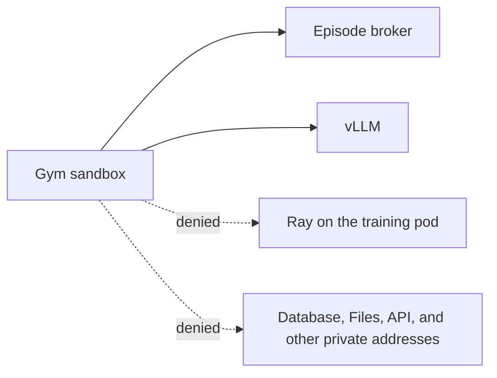

<a id="secure-sandboxed-grpo"></a>

Sandboxed GRPO runs untrusted environment code in an OpenSandbox pod, separate from the training pod. The sandbox needs two endpoints on the training pod: the episode broker and the vLLM generation server. Everything else on that pod, including Ray, is the training control plane and must stay unreachable from the sandbox.

This how-to separates the settings that make GRPO **run** from the settings that make the sandbox **secure**. A GRPO job starts and trains without the network-policy settings and without Kata, but then the sandbox's cluster access is open and a kernel exploit in the Gym can leave the sandbox. The worked example is a single-node minikube cluster. On another Kubernetes cluster, use the same Helm overlay and follow [On a Kubernetes cluster](#on-a-kubernetes-cluster).

## What each layer does

| Layer | Required to run GRPO | Required for a secure sandbox | What it provides |
| --- | --- | --- | --- |
| OpenSandbox server and `sandboxClusterCapable: true` | Yes | Yes | Runs the Gym in its own pod. Without it, GRPO fails at submit. |
| CNI that enforces NetworkPolicy | No | Yes | Without enforcement, NetworkPolicy objects are stored and ignored. Cilium is the tested CNI. Calico and other enforcing CNIs work on Kubernetes. |
| `networkPolicies.enabled` and `networkPolicies.jobSteps.enabled` | No | Yes | The jobs controller creates a per-step ingress policy that admits the sandbox only on the broker and vLLM ports. |
| Kata (`kata-qemu`) | No | Yes | Gives each sandbox its own guest kernel. A shared-kernel sandbox uses the node's kernel, so a kernel exploit in the Gym can leave the sandbox. Kata does not restrict network access. |

The Helm chart sets `rl.job_storage_pvc_claim` to its job-storage PVC. The sandbox reads the environment and dataset from that claim. Leave it unset unless you are not using the chart, or job storage uses a different claim.

## Prerequisites

- A source checkout of `NVIDIA-NeMo/nemo-helix`
- A Kubernetes cluster. The steps below use minikube; skip the minikube start when the cluster already exists.
- `kubectl`, `helm`, `jq`, and `openssl`. The minikube path also needs `minikube` and `docker`.
- An NVIDIA GPU host with the NVIDIA container toolkit, for GPU training
- `NGC_API_KEY` with access to NeMo Helix chart and container images
- Kubernetes 1.30 or later, or 1.28 or later with the ValidatingAdmissionPolicy beta API enabled. This is needed only for the secure configuration.

## 1. Start minikube with an enforcing CNI

minikube's default CNI on the Docker driver accepts NetworkPolicy resources and does not enforce them. Use Cilium. The CNI cannot be changed on an existing profile, so delete and recreate a profile that was started without it.

```sh
export NGC_API_KEY=<your-ngc-api-key>
export KUBE_NAMESPACE=default

MINIKUBE_CNI=cilium ./e2e/k8s/scripts/setup_local_minikube_gpu.sh
```

The script starts minikube with the Docker driver, passes `--gpus all` when `nvidia-smi` works, and creates the platform pull Secrets in `KUBE_NAMESPACE`. Do not use `--cni calico` with the Docker driver: Calico pods stay in `ContainerCreating` there.

Confirm Cilium is running:

```sh
kubectl -n kube-system rollout status ds/cilium --timeout=5m
```

<Note>
  The [NetworkPolicy smoke test](/documentation/kubernetes-deployment/setup/helm/network-policy-smoke-test) checks the chart's API, controller, and managed-job policies on Kind with Calico. It does not exercise the Gym sandbox policy described here.
</Note>

## On a Kubernetes cluster
<a id="on-a-kubernetes-cluster"></a>

Skip the minikube start when the cluster already exists. The sandbox settings in the Helm overlay below are the same. These parts differ:

| | minikube | Kubernetes |
| --- | --- | --- |
| Cluster | `setup_local_minikube_gpu.sh` | The cluster you already run. Install the chart with [Install](/documentation/kubernetes-deployment/setup/helm/install). |
| CNI | Cilium. The Docker driver does not enforce NetworkPolicy on its own, and Calico stays in `ContainerCreating` with that driver. | Any CNI that enforces NetworkPolicy. Cilium is the one this setup was tested with. Calico and other enforcing CNIs apply the same policy. |
| OpenSandbox | `install_opensandbox_minikube.sh` | [OpenSandbox](/documentation/kubernetes-deployment/setup/helm/open-sandbox), then [Kata](/documentation/kubernetes-deployment/setup/helm/opensandbox-kata) for a secure sandbox. |
| Chart values | `e2e/k8s/values/minikube.yaml`, then the overlay | Your cluster's values file, then the same overlay. Job storage needs a ReadWriteMany claim, as in [Install](/documentation/kubernetes-deployment/setup/helm/install). |
| DNS | CoreDNS with the `k8s-app=kube-dns` label | The chart's managed-job DNS rule selects that label in `kube-system`. If your DNS pods use another label, set `networkPolicies.jobs.dns` to match. |

The per-step policy is a standard ingress NetworkPolicy. The jobs controller writes each allowed port on its own, so a CNI that ignores port ranges still admits the broker and the vLLM span.

## 2. Install OpenSandbox

Install the shared-kernel OpenSandbox controller and server, and copy its API-key Secret into the platform namespace:

```sh
./e2e/k8s/scripts/install_opensandbox_minikube.sh
```

The server's `[kubernetes] namespace` must be the platform release namespace, because sandbox pods remount the job-storage PVC and resolve pull Secrets there. See [OpenSandbox](/documentation/kubernetes-deployment/setup/helm/open-sandbox) for the namespace rule, the Secret copy, and installs outside minikube.

## 3. Install Kata

The server from the previous step is the shared-kernel runtime, which is enough to run GRPO. It is not enough for a secure sandbox: the Gym shares the node's kernel, and a kernel exploit in untrusted environment code can leave the pod. Follow [OpenSandbox with Kata](/documentation/kubernetes-deployment/setup/helm/opensandbox-kata) and point the platform at the Kata server's Service. One OpenSandbox server cannot mix shared-kernel and Kata sandboxes.

Kata is the kernel boundary. The network-policy values in the next step are the network boundary. A secure sandbox needs both.

## 4. Install the platform with sandboxing enabled

Install the chart with the minikube values:

```sh
export HELM_VALUES="${PWD}/e2e/k8s/values/minikube.yaml"
./e2e/k8s/scripts/install_helm_e2e.sh
```

Then apply this overlay. The first block makes sandboxed GRPO run. The `networkPolicies` block locks down the sandbox's cluster access.

```yaml title="sandboxed-grpo-values.yaml"
# Required to run sandboxed GRPO.
sandboxClusterCapable: true
opensandbox:
  domain: opensandbox-server.opensandbox-system.svc.cluster.local
  protocol: http
  apiKeySecret: opensandbox-server-api-key
  apiKeySecretKey: api-key

# Required for a secure sandbox. Both flags must be true.
networkPolicies:
  enabled: true
  jobSteps:
    enabled: true

platformConfig:
  rl:
    # A complete wheels-v1 closure lets the sandbox stay off the public internet.
    # Set this true for native-v1, an incomplete wheels closure, or an environment
    # that calls a public service while it runs.
    sandbox_allow_internet: false
```

```sh
helm upgrade nemo-helix k8s/helm -n "$KUBE_NAMESPACE" --reuse-values \
  -f sandboxed-grpo-values.yaml \
  --timeout 10m
```

Notes on these values:

- `opensandbox.protocol: http` is required for the in-cluster Service. If it is unset, health checks use `https` and the job stalls waiting for the sandbox.
- `networkPolicies.enabled: true` also enables the chart's API, controller, and managed-job policies. Keep them on. Turning them off is not part of this setup.
- The per-step policy is created only when **both** `networkPolicies.enabled` and `networkPolicies.jobSteps.enabled` are true. With either one off, GRPO still runs and the sandbox can reach every port on the training pod.
- `rl.sandboxed_gym_default` already defaults to `true`, and `rl.job_storage_pvc_claim` already names the chart PVC.
- With the policy flags on, the chart installs a ValidatingAdmissionPolicy and fails the install on clusters that do not serve that API.

## Internet access
<a id="internet-access"></a>

`rl.sandbox_allow_internet` defaults to `false`. It is an operator setting on the platform, under `platformConfig.rl`. The overlay above leaves it off, which is the setting for a complete `wheels-v1` closure.

| | `false` | `true` |
| --- | --- | --- |
| Public names | The sandbox cannot resolve public hosts. | The sandbox may resolve `*.com` and `*.org`. |
| When to use it | A complete `wheels-v1` closure, and converter-built `adapter-wheels-v1` packages, when the environment calls no public service while it runs. | Every `native-v1` package and any wheels package whose closure is incomplete, or the venv build fails when it cannot reach an index. Also any environment whose task calls a public service, such as an external API, while it runs. |
| Other public hosts | None. | A host outside `*.com` and `*.org`, such as `hub.primeintellect.ai`, must be named in `rl.sandbox_public_dns_allow`. |

Turning internet on does not open a public address range, and it does not open the cluster. Private, link-local, and metadata addresses stay denied, including the platform database, the Files service, the platform API, and Ray.

## How the sandbox is isolated

Two boundaries apply. OpenSandbox's egress sidecar is on every Gym sandbox the documented server creates. The per-step NetworkPolicy is ingress to the training pod, and the jobs controller creates it only when both network-policy flags are on.



### OpenSandbox egress

The documented OpenSandbox server runs its egress sidecar in `dns+nft` mode. The policy is deny by default, and it denies private, shared, link-local, and metadata ranges, including `10.0.0.0/8`, `172.16.0.0/12`, `192.168.0.0/16`, and `169.254.0.0/16`. The platform database, the Files service, the platform API, and the rest of the cluster sit in those ranges, so the Gym cannot open them. The job-storage claim is still mounted into the sandbox so it can read its environment and dataset. That mount is not a connection to the Files service.

The addresses carved out of the deny are the job's episode broker, the policy model endpoint, and the cluster DNS resolver. Public name resolution is the [internet access](#internet-access) setting. The platform builds the allow list.

The broker and the policy model are addresses on the training pod. An address carve-out has no port, so this layer alone still leaves the training pod's other ports, including Ray, reachable. The ingress policy below closes those ports.

### Training pod ingress

For each GRPO training step, the jobs controller creates an ingress NetworkPolicy:

- **Target.** The training step's pods, selected by `nhx.nvidia.com/managed_by=jobs-controller`, `nhx.nvidia.com/job_id`, and `nhx.nvidia.com/job_step_id`.
- **Same job.** Pods of the same job reach every port. Ray traffic between training pods stays inside the job.
- **Gym sandbox.** Pods labelled `nemo-rl-job-id=<job id>` reach only TCP 51234 (the episode broker) and TCP 3000–4998 (the span vLLM picks its generation port from). OpenSandbox turns sandbox metadata into pod labels, and the broker stamps the job id. The sandbox's `opensandbox.io/id` label names the sandbox; it is not what the policy matches.
- **Everything else.** No other ingress is allowed into the training pods.

Ray's ports stay outside the allowed set: GCS 6379, client 10001, dashboard 8265, node manager and agent ports from 53001, and workers 54001–54257. If you override Ray ports with `GCS_PORT`, `MIN_WORKER_PORT`, or the other Ray port variables, keep them out of 3000–4998 and off 51234.

NetworkPolicy allows are additive. Another policy in the namespace that selects the training pods with a broader allow, such as an exception for the training pod's IP with no ports, reopens every port on that pod, including Ray.

## Verify

Before a job, confirm the admission policy is installed:

```sh
kubectl get validatingadmissionpolicy | grep job-step-networkpolicies
```

Submit a short GRPO job, as described in [GRPO and Reward Environments](/documentation/customizer-reference/grpo-and-reward-environments). While it runs, set `JOB_ID` to the platform job id and inspect the step policy:

```sh
export JOB_ID=<platform-job-id>

kubectl -n "$KUBE_NAMESPACE" get networkpolicy \
  -l nhx.nvidia.com/managed_by=jobs-controller,nhx.nvidia.com/job_id="$JOB_ID" -o yaml
```

Expect:

- `spec.podSelector` selects one job step, and `policyTypes` is `[Ingress]`.
- One ingress rule allows pods with `nhx.nvidia.com/job_id: <job id>` on all ports.
- One ingress rule allows pods with `nemo-rl-job-id: <job id>` on TCP 51234 and TCP 3000–4998, and no other ports.

Confirm the Gym sandbox pod carries the job id:

```sh
kubectl -n "$KUBE_NAMESPACE" get pods -l nemo-rl-job-id="$JOB_ID" --show-labels
```

The expected connectivity from the sandbox is:

- The episode broker and the vLLM generation port are reachable.
- Ray ports on the training pod are not reachable.
- The platform database, the Files service, the platform API, and other private addresses are not reachable.

A completed GRPO job with training metrics and an output model confirms that the allowed ports are enough.

## Next Steps

- Build an environment package in [GRPO Environment Packages](/documentation/customizer-reference/tutorials/grpo-environment-packages).
- Review [OpenSandbox](/documentation/kubernetes-deployment/setup/helm/open-sandbox) for installs outside minikube.
- Review [Security](/documentation/kubernetes-deployment/setup/security) for broader deployment hardening.
