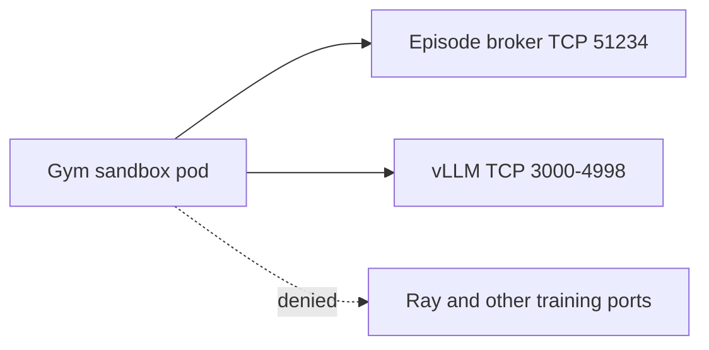

<a id="secure-sandboxed-grpo"></a>

Sandboxed GRPO runs untrusted environment code in an OpenSandbox pod, separate from the training pod. The sandbox needs two endpoints on the training pod: the episode broker and the vLLM generation server. Everything else on that pod, including Ray, is the training control plane and must stay unreachable from the sandbox.

This how-to walks through one supported single-node setup end to end: an enforcing CNI on minikube, OpenSandbox, optional Kata, and the Helm values. It separates the settings that make GRPO **run** from the settings that make the sandbox **secure**. A GRPO job starts and trains without the network-policy settings, but the sandbox's cluster access is not locked down.

## What each layer does

| Layer | Required to run GRPO | Required for a secure sandbox | What it provides |
| --- | --- | --- | --- |
| OpenSandbox server and `sandboxClusterCapable: true` | Yes | Yes | Runs the Gym in its own pod. Without it, GRPO fails at submit. |
| Job-storage PVC (`rl.job_storage_pvc_claim`) | Yes | Yes | The sandbox reads the environment and dataset from it. The chart sets it. |
| CNI that enforces NetworkPolicy | No | Yes | Without enforcement, NetworkPolicy objects are stored and ignored. |
| `networkPolicies.enabled` and `networkPolicies.jobSteps.enabled` | No | Yes | The jobs controller creates a per-step ingress policy that admits the sandbox only on the broker and vLLM ports. |
| Kata (`kata-qemu`) | No | Optional | Gives each sandbox its own guest kernel. It does not restrict network access. |

## Prerequisites

- A source checkout of `NVIDIA-NeMo/nemo-helix`
- `minikube`, `docker`, `kubectl`, `helm`, `jq`, and `openssl`
- An NVIDIA GPU host with the NVIDIA container toolkit, for GPU training
- `NGC_API_KEY` with access to NeMo Helix chart and container images
- Kubernetes 1.30 or later, or 1.28 or later with the ValidatingAdmissionPolicy beta API enabled. This is needed only for the secure configuration.

## 1. Start minikube with an enforcing CNI

minikube's default CNI on the Docker driver accepts NetworkPolicy resources and does not enforce them. Use Cilium. The CNI cannot be changed on an existing profile, so delete and recreate a profile that was started without it.

```sh
export NGC_API_KEY=<your-ngc-api-key>
export KUBE_NAMESPACE=default

MINIKUBE_CNI=cilium ./e2e/k8s/scripts/setup_local_minikube_gpu.sh
```

The script starts minikube with the Docker driver, passes `--gpus all` when `nvidia-smi` works, and creates the platform pull Secrets in `KUBE_NAMESPACE`. Do not use `--cni calico` with the Docker driver: Calico pods stay in `ContainerCreating` there.

Confirm Cilium is running:

```sh
kubectl -n kube-system rollout status ds/cilium --timeout=5m
```

<Note>
  The [NetworkPolicy smoke test](/documentation/kubernetes-deployment/setup/helm/network-policy-smoke-test) checks the chart's API, controller, and managed-job policies on Kind with Calico. It does not exercise the Gym sandbox policy described here.
</Note>

## 2. Install OpenSandbox

Install the shared-kernel OpenSandbox controller and server, and copy its API-key Secret into the platform namespace:

```sh
./e2e/k8s/scripts/install_opensandbox_minikube.sh
```

The server's `[kubernetes] namespace` must be the platform release namespace, because sandbox pods remount the job-storage PVC and resolve pull Secrets there. See [OpenSandbox](/documentation/kubernetes-deployment/setup/helm/open-sandbox) for the namespace rule, the Secret copy, and installs outside minikube.

## 3. Optional: use Kata

To isolate sandbox pods from the host kernel, follow [OpenSandbox with Kata](/documentation/kubernetes-deployment/setup/helm/opensandbox-kata) and point the platform at the Kata server's Service instead. One OpenSandbox server cannot mix shared-kernel and Kata sandboxes.

Kata changes the kernel boundary, not the network boundary. Configure the network-policy values in the next step whether or not you use Kata.

## 4. Install the platform with sandboxing enabled

Install the chart with the minikube values:

```sh
export HELM_VALUES="${PWD}/e2e/k8s/values/minikube.yaml"
./e2e/k8s/scripts/install_helm_e2e.sh
```

Then apply this overlay. The first block makes sandboxed GRPO run. The `networkPolicies` block locks down the sandbox's cluster access.

```yaml title="sandboxed-grpo-values.yaml"
# Required to run sandboxed GRPO.
sandboxClusterCapable: true
opensandbox:
  domain: opensandbox-server.opensandbox-system.svc.cluster.local
  protocol: http
  apiKeySecret: opensandbox-server-api-key
  apiKeySecretKey: api-key

# Required for a secure sandbox. Both flags must be true.
networkPolicies:
  enabled: true
  jobSteps:
    enabled: true

platformConfig:
  rl:
    # Needed for native-v1 packages and wheel closures that are incomplete.
    sandbox_allow_internet: true
```

```sh
helm upgrade nemo-helix k8s/helm -n "$KUBE_NAMESPACE" --reuse-values \
  -f sandboxed-grpo-values.yaml \
  --timeout 10m
```

Notes on these values:

- `opensandbox.protocol: http` is required for the in-cluster Service. If it is unset, health checks use `https` and the job stalls waiting for the sandbox.
- `networkPolicies.enabled: true` also enables the chart's API, controller, and managed-job policies. Keep them on. Turning them off is not part of this setup.
- The per-step policy is created only when **both** `networkPolicies.enabled` and `networkPolicies.jobSteps.enabled` are true. With either one off, GRPO still runs and the sandbox can reach every port on the training pod.
- `rl.sandboxed_gym_default` already defaults to `true`, and `rl.job_storage_pvc_claim` already names the chart PVC.
- `rl.sandbox_allow_internet` lets a sandbox's per-server venv build reach a public package index. Cluster-private, node-local, and metadata destinations stay denied. Add hosts outside `*.com` and `*.org` with `rl.sandbox_public_dns_allow`. A complete `wheels-v1` closure needs neither.
- With the policy flags on, the chart installs a ValidatingAdmissionPolicy and fails the install on clusters that do not serve that API.

## How the sandbox is isolated



For each GRPO training step, the jobs controller creates an ingress NetworkPolicy:

- **Target.** The training step's pods, selected by `nhx.nvidia.com/managed_by=jobs-controller`, `nhx.nvidia.com/job_id`, and `nhx.nvidia.com/job_step_id`.
- **Same job.** Pods of the same job reach every port. Ray traffic between training pods stays inside the job.
- **Gym sandbox.** Pods labelled `nemo-rl-job-id=<job id>` reach only TCP 51234 (the episode broker) and TCP 3000–4998 (the span vLLM picks its generation port from). OpenSandbox turns sandbox metadata into pod labels, and the broker stamps the job id. The sandbox's `opensandbox.io/id` label names the sandbox; it is not what the policy matches.
- **Everything else.** No other ingress is allowed into the training pods.

Ray's ports stay outside the allowed set: GCS 6379, client 10001, dashboard 8265, node manager and agent ports from 53001, and workers 54001–54257. If you override Ray ports with `GCS_PORT`, `MIN_WORKER_PORT`, or the other Ray port variables, keep them out of 3000–4998 and off 51234.

### What a job cannot widen

- The training step's network rules are compiled by the platform. A job JSON cannot set them.
- A job cannot set sandbox metadata under the `nhx.nvidia.com/` prefix or override `nemo-rl-job-id`.
- The chart's ValidatingAdmissionPolicy admits only this policy shape from the jobs controller: ingress-only, same-namespace pod peers labelled with the target job's id, and TCP ports from `networkPolicies.jobSteps.allowedIngressTcpPorts` and `allowedIngressTcpPortRanges`. It rejects `ipBlock` peers, namespace selectors, egress rules, and other ports.

NetworkPolicy allows are additive. Do not add another policy in the namespace that selects the training pods with a broader allow, such as an exception for the training pod's IP with no ports. That reopens every port, including Ray.

### Policy lifecycle

- **Create.** The controller creates the policy before the step's pods exist. If a policy with that name is left over, it deletes and recreates it.
- **Own.** It sets the Job or Volcano workload as the policy's owner, so Kubernetes garbage-collects the policy with the workload.
- **Delete.** It deletes the policy when the step terminates.

Do not edit these policies by hand. The same settings apply to the `volcano_job` executor, so multi-node GRPO gets the same policy shape. This how-to was verified on single-node minikube.

## Verify

Before a job, confirm the admission policy is installed:

```sh
kubectl get validatingadmissionpolicy | grep job-step-networkpolicies
```

Submit a short GRPO job, as described in [GRPO and Reward Environments](/documentation/customizer-reference/grpo-and-reward-environments). While it runs, set `JOB_ID` to the platform job id and inspect the step policy:

```sh
export JOB_ID=<platform-job-id>

kubectl -n "$KUBE_NAMESPACE" get networkpolicy \
  -l nhx.nvidia.com/managed_by=jobs-controller,nhx.nvidia.com/job_id="$JOB_ID" -o yaml
```

Expect:

- `spec.podSelector` selects one job step, and `policyTypes` is `[Ingress]`.
- One ingress rule allows pods with `nhx.nvidia.com/job_id: <job id>` on all ports.
- One ingress rule allows pods with `nemo-rl-job-id: <job id>` on TCP 51234 and TCP 3000–4998, and no other ports.

Confirm the Gym sandbox pod carries the job id:

```sh
kubectl -n "$KUBE_NAMESPACE" get pods -l nemo-rl-job-id="$JOB_ID" --show-labels
```

The expected connectivity from the sandbox is:

- The episode broker and the vLLM generation port are reachable.
- Ray ports on the training pod are not reachable.
- Unrelated cluster-private services are not reachable.

A completed GRPO job with training metrics and an output model confirms that the allowed ports are enough.

After the job ends, confirm the policy is gone:

```sh
kubectl -n "$KUBE_NAMESPACE" get networkpolicy \
  -l nhx.nvidia.com/managed_by=jobs-controller,nhx.nvidia.com/job_id="$JOB_ID"
```

## Next Steps

- Build an environment package in [GRPO Environment Packages](/documentation/customizer-reference/tutorials/grpo-environment-packages).
- Review [OpenSandbox](/documentation/kubernetes-deployment/setup/helm/open-sandbox) for installs outside minikube.
- Review [Security](/documentation/kubernetes-deployment/setup/security) for broader deployment hardening.
