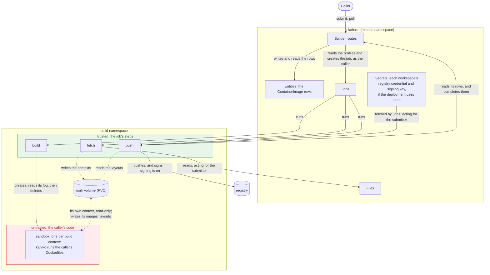
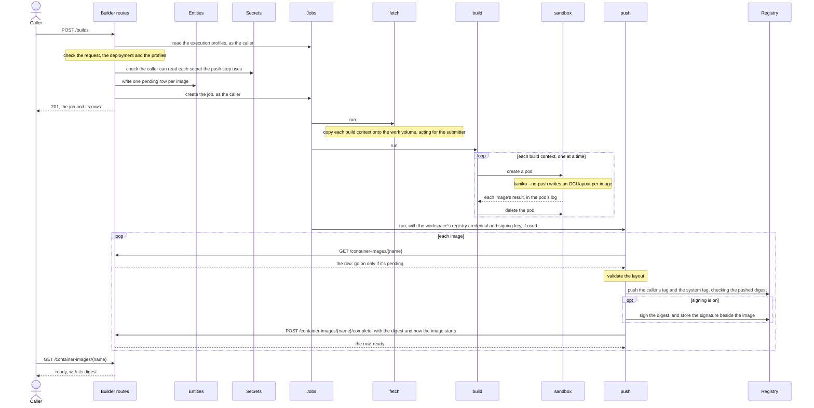

<!-- SPDX-FileCopyrightText: Copyright (c) 2025-2026 NVIDIA CORPORATION & AFFILIATES. All rights reserved. -->
<!-- SPDX-License-Identifier: Apache-2.0 -->

# NeMo Builder Plugin

Container image builds for NeMo Helix. You submit Dockerfiles whose build context is in a Files
fileset. The plugin builds them with kaniko, in a sandbox pod that holds no credentials. Then it
pushes each image to the deployment's registry, signs it with your workspace's key, and records it
as a `ContainerImage` you can pin by digest. A deployment can instead have a build service outside
the cluster build its images: see
[Building through a service outside the cluster](#building-through-a-service-outside-the-cluster).

**Status: proof of concept.** It runs end to end, installed with the platform's Helm chart, on minikube
and on a shared multi-node cluster publishing to Harbor, and it has the [limitations](#limitations)
listed below. That is the in-cluster build. Building through a service outside the cluster has run
in this plugin's tests and on a Kind cluster, with platform auth off, both against a stand-in for a
build service: this repository holds no service's client or step image, and that path has not been
run against a real build service.

## Quickstart (minikube)

This installs the platform with the builder, and a registry, inside minikube, from the platform's Helm
chart. It builds one image and checks the result. Run the commands from the repository root, in one
shell: later steps use variables that earlier ones set.

You need Docker with buildx, minikube, `kubectl`, `helm`, `openssl`, `jq`, and the `nemo` CLI
(`make bootstrap`; see [SETUP.md](../../SETUP.md)). The cluster uses 4 CPUs and 6 GB of memory.
Sandboxes resolve names with `8.8.8.8` and `1.1.1.1`, so your network must allow DNS to them; some
corporate networks and VPNs don't.

**1. Cluster.**

```bash
minikube start --driver=docker --cpus=4 --memory=6144
```

**2. Images.** Build the platform image, `nhx-api`, which includes the builder; `nhx-builder-tasks`, the
image the build steps run in; and `nhx-kaniko`, the sandbox's. On an x86 machine, use `linux/amd64`
instead of `linux/arm64`.

```bash
# The Studio UI is stubbed out; the builder doesn't use it
mkdir -p /tmp/empty-studio/artifacts && touch /tmp/empty-studio/artifacts/.keep
docker buildx bake -f docker-bake.hcl nhx-api-docker nhx-builder-tasks-docker nhx-kaniko-docker --load \
  --allow=fs.read=/tmp/empty-studio --set '*.platform=linux/arm64' \
  --set nhx-api-docker.contexts.nhx-studio-ui=/tmp/empty-studio

minikube image load my-registry/nhx-api:local
minikube image load my-registry/nhx-builder-tasks:local
minikube image load my-registry/nhx-kaniko:local
```

They're tagged `my-registry/<name>:local`, which step 4's values point the platform at.

`minikube image load` doesn't reliably replace an image already loaded under the same tag. When you
rebuild, give all three a new tag with `BAKE_TAG=<tag> docker buildx bake …`, then pass it to
`helm upgrade` as `--set api.image.tag=<tag>,core.image.tag=<tag>,platformConfig.platform.image_tag=<tag>`.

**3. Keys and a password.** All for this cluster only, kept in a temporary directory rather than the
repository: a signing key pair, and a password for the registry. Keep `$KEYS/signing.pub` to verify
signatures later.

```bash
KEYS=$(mktemp -d)
openssl ecparam -name prime256v1 -genkey -noout | openssl pkcs8 -topk8 -nocrypt -out "$KEYS/signing.key"
openssl pkey -in "$KEYS/signing.key" -pubout -out "$KEYS/signing.pub"
printf '%s' "$(openssl rand -hex 16)" > "$KEYS/registry-password"
```

**4. Install.** `config/minikube-values.yaml` installs the platform with only the services the builder
uses, and turns on the chart's `builder` section:

| Namespace | What runs there |
|---|---|
| `nhx-platform` | The platform, its database, and a registry at `nemo-helix-builder-registry.nhx-platform.svc.cluster.local:5000` that takes a username and password |
| `nhx-platform-builds` | The build jobs and their sandboxes, with the step ServiceAccounts, their RBAC, the work volume, and the namespace's limits |

```bash
helm install nemo-helix k8s/helm --namespace nhx-platform --create-namespace \
  -f plugins/nemo-builder/config/minikube-values.yaml \
  --set-file builder.devRegistry.password="$KEYS/registry-password" --wait --timeout 15m

kubectl -n nhx-platform port-forward svc/nemo-helix-api 8080:8080 >/dev/null &
export NHX_BASE_URL=http://localhost:8080
```

The port-forward runs in the background until the shell exits.

**5. Your workspace's secrets.** The push step logs in to the registry, and signs, with three
platform secrets in the workspace that submits the build:

```bash
nemo secrets create builder-registry-username --workspace default --value builder
nemo secrets create builder-registry-password --workspace default --from-file "$KEYS/registry-password"
nemo secrets create builder-signing-key --workspace default --from-file "$KEYS/signing.key"
```

**6. Build context.**

```bash
CTX=$(mktemp -d) && cat > "$CTX/Dockerfile" <<'EOF'
FROM docker.io/library/python:3.13-slim
RUN pip install --no-cache-dir six==1.16.0
RUN echo "hello from nemo-builder" > /hello.txt
EOF
nemo files filesets create hello-context --workspace default
nemo files upload "$CTX/" hello-context --workspace default
```

**7. Build.** A spec that names no `platform` is built for the deployment's `default_platform`,
`linux/amd64` unless set. On an arm64 machine, its `RUN` steps work only if the node can run amd64
binaries, as Docker Desktop's emulation does; otherwise uncomment `default_platform: linux/arm64` in
`config/minikube-values.yaml`, or add `"platform": "linux/arm64"` to the spec.

```bash
curl -s -X POST "$NHX_BASE_URL/apis/builder/v2/workspaces/default/builds" \
  -H 'Content-Type: application/json' \
  -d '{
    "name": "hello",
    "revision": 1,
    "build_specs": [
      {
        "source": {"fileset": "hello-context"},
        "output": {"repository": "demo/hello", "tag": "v1"}
      }
    ]
  }' | jq '{job, images: [.images[] | {name, status}]}'
```

`kubectl -n nhx-platform-builds get pods -w` shows the `fetch` pod, then `build` with its sandbox, then
`push`. Poll the image until it leaves `pending`, which takes a minute or two:

```bash
curl -s "$NHX_BASE_URL/apis/builder/v2/workspaces/default/container-images/hello-1" \
  | jq '{status, digest, status_detail}'
```

```json
{
  "status": "ready",
  "digest": "sha256:4c9b935d53ba5b129d7d8d68a5da8034103817d319623a6591650dd2b306c49d",
  "status_detail": null
}
```

**8. Check the result.** The registry should serve the recorded digest, and the image should contain
the Dockerfile's output; the first command checks both with the crane in `nhx-builder-tasks`. The
signature should verify against your public key; the second checks it with cosign's own image.

```bash
DIGEST=$(curl -s "$NHX_BASE_URL/apis/builder/v2/workspaces/default/container-images/hello-1" | jq -r .digest)
REF=nemo-helix-builder-registry.nhx-platform.svc.cluster.local:5000/default/demo/hello

kubectl -n nhx-platform run check --rm -i --restart=Never --image=my-registry/nhx-builder-tasks:local \
  --env="PASSWORD=$(cat "$KEYS/registry-password")" --env="DIGEST=$DIGEST" --env="REF=$REF" --command -- sh -c '
  set -e; export HOME=/tmp
  crane auth login "${REF%%/*}" -u builder -p "$PASSWORD" >/dev/null 2>&1
  V1=$(crane digest --insecure "$REF:v1")
  [ "$V1" = "$DIGEST" ] || { echo "v1 is $V1, not the recorded $DIGEST" >&2; exit 1; }
  echo "v1 is $DIGEST"
  crane export --insecure "$REF:v1" - | tar -xO hello.txt'

kubectl -n nhx-platform run verify --rm -i --restart=Never --image=ghcr.io/sigstore/cosign/cosign:v2.5.3 \
  --env="PUB=$(cat "$KEYS/signing.pub")" -- verify --key env://PUB --insecure-ignore-tlog=true \
  --allow-http-registry --registry-username builder --registry-password "$(cat "$KEYS/registry-password")" \
  "$REF@$DIGEST" >/dev/null && echo "its signature verifies"
```

On success the first prints `v1 is sha256:…` and `hello from nemo-builder`, and the second
`its signature verifies`. If the digests differ or the signature doesn't verify, it says so and exits
non-zero.

To build again, submit with `"revision": 2`.

## On another cluster

The quickstart runs on any cluster the chart installs on, with the changes below; submitting,
polling and checking work as they do on minikube. Set these first, for your registry, the path in it
for builds, the namespace to install in, and a storage class:

```bash
REGISTRY=registry.example.com         # a host only
PREFIX=builds                         # builder.repository_prefix: the project or path for builds
NS=nemo-helix                         # the release namespace; builds run in $NS-builds
STORAGE_CLASS=<class>                 # for the work volume: ReadWriteMany, and binds immediately
```

**Before you start.** Sandboxes resolve names with `8.8.8.8` and `1.1.1.1`. Check that a pod can
reach them, from any namespace you can run pods in; if it can't, set
`platformConfig.builder.sandbox.dns_nameservers` to resolvers that answer. Name images in full, here
and in your own pods: some runtimes, CRI-O among them, refuse a short name such as `busybox:1.36`.

```bash
kubectl run dnscheck --rm -i --restart=Never --image=docker.io/library/busybox:1.36 -- nslookup pypi.org 8.8.8.8
```

**Instead of steps 1 and 2: images the cluster can pull.** Use a release's, or the ones CI publishes
to `ghcr.io/nvidia-nemo/nemo-helix` for every commit to `main` and every pull request from a branch in
this repository, tagged with the commit and built for `linux/amd64` only. The build steps and
sandboxes take `nhx-builder-tasks` and `nhx-kaniko` from the platform's `image_registry` and
`image_tag`, so point those at the same build as the API:

```bash
IMAGES=ghcr.io/nvidia-nemo/nemo-helix
TAG=<commit>
```

**Instead of step 3: a registry credential.** There's no dev registry: the workspace logs in to
yours. On Harbor, use a robot account with push on the project `$PREFIX` names. Single quotes keep a
robot's `$` from being expanded:

```bash
KEYS=$(mktemp -d)
openssl ecparam -name prime256v1 -genkey -noout | openssl pkcs8 -topk8 -nocrypt -out "$KEYS/signing.key"
openssl pkey -in "$KEYS/signing.key" -pubout -out "$KEYS/signing.pub"
printf '%s' '<username>' > "$KEYS/registry-username"
printf '%s' '<password>' > "$KEYS/registry-password"
```

**Instead of step 4: values for your cluster.** These are the builder's. Add what every install
needs, such as the `ngc-api` Secret, from the chart's [install guide](../../docs/set-up/helm/install.mdx):

```bash
cat > "$KEYS/values.yaml" <<EOF
api:
  image: {repository: $IMAGES/nhx-api, tag: "$TAG"}
core:
  image: {repository: $IMAGES/nhx-api, tag: "$TAG"}
platformConfig:
  platform: {image_registry: $IMAGES, image_tag: "$TAG"}
  builder: {registry: $REGISTRY, repository_prefix: $PREFIX}
builder:
  enabled: true
  workVolume: {storageClass: $STORAGE_CLASS}
EOF
helm install nemo-helix k8s/helm --namespace $NS --create-namespace -f "$KEYS/values.yaml" --wait --timeout 15m
kubectl -n $NS port-forward svc/nemo-helix-api 8080:8080 >/dev/null &
export NHX_BASE_URL=http://localhost:8080
```

[The Helm chart](#the-helm-chart) explains each setting. If the images are private, add
`imagePullSecrets`, and get the same Secret into `$NS-builds`: the chart doesn't copy it, but
`builder.namespaceLabels` can label the namespace for a tool that does. Installing needs permission
to create the build namespace and its RBAC. Platform auth is off, the chart's default, as in the
quickstart; with it on, your calls need a token, and builds have been run only with workload token
exchange off (see [Security](#security)).

**Instead of step 5:** the username from your file, not `builder`.

```bash
nemo secrets create builder-registry-username --workspace default --from-file "$KEYS/registry-username"
nemo secrets create builder-registry-password --workspace default --from-file "$KEYS/registry-password"
nemo secrets create builder-signing-key --workspace default --from-file "$KEYS/signing.key"
```

**In step 6,** a `FROM` on Docker Hub can hit its pull rate limit where many nodes share one address.
Pull through a mirror if your registry has one: `FROM <mirror>/library/python:3.13-slim`.

**In step 7,** watch `$NS-builds` instead of `nhx-platform-builds`.

**Instead of step 8:** your registry, with its TLS, and the robot's credential.

```bash
DIGEST=$(curl -s "$NHX_BASE_URL/apis/builder/v2/workspaces/default/container-images/hello-1" | jq -r .digest)
REF=$REGISTRY/$PREFIX/default/demo/hello

kubectl -n $NS run check --rm -i --restart=Never --image=$IMAGES/nhx-builder-tasks:$TAG \
  --env="U=$(cat "$KEYS/registry-username")" --env="P=$(cat "$KEYS/registry-password")" \
  --env="DIGEST=$DIGEST" --env="REF=$REF" --command -- sh -c '
  set -e; export HOME=/tmp
  crane auth login "${REF%%/*}" -u "$U" -p "$P" >/dev/null 2>&1
  V1=$(crane digest "$REF:v1")
  [ "$V1" = "$DIGEST" ] || { echo "v1 is $V1, not the recorded $DIGEST" >&2; exit 1; }
  echo "v1 is $DIGEST"
  crane export "$REF:v1" - | tar -xO hello.txt'

kubectl -n $NS run verify --rm -i --restart=Never --image=ghcr.io/sigstore/cosign/cosign:v2.5.3 \
  --env="PUB=$(cat "$KEYS/signing.pub")" -- verify --key env://PUB --insecure-ignore-tlog=true \
  --registry-username "$(cat "$KEYS/registry-username")" --registry-password "$(cat "$KEYS/registry-password")" \
  "$REF@$DIGEST" >/dev/null && echo "its signature verifies"
```

These pods carry the credential in their spec, and anything that records `kubectl` sessions records
it too. Use a credential you can rotate.

**If the push fails with `401`** on crane's first `HEAD`, rather than at login, check the username
and password: Harbor answers bad credentials with an anonymous token, so the failure shows up only
once crane uses it. Fix the secret, then submit with the next `revision`: the failed image's row fails
once its job has ended (see [Reliability](#reliability)).

`helm uninstall` deletes `$NS-builds` and its work volume. The images stay in the registry.

## Using the API

There's no CLI or SDK accessor yet. All routes are under `/apis/builder/v2/workspaces/{workspace}`.

### Submit a build: `POST /builds`

A request is a `BuildSet`: a name, a revision, and up to 100 `BuildSpec`s. The set runs as one Jobs
job, and each spec becomes one `ContainerImage` row.

```json
{
  "name": "hello",
  "revision": 1,
  "build_specs": [
    {
      "name": "main",
      "source": {"fileset": "hello-context", "archive": null, "context_path": null},
      "dockerfile": "Dockerfile",
      "platform": "linux/amd64",
      "output": {"repository": "demo/hello", "tag": "v1"}
    }
  ]
}
```

| Field | Meaning |
|---|---|
| `name` | What is being built. Reused across rebuilds. Lowercase letters, digits and single hyphens, starting with a letter and ending in a letter or digit, at least two characters, and short enough that every name built from it fits in 63 characters. |
| `revision` | Your own version number for `name`, starting at 1. Use a new revision for every build. |
| `build_specs` | Up to 100 specs. |
| `build_specs[].name` | The image's name within the set, unique in it: lowercase letters and digits, joined by single `.`, `_` or `-`. It names the image's row, `<name>-<revision>.<spec>`, and an image with no `output` is published under it. One spec in a set may leave it out; its row is `<name>-<revision>`. |
| `source.fileset` | The fileset holding the build context: `name` in this workspace, or `workspace/name`. |
| `source.archive` | Optional. A tar archive in the fileset to build from, compressed or not, under any file name: the fetch step reads the format from the file, and a file that isn't a tar archive fails the build. Relative, with no `..`. |
| `source.context_path` | Optional subdirectory to use as the context: of the fileset, or of the archive if `archive` is set. Relative, with no `..`. Omit it to use the whole fileset or archive. |
| `source.image` | Instead of a fileset, a published image to copy unchanged: see [Copying a published image](#copying-a-published-image). |
| `dockerfile` | Path relative to the context, or an absolute path to a file inside one of the spec's `mounts`. `..` is rejected. Defaults to `Dockerfile`. A copy takes none. |
| `mounts` | Optional. Files the build's `RUN` instructions read that the context mustn't hold: see [Mounting files into a build](#mounting-files-into-a-build). A copy takes none. |
| `platform` | Passed to kaniko. Defaults to the deployment's `default_platform`, `linux/amd64` unless set. |
| `output.repository`, `output.tag` | Optional. Where the image is published, within your workspace's part of the registry. Tags containing `--` or starting with `sha256-` are reserved for system tags and signatures. |

A misspelt field is a `422`, never silently ignored.

One archive can hold several images' contexts, as a benchmark task with an environment and a test
image does. Name the archive in each spec, each with its own `context_path`. A build downloads and
unpacks an archive once, however many of its specs use it:

```json
{"name": "tests", "source": {"fileset": "tasks", "archive": "tb/hello-world.tar.gz", "context_path": "tests"}}
```

#### Mounting files into a build

A spec's `mounts` put files where its `RUN` instructions can read them, without putting them in the
build context. The Dockerfile's `COPY . .` doesn't copy them, and its `.dockerignore` doesn't hide them.
Each mount names a `source`, shaped like the spec's own, and an absolute `target`:

```json
{"mounts": [{"source": {"fileset": "tools", "context_path": "installer"}, "target": "/opt/installer"}]}
```

The fetch step downloads a mount like a context. The sandbox mounts it read-only at `target`, and
kaniko leaves every mount out of its snapshots, so the image holds nothing of it. Files the base
image has at `target` are hidden from the build's `RUN` instructions but kept in the image.

A spec's `dockerfile` can be a file inside one of its mounts, by its absolute path, such as
`/opt/installer/Dockerfile`. A generated Dockerfile kept there isn't in the context, so the build's own
`COPY . .` doesn't copy it into the image.

A target is a plain absolute path below `/`. It can't be in, or above, `/busybox`, `/dev`, `/kaniko`,
`/nhx-work`, `/proc` or `/sys`. Two mounts of one spec can't nest.

#### Copying a published image

A spec can copy an image instead of building one: `{"source": {"image": "ubuntu:24.04"}}`, by tag or
digest, as `docker pull` takes it. At submit the builder resolves it, anonymously, to the one manifest
for the spec's `platform`, and records the reference and that manifest's digest on the row as
`provenance.upstream`. Submitting the same revision again keeps that digest without asking the
registry, even if the tag has moved since. The job pulls exactly that manifest and pushes it unchanged, so the published
digest is the upstream one; the push step and `complete` both refuse any other. The copy is signed
like a build. Copies skip the build step, so a set of nothing but copies runs no sandbox.

Only registries in the deployment's `import_registries` can be copied from, and only public images.
A copy from any other registry is a `409`. A reference that doesn't resolve, or names no image for
the platform, is a `400`; a registry that can't be reached is a `502`. Evals fails a task's image
build on that `409`: on its own record of the build, the refused image is `failed` with the answer's
`detail` in its `error`. It asks for a task's copies before its Dockerfile builds and submits nothing
more of the task after a refusal, so none of the task's Dockerfile images is submitted: they stay
`pending`, with no `builder_image`, on Evals' record of the failed build.

Every image goes to the deployment's one registry. With an `output`, it goes to
`<registry>/<repository_prefix>/<workspace>/<output.repository>:<output.tag>`. Without one, it goes
to `<registry>/<repository_prefix>/<workspace>/<name>/<build_specs[].name>`, or
`<registry>/<repository_prefix>/<workspace>/<name>` for the unnamed spec, under the system tag only.
You can't name a registry: whatever runs the image has to pull it, and one registry means one pull
credential for every workload.

A successful submit returns `201` with the job's name and the `pending` rows. Poll the rows, not the
job: images in a set finish independently.

Jobs starts each of the job's steps once that step's [execution profile](#jobs-execution-profiles)
has room: the chart's `builder.maxConcurrentBuilds` sets each build profile's `max_active_jobs`, so at
most that many steps run on each profile at once, and Jobs queues the rest, one user's at a time. That
caps the sandboxes, not the builds in flight (see the profiles section). While a step waits, the job's
status is `queued` and the rows stay `pending`.

| Status | When |
|---|---|
| `201` | Rows created and job submitted, or the same request was submitted before and these are its rows and job. |
| `400` | Two specs would publish the same `repository:tag`, or the workspace name can't be a repository path component (with `backend: remote`, can't be recorded on an image's row). Or an image to copy doesn't resolve to a public image for its platform. |
| `401` | Platform auth is on and the request names no one. |
| `403` | You may not submit builds in the workspace, or read Jobs' execution profiles, which every user can by default. Or you may, but may not create jobs there: the rows were already written, and fail five minutes on. Or you're a service that isn't acting for a person. |
| `409` | An image to copy is on a registry the deployment doesn't allow. Or the deployment can't build: a `builder` setting is invalid, `registry` is unset, or the build's [Jobs execution profiles](#jobs-execution-profiles) are missing, aren't on Kubernetes, or disagree. Or the push step's secrets don't exist in the workspace, or you can't read them. Or this `name` and `revision` were already submitted with a different request, or the job's name is held by a job this request didn't create; the request's rows are then failed. With `backend: remote`, the job's name is held by a job that the request's `pending` rows don't record: those rows are left as they are, whether they record no job or an earlier one (see [Building through a service outside the cluster](#building-through-a-service-outside-the-cluster)). Some `409`s carry a `code` beside their `detail`. `backend_rejected` (the deployment or its backend can't build this) and `missing_secrets` refuse the request itself, whatever its revision. `backend_changed` refuses only this revision, which was submitted under another backend: submit the next. A revision another request holds has no `code`. |
| `422` | The body failed validation: for example a path outside the context or fileset, a set or spec name that doesn't fit, more than 100 specs, duplicate spec names, a `revision` below 1, a repository or tag that isn't valid or is reserved, or an unknown field such as `output.registry`. |
| `502` | Another platform service refused the build. If Jobs refused the job, the rows were already written, and fail five minutes on. Or the registry of an image to copy couldn't be reached. |
| `500` | Anything else. |

### Read the results: `GET /container-images` and `GET /container-images/{name}`

`GET /container-images` takes `page` and `page_size` (at most 100), and four filters: `job`, a job
name a submit returned; `build_set` and `revision`, a request's `name` and `revision`; and `status`.
`GET /container-images/{name}` returns `404` for a name that doesn't exist. With platform auth on, a
person needs only the permission to read an image; a service, as the push step calls without
workload token exchange, must also act for a person, or gets `403`. That person needn't be the image's
submitter, so a service such as evals can reuse one user's build for another; the policy admits a
service on its own permissions, so the service checks its user may read images here. Each row is a
`ContainerImage`:

| Field | Meaning |
|---|---|
| `status` | `pending`, `ready` or `failed` (or `queued`, deprecated: see [Upgrading from 0.10](#upgrading-from-010)). `ready` is written once the push step has pushed and signed the image, or, with the `remote` backend, once the build service has published it. `failed` is written when the submit that wrote the row was refused, or once the image is found abandoned: its job ended without completing it, or it is five minutes old and has no job (see [Reliability](#reliability)). The builder's routes never change either (but see [Security](#security)). |
| `status_detail` | Why a row failed. When its job ended without completing it, the detail ends with the job's own reason, if the job gave one: for a remote build, the line its step logged for the image. |
| `registry`, `repository` | Where the image lives. |
| `digest` | The digest the image is published at, set when the row becomes `ready`: the one the push step pushed and signed, or the one a remote build service published. |
| `image_ref` | `<registry>/<repository>@<digest>`, the reference to pin. Null until the row is `ready`. |
| `runtime_config` | How the image starts by default: its `entrypoint`, `cmd` and `working_dir`, read from the image's config when the row becomes `ready`, including what it inherits from its base image. A runtime that replaces the container's entrypoint, such as OpenSandbox, uses it to start the image's own. Null for a row completed before the builder recorded it, or one whose config couldn't be read. For a row the `remote` backend built, it is what the build service's client reported for the image, and null when the client reported none, or one that can't be recorded or that holds the service's credential. |
| `provenance` | The build set, revision, spec and job that produced the image, and `request_digest`, the digest of the request. `spec` is null for the unnamed spec. `backend` is the backend that built the row: `execution`, this cluster, or `remote` (see [Building through a service outside the cluster](#building-through-a-service-outside-the-cluster)). Evals records it on its own record of the image as `builder_backend`, whatever the row's status, when it isn't `execution`. A row the `remote` backend builds also records `job_uid` and `job_attempt_id`, once its job exists: the ID Jobs gave the job the row's submit created, and the ID of that job's first attempt. Until then, and on a row this cluster builds, the row has neither field. |
| `external` | Only on a row the `remote` backend built: what the build service calls the image. `image_id` is the service's own handle, for a consumer that uses the same service, and isn't necessarily unique to a row; `build_id` is its record of the build; `attributes` holds a few facts it reports. The builder stores these and uses none of them itself. It requires only that a completion carries a `build_id`, and that a second completion carries the same `external` and the same `runtime_config`. Evals copies `image_id` onto its own record of the image as `external_image_id`. It takes that and the row's backend as the row has them and checks neither against the build service; a run's plan and its task Jobs read neither. Its build of an agent layer does read a row's backend: it refuses a row under the layer's name that another backend built (`layer_not_built_in_cluster`). For what a row of a remote build shows, see [Security](#security). |

Names come from the request:

| | Pattern | Example |
|---|---|---|
| Job | `builder-<set>-<revision>` | `builder-hello-1` |
| Row | `<set>-<revision>.<spec>`, or `<set>-<revision>` for the unnamed spec | `hello-1.tests`, `hello-1` |
| System tag | `<workspace>--<row>` | `default--hello-1` |

## How a build runs

A submitted build set becomes one Jobs job with three steps, each under its own ServiceAccount (two when every spec is a copy, which needs no build step). Your
Dockerfiles run in sandboxes, one pod per build context, which aren't job steps and hold nothing. The
steps are trusted (green): they run the builder's own code. The sandboxes are untrusted (red): they
run yours. What a sandbox writes reaches the steps two ways only: the layouts on the work volume, and
its log, which `build` reads for each image's result. The build namespace is whichever the
[Jobs execution profiles](#jobs-execution-profiles) name.





1. **Submit.** The request is resolved into a job name and a row name per image, and each image is
   placed: registry, repository and system tag. Anything the deployment can't honor is refused
   before anything is written, including a push step secret the caller can't read, and execution
   profiles the sandbox can't follow. Then one `pending` row per image is written, then the job.
   Each row records a digest of the request, so the same request submitted again returns the same
   rows, and a different request under the same `name` and `revision` is refused.
2. **`fetch`** clears what an earlier run left behind, then copies each fileset, or just its
   `context_path`, onto the work volume, for both contexts and mounts. It calls Files as `service:builder`, acting for the
   submitter: a fileset in a workspace where the submitter has no role fails here, and so the whole
   set does. It downloads each archive to the work volume and unpacks it, once, with Python's
   `data` filter, which keeps every entry inside the archive's directory. It refuses an archive that
   unpacks to more than 4 GiB or 100,000 entries.
3. **`build`** creates one sandbox per distinct context and set of mounts, one at a time,
   and deletes each when it ends. The sandbox runs kaniko
   once per image with `--no-push`, writing an OCI layout to that image's output directory. The
   sandbox has:
   - no ServiceAccount token, no secret, and no credential in its environment
   - a security context the `baseline` Pod Security Standard admits: root, but with only five
     capabilities, `RuntimeDefault` seccomp and no privilege escalation
   - public DNS resolvers rather than cluster DNS
   - a deadline the kubelet enforces, so it ends even if `build` is killed first
4. **`push`** treats each layout as untrusted, and checks what crane will read of it: an index with
   exactly one image manifest, and the index, the manifest and every blob it names as regular files,
   not symlinks or FIFOs, under real directories. The registry checks each blob against its digest
   as crane uploads it. For each image whose row is still `pending`, it pushes the caller's tag and
   the system tag with crane, goes on only if crane reports pushing the digest the index names, signs
   that digest unless signing is off, and asks the builder to complete the image. It sends along the
   image's `ENTRYPOINT`, `CMD` and `WORKDIR` from its config, after checking the config against its
   digest; a config it can't read is sent as none rather than refusing the push.
5. **Completing** writes the row `ready` at the digest the push step names, with how the image starts,
   in one write.

One failed Dockerfile, or one sandbox that can't run, doesn't stop the rest of the set: the other
images still build, push and complete. The failed image's row fails once the job has ended (see
[Reliability](#reliability)). If every image in a set fails, `push` never runs.

| | Runs as | Holds | Work volume | Runs your code |
|---|---|---|---|---|
| `fetch` | `nhx-build-fetch` | a Files client, acting for the submitter | yes | no |
| `build` (runs `nhx-build supervise`) | `nhx-build-control` | permission to manage pods in the build namespace | no | no |
| sandbox (kaniko) | no ServiceAccount token | nothing | its own context read-only, and one output directory per image | yes |
| `push` | `nhx-build-push` | the workspace's registry credential and signing key, unless the deployment turned them off | yes | no |

## Building through a service outside the cluster

To set this up on a deployment, follow the operator's walk-through,
[`docs/set-up/helm/builder-remote-backend.mdx`](../../docs/set-up/helm/builder-remote-backend.mdx):
the order of setup, with the chart values to set. This README stays the reference for what the
step image's client owes. The calls themselves, and what each is given and returns, are in
[`run/remote.py`](src/nemo_builder_plugin/run/remote.py).

Unless it says otherwise, the rest of this README describes the default backend, `execution`, which
builds in this cluster. A deployment can instead set `builder.backend: remote`, and a build service outside the cluster then
builds and publishes every image. The API, the rows and the caller's requests stay the same.
The plugin names no service: the deployment names a step image that holds the service's client.

```yaml
builder:
  backend: remote
  remote:
    registry: registry.example.com       # where the service publishes; unset refuses every submit
    repository: team/images              # its one repository: images are told apart by digest
    image: steps.example.com/my-step:1   # the step image; unset, the profile's default_task_image
    command: [remote-build]              # the step program in that image
    profile: build-remote                # the Jobs profile, provider cpu, the step runs on
    credential_secret: builds/credential # <workspace>/<name> of a platform secret; null if the profile mounts it
    platforms: [linux/amd64]
    max_specs_per_set: 1
    allow_dockerfile_path: true          # false refuses any Dockerfile but `Dockerfile` at the context root
    build_timeout_seconds: 3600          # for one image, from when the service is asked to start
    allow_unverified_completion: false   # true builds where nothing shows who completes an image
```

From the environment, the `remote` section is one JSON value, `NEMO_BUILDER_REMOTE`.

A build set becomes one job with one step, `remote-build`. The step fetches each image's context
from Files, acting for the submitter, has the service build it, and completes the row with the digest
the service published, the service's own handle (`external`) and, when the service's client
reported it, how the image starts (`runtime_config`). The builder completes such a row
only when the completion names the service's build (`external.build_id`), and answers a second
completion that names another build, or carries another `runtime_config`, with `409`. No sandbox
runs, and the push step's secrets, the build namespace and the work volume aren't used.

Jobs answers the submit's create with the job's ID, which it gives no later job, and the ID of the
job's first attempt, the one that runs the request as the builder compiled it. The submit then
writes each of its rows that is still `pending` once more, with both, as `provenance.job_uid` and
`provenance.job_attempt_id`. They come only from that answer, never from a job found under the
build's name: whatever such a job says of itself, its creator wrote. A row that can't be written
again is named in the API log, and the submit still answers `201`, with that row as it was: for
a row it has just created, `pending` and with neither field. No later submit records that job
on the row (see [Reliability](#reliability)).

Completing such a row records what its caller sends, and the builder can check none of it against
the build service. What stands for it is who is calling, so who may complete the row goes by how
the platform authenticates a caller:

- **Platform auth off.** No caller is checked, as for an image built in this cluster.
- **Platform auth on, with workload token exchange.** Only a step of the attempt the row records
  completes it. The caller must act for the image's submitter, and its token must name the
  platform's record of its workload, which Jobs keeps for each step's pod. That record must
  still stand, be a job step's, and name the row's workspace, its job's name and the attempt
  the row records. Any other caller is answered `403`, and told which it was: one whose token
  names no workload, as a platform service acting for the submitter; one the platform has no
  job step on record for; a step of another job; or a step of another run of the build's job.
  A row that records no attempt yet is answered `503`, which the step waits out for up to five
  minutes: the submit that created the job may still be writing it. A row that records an
  earlier job of the request, deleted since, is not waited for: a step of the job a resubmit
  created is answered `403` until that submit has written its job on the row, as a step of any
  other run is (see [Reliability](#reliability)).
- **Platform auth on, without workload token exchange.** The platform takes a request's identity
  from headers that anything able to reach its API can set. Nothing then shows who is calling,
  and there is no secret the builder could hand a step that such a caller couldn't read. So
  every submit is refused, with `409` `backend_rejected`, and every completion of such a row,
  with `403`, unless the deployment sets `allow_unverified_completion: true`. That accepts
  exactly this: anything able to reach the platform's API can make a `pending` image `ready` at
  a digest, with a build and a `runtime_config`, of its choosing. The row is then completed by
  any caller that says it acts for its submitter, as an image built in this cluster is. The
  setting changes nothing in the other two modes.

What differs for a caller:

- A spec with `output`, `mounts` or an image to copy is refused with `409`, as is a platform outside
  `platforms` and a set of more than `max_specs_per_set` images. The answer's `code` is
  `backend_rejected`; a revision another request holds is a `409` with no `code`. Evals asks for
  two of these: it builds agent layers with `mounts` and copies prebuilt task images, so this
  backend refuses those builds. A task's image build that is refused fails: on Evals' own record of
  the build, the refused image's `error` is `Builder refused the build:` followed by the answer's
  `detail`. Evals asks for a task's copies before its Dockerfile builds and submits nothing more of
  the task after a refusal, so a task that names a prebuilt image starts no build on this backend:
  its other images are never submitted, and they stay `pending`, with no `builder_image`, on that
  record.
- A Dockerfile that isn't `Dockerfile` at the context root is copied to the root for the build, in
  place of any `Dockerfile` already there. Its own ignore file (`<its path>.dockerignore`) goes with
  it, as `Dockerfile.dockerignore`, and one that belonged to the replaced `Dockerfile` is removed, so
  the build leaves out what it would have left out where it was written. The ignore file the build
  reads at the root, `Dockerfile.dockerignore` or the context's own `.dockerignore`, is left there
  as a regular file: one that is a link to a file becomes a copy of that file, taken before
  anything at the root is replaced, so rules reached through a file that is removed are kept. That
  holds for `Dockerfile` at the root too. With
  `allow_dockerfile_path: false`, such a spec is refused instead, with `409` `backend_rejected`.
- What the ignore file at the root leaves out of the build is left out of what is sent to the
  service only by the service's client. The step hands the client the whole context, ignored files
  included, and the client must apply that ignore file before anything leaves the step (see what
  an operator sets up, below).
- A build context with a link that leads out of it fails the image. In an archive, a link may point
  anywhere in the archive, which can be more than the context; a service that follows links would
  be sent a file from beside the context. So does one with a link that leads back to a directory it
  is in, which such a service would follow without end. And so does a `context_path` that leads
  out of its source once the links in it are followed: the step checks that for itself, since it
  holds the service's credential. A link that leads inside the context is kept. One whose path
  stays inside the context all the way is left exactly as it is written. One whose path leaves
  the context on the way to what it names inside it is rewritten in the context the service is
  handed, so that it still leads
  there wherever the service unpacks the context: one written as an absolute path, by way of the
  context's own directory (`../app/payload`, in a context named `app`), whose name the service
  doesn't keep, or by any other way that steps out of the context and comes back. It becomes the
  way from its own directory to what it named, so a build that copies the link itself copies it
  as rewritten, and the step's log says how many links were. A link that the step's own changes
  at the context root leave leading out of the context fails the image with the same reason: one
  written as a path through a root `Dockerfile` or `Dockerfile.dockerignore` that was a link to
  a directory, which the step replaces or removes.
- The step follows each link once, however many links lead to it, so a chain of links costs its
  length to read, not the square of it. And it counts each name of each path it follows to learn
  where a link leads: a build context whose links take more than 10,000,000 such steps fails the
  image, with `the build context's links take more than 10000000 steps to follow: there are too
  many of them, or the paths they are written as are too long`. As many links as an archive may
  hold entries, each written as a path of thirty names, stay under it. What reaches it was made
  to: links written as paths of thousands of names, or a few thousand links that end in a loop
  of links, which no build can follow and which the step works out again for each of them.
  It also follows no path of more than 8,192 characters, which is twice the longest path the
  system reads. One link never leads to as much: what does is a chain of links that each add
  names that are not there to where the next one led, which no build can follow either, and
  whose every name would cost the length of the path so far. Such a context fails the image,
  with `the build context's links lead to a path of more than 8192 characters, where nothing can
  be: the paths they are written as are too long`.
  The Dockerfile's own path is not followed this way. Whether it leads to a file is asked of the
  system, which follows a few tens of links and no more (40 on Linux), and steps back with `..`
  only from a directory that is there. A Dockerfile the system can't read by its path fails the
  image, with `dockerfile '<path>' is not a file inside the build context`. Its ignore file is
  looked for beside that same path, so a Dockerfile is never staged by a way its ignore file
  can't be found by.
- The size and entry limits of an unpacked archive (4 GiB and 100,000 entries) are kept for
  the build context as the service is handed it. A context with links is measured with them
  followed, and one that comes to more that way fails the image: a few links to one directory,
  each inside the last, come to many times what the context holds on disk, and a client that
  followed them as it packed would send all of it. The row's reason is `the build context comes
  to more than 100000 entries with its links followed`, or `more than 4294967296 bytes`. A link
  to a file counts as the file, and the names an archive gives one file (hard links) count once.
  An entry here is a name on disk, a directory's included.
  What the step adds to a context is counted too: the named Dockerfile at its root, its ignore
  file beside it, and whatever a link to either of them then leads to. A context that was
  within the limits, and that these carry past one, fails the image with the same reason,
  before any of them is written where their sizes alone tell it. Otherwise it is measured once
  it is staged, as is every context that holds a link.
  A context that holds no link is as large as it was fetched, and two such are not measured.
  One that the step writes nothing into, its Dockerfile being `Dockerfile` at its root. And one
  that was already past a limit as it was fetched, whatever the step writes into it: its fetch
  put no such limit on it, and the step carries no context past a limit it was within, but
  holds none to a limit it never had. That is a fileset that is not an archive, which has no
  limit as it is fetched: a large one builds wherever its Dockerfile is, and one within the
  limits fails only if the Dockerfile and ignore file copied to its root carry it past one. It
  is also an archive that doesn't list its directories: unpacking counts the entries an archive
  lists, so on disk it can be more names than it was let through as. With a link in it, such an
  archive is measured, by its names on disk, and can fail for entries it was unpacked within.
- Each archive a set names is downloaded once, whole, and so is a fileset if any image builds from
  all of it; otherwise each directory of a fileset that the set names is its own download, however
  its `context_path` is spelt: `app`, `app/` and `./app` are one directory. Images built from one
  download see the same files, however long the set takes. Each of them builds from its own copy
  of its directory of the download, in which the names an archive gives one file (hard links) are
  still one file, so a copy takes no more space than the download. An image built from a
  download that another image shares is handed the same context as when it is built alone, or
  is refused for the same reason: where each of its links leads is decided where the download
  was unpacked, with the rest of an archive beside the image's directory, and a link that is
  rewritten is rewritten in the image's own copy. The download itself is never changed.
- Every workspace's images land in the service's one repository, and no tag is pushed. Pin
  `image_ref`.
- The builder doesn't sign, and holds no key. Whether an image is signed, and by whom, is the
  service's.
- `runtime_config` is what the service's client reported for the finished image, and null when it
  reported none, or one that can't be recorded: the step never reads the image's config itself.
  One that holds the service's credential, in any part, is recorded as none too, not with the
  credential taken out: a consumer starts the image with what the row says, and would run an
  argument that was never the image's. The step's log says so, without the value.
  With none, a consumer can't learn how the image starts. Evals then can't run a Compose task
  whose main service sets a `command` over an entrypoint it must read from the image, and
  building the image again changes nothing.
- There is no build log. When the step ends as a failed step, the row's `status_detail` ends with
  the step's one-line reason, which names the service's build once one was started, and says so if
  that build couldn't be cancelled and may still be running. In a set of many images, the end of the
  log that Jobs keeps holds only the last few reasons, and the other rows say only that their job
  ended. When the job is cancelled, Jobs usually keeps no log for the step: the row then says only
  that its job ended, and the reason is only in the step's own log.
- A job already under the build's name (`builder-<set>-<revision>`) is the build's own only if
  every row of the request that is still `pending` records that job's ID. A submit of the same
  request then returns the rows and the job, as it does in this cluster. So does one that finds
  no row still `pending`: no job completes a row that has settled, so a finished build's rows
  are returned as they are, whichever job holds the name by then.
  Any other job under the name is answered `409`, whatever digest the job carries. A `pending`
  row that doesn't record the job is left as it is, whether it records no job or an earlier
  one: the job of an earlier submit of the request, deleted since. The job may be one
  that another submit of the same request has just created and not yet recorded: the submit
  that finds it may be a client's retry of one that is slow, and failing the row would fail the
  build that one started. The submit reads the rows again for about two seconds before it
  answers, and returns them if they have come to record the job; the `409` says to submit the
  request again, and the next revision if the answer is the same. A row that never records the
  job, because the job was put under the name before the build was submitted or once the
  build's own job was deleted, or because the submit that created it died before recording
  it, stays `pending` until that job ends, and is then failed
  unless the job's step completed it, which under workload token exchange it can't (see
  [Reliability](#reliability)). The in-cluster backend still takes a job that carries the
  request's digest for the request's own.
- Under workload token exchange, a rerun of the build's job completes nothing. Its steps are of
  another attempt than the one the rows record, which may run a specification changed since the
  submit, and their completions are answered `403`. To build again, submit the next revision.
- A `ready` row doesn't show that its own build made the image it names, nor whose image that is,
  nor that the image starts as the row says: see [Security](#security).
- An upload or a start that fails while the service is unreachable is tried again for up to ten
  minutes each, less if the build's timeout is sooner, and a build already running is waited on until its timeout. A longer outage fails each queued build as it
  reaches a slot.

What an operator sets up:

- The step image. Its program is a few lines around `run/remote.py`'s `step_main`, which takes a
  factory for a `RemoteBuildService`: four methods, `upload_context`, then `start`, then
  `status` until the build ends, and `cancel` when the driver gives a build up, and three error
  types that tell the driver whether to repeat a call, wait, or fail the image. The driver does the
  rest: the context, the deadline, polling, cancelling when the job is told to stop, and completing
  rows. A client that can read the published image's config reports how the image starts, with
  the image it built (`RemoteImage.runtime_config`), and the driver sends that with the
  completion: the driver reads nothing from the registry itself. `start` must give the service
  the build's time limit (`RemoteBuild.timeout_seconds`) as the build's own deadline, wherever the
  service takes one: nothing else ends the build of a step that is killed (see
  [Reliability](#reliability)). Each of the four calls must bound its own time: the driver can't
  interrupt one, and a pod has about 30 seconds from the stop signal to cancel its build. `cancel`
  must be safe to repeat, and must return normally for a build that has already ended: the driver
  asks up to three times, and takes any error to mean the build may still be running.
  The client is handed the build context as a directory in `upload_context` (`RemoteContext.path`),
  all of it, and returns the service's reference to the upload, which the driver hands `start` as
  `RemoteBuild.context`. `upload_context` is also told the platform the image is for
  (`RemoteContext.platform`), so a client can refuse one its service doesn't build before
  uploading anything. Both calls must be safe to repeat with one key: a repeated upload keeps
  the first. Before anything leaves the step, it must apply the ignore file at the context's root
  (`Dockerfile.dockerignore`, or else `.dockerignore`), which the driver leaves there as a regular
  file: rules applied only by the service come too late for a file that must not leave the
  cluster. The Dockerfile and that ignore file are sent whatever the rules say, as a container
  build still reads them. And it must not follow a link: it packs a link as a link, or refuses a
  context that holds one. It packs the names of one file (hard links) as one file: the driver has checked where each link leads, rewritten
  those that would lead elsewhere once unpacked, and refused a context that its links would make
  too much of, but it measures one file once, however many names the file has.
- The Jobs profile, on the `kubernetes_job` backend: a submit is refused on any other. It is
  written in full: a profile added under `jobs.executors`
  inherits nothing from `jobs.executor_defaults`, so it names its own backend, launcher image, ServiceAccount and pod
  security context, as the chart does for the in-cluster build profiles. Its `max_active_jobs` caps
  the build jobs that run at once. A job is one set, built an image at a time, so running jobs wait
  on at most that many builds at the service: set it to what the service lets the deployment queue.
  A build whose step was killed holds no slot once its job has ended, and may still be running at
  the service (see [Reliability](#reliability)). Its
  `ttl_seconds_active` is the only time limit Jobs puts on the step once its pod is running, and Jobs
  counts it from when the build was submitted, so it must cover the longest a build waits for a slot
  as well as the build. The limit a submit checks it against is a floor: it leaves out fetching each context and
  up to five minutes of reporting a built image, so set the profile's limit above it. Other
  limits of the profile can end a step that has its slot before its pod is running:
  `ttl_seconds_before_active`, once Jobs has recorded no change to the step for that long, 30
  minutes by default, in the same words as `ttl_seconds_active` (`Job timed out after reaching max
  TTL of <n> seconds`: the number says which), and `ttl_seconds_image_pull` when an image can't be
  pulled. Whatever the service's client reads from its environment is set there too, and so is the
  network path to the service: a Jobs profile has no egress setting. A profile in a namespace other
  than the release's also needs what the chart creates only for the in-cluster builder: a Role and
  RoleBinding there for the Jobs controller, the ServiceAccount the profile names, with
  `sandboxClusterCapable` a Secret under the OpenSandbox key's name (Jobs gives every job pod a
  reference to it), and, where the chart puts a network policy on the API (`networkPolicies.enabled`,
  with `networkPolicies.api.enabled`, its default), an ingress rule that admits that namespace's
  step pods (`networkPolicies.api.extraIngress`). The chart copies image pull
  secrets nowhere: Jobs gives the step's pod the platform's `imagePullSecrets` and the profile's by
  name, so create them in that namespace too. And the step's pod must be able to resolve and reach
  `platform.base_url`, which Jobs hands to every step by default. The chart's default names the API's Service
  without its namespace. With workload token exchange off, the Service's namespace-qualified address
  is enough, and the chart sets it when `builder.enabled`. With it on, the address must be an
  `https://` one, as that mode requires of `platform.base_url` anyway (see
  [Credential Propagation](../../docs/auth/deployment/credential-propagation.mdx)): a step's client
  sends its token over plain HTTP to loopback only.
- The credential, which is in reach of more than the step either way, so give the service one that
  can do no more than build into the one repository, and that can be replaced.
  Set `credential_secret`, which names a platform secret, whether or not the platform uses
  workload token exchange. Jobs' launcher fetches the secret as the step starts, acting for the
  build's submitter: without exchange, with headers that name them; with it, with the token Jobs
  gives the step's pod, exchanged for one that acts for them. Either way the submitter must be
  able to read the secret. So every user who may build must be, and a submit from one who can't
  is refused with `409` `missing_secrets`. Each of them can read its value too, through a job of
  their own that names it. It is otherwise kept as any platform secret is, which is not from
  everything inside the cluster (see [Security](#security)). Write it as `<workspace>/<name>`: a
  bare name is read from the workspace the build is submitted in.
  The other way is for the profile to mount it, as a Kubernetes Secret volume
  (`storage.additional_volumes`, with a read-only `storage.additional_volume_mounts` entry that
  mounts it in the step), and that way it reaches further. Jobs gives whatever a profile carries
  to every step that names the profile, and doesn't restrict who may name one: any user who may
  create a job, in any workspace, can name `cpu/<profile>`, run their own image on it, read the
  mounted credential, and spend the build service's budget with it directly, whether or not they
  may submit builds or read platform secrets (see [Security](#security)). Nothing in the builder
  narrows that, and a credential made for this deployment alone, narrow and revocable, limits
  what is lost with it, not who can take it. So mount a credential only where every user who may
  create a job (`jobs.create`, which the Editor role carries) is trusted with it, or where the
  deployment itself restricts who may create jobs. Otherwise use `credential_secret`.
  The builder can't check that the profile does
  mount the credential. A step program that passes `read_credential` and finds none fails each
  image and says so on its line; one that reads the credential some other way reports what its own
  client does. Never put the credential in the profile's `env`: Jobs returns a profile's settings, `env` included, to every user who lists the profiles.
  A step program that reads a mounted credential passes `step_main` the function that reads it
  (`read_credential`), so the driver keeps it out of what the step logs and out of every reason, as
  it does one from the environment. In a log record, that is the message and the arguments it was
  made from, the exception, and each field that the log call (`extra`) or a tracing library's
  record factory attaches. From when the driver or the client first names a secret to keep out,
  the exception a record carries (`exc_info`) reaches a log handler only as the text of its
  traceback, as the standard formatter writes one, with the secret taken out, and never as the
  exception itself: a handler that prints the variables of each frame, where a client keeps the
  credential, has none to print, and a handler's own way of formatting a traceback is not used.
  Until then, as in a step whose client finds the credential itself and has not yet given it to
  `redact_log`, a handler is handed the exception as it was logged.
  A field or an argument that is a mapping, a sequence or a set is checked
  by what it holds, not by what it prints, so a request's headers that print a mask are covered.
  Any other object, an exception passed as an argument or a field included, is checked only as it
  prints, and a field that a logging filter sets on a
  record after it is made is not checked. What the step program, or anything it runs, prints
  instead of logging is not redacted. The driver knows the credential only as it was given: whole,
  and for one of several lines, each line of eight characters or more.
  A client that uses a part of it alone, or trades it for a token, gives that to `redact_log`, which
  keeps it out too.
- How the platform authenticates callers, which decides who can complete an image (above). With
  platform auth on, turn workload token exchange on. `allow_unverified_completion: true` is for
  a deployment that can't, and that trusts everything able to reach the platform's API with
  every image's row. Neither has been run on a cluster (see [Security](#security)).
- Under workload token exchange, a namespace of its own for the step, where nothing but Jobs
  can create a pod. A step is known as the build's by the platform's record of its pod, and
  that record is as sure as the namespace is closed. So the remote-build profile must name a
  namespace where no other workload and no user may create pods. Never the build namespace
  while the in-cluster build's profiles are deployed: its `build-control` step may create pods
  there (see [Security](#security)). While Jobs lists the `control_profile` on the
  `kubernetes_job` backend, a submit is refused unless both profiles name a `namespace` and the
  two differ. A profile that names none, or an
  empty one, runs its steps in the namespace of Jobs' own controller, which the builder can't
  read: two such profiles share that namespace, and one may share the namespace the other
  names, so either is refused. The builder can't see what else may create pods where the step
  runs.

A deployment that can't run the step refuses every submit with `409` and says what is missing or
wrong: the registry or repository, the profile, a profile on a Jobs backend other than
`kubernetes_job`, a step image, a profile whose `ttl_seconds_active` is below one full set's
build timeouts plus two minutes, or a `default_platform` the service doesn't build. Last, it
refuses a platform that can't show who completes an image. One with platform auth on and workload
token exchange off, unless `allow_unverified_completion` is set: the answer names the setting and
what turning it on accepts. One with platform auth on whose settings for token exchange can't be
read, whatever that setting is: `complete` admits no one there, since the platform may be
verifying its workloads. And one with platform auth and workload token exchange on, while Jobs
lists the in-cluster build step's profile on `kubernetes_job`, unless that profile and the
remote-build profile each name a `namespace` and the two differ.

Switching a deployment's backend doesn't move its images. A resubmit of a revision that was submitted
under the other backend, and whose rows are still there, is refused: with `code` `backend_changed` when the new backend can take the request (submit
the next revision), and otherwise as any request it can't take is, under any revision
(`backend_rejected` or `missing_secrets`, for example).

Evals takes its task images from the backend `backend` names. It reads the setting from the
configuration its API reads: where that is the builder's own, switching `backend` switches Evals
too, and there is nothing to set under `evals`. A deployment whose Evals API reads another
configuration than the builder does sets `backend` there too, to the backend the builder builds
with. A request for a task's image build returns the
task's ready build only when that backend built every image of it. Otherwise the request starts the
next attempt, which uses no build the other backend made and submits, as the next revision, each
Dockerfile image whose newest build at the builder is the other backend's, or has failed.
So after a switch a task is built again, on the new backend, the next time its build
is requested, with or without `rebuild`. Only the newest build of an image is read, so that holds
after a switch back too: an image the other backend built in between is built again, although the
first backend's older build is still there.
A build still running when the setting changes is returned
as it is, and keeps the backend it was requested for. Evals requests no build by itself, and neither
`nemo evals runs submit` nor `nemo evals tasksets build-images --wait` sends a request for a task
whose newest build is ready: request each taskset's builds once with
`nemo evals tasksets build-images <taskset>`. Until a new build of a task is requested, a run takes
the task's ready build, whichever backend built it. From that request on, a run takes only the new
attempt, once it is ready, and a failed attempt leaves the task without a build a run takes.

Agent layers follow a rule of their own: only `execution` builds one, because a layer build needs
`mounts` and `remote` refuses them. A layer this cluster built is used until it is too old for the
run, whatever `backend` is now, and a row another backend made under a layer's name is refused
(`layer_not_built_in_cluster`). On `remote`, a layer that is too old can't be built again: its
attempt fails, the task runs on its own image, and its trials install the agent during setup.

If a task's build was requested for another backend than the builder builds with, the first image
of it the builder takes fails with an error that names both backends, and Evals submits nothing
more of that task. An image the builder refuses instead, as `remote` refuses a prebuilt image, fails
with the builder's refusal. That is one failed build for each request. Taking the image would make a
ready build that no request accepts, so every request would build the task again without saying why.
A build requested before a switch, whose Job submits an image after it, fails this way once, and
needs only to be requested again. In a deployment whose Evals API reads another `backend` than the
builder does, every attempt that submits an image fails this way, until `backend` is the builder's
in the configuration the Evals API reads. Such an attempt can submit an image built from a
Dockerfile once more, as the next revision, which the builder builds too. With `rebuild`, no build
starts when the image's newest build at the builder is one the builder's own backend made for this
task and hasn't failed: the attempt rejoins that build.
`nemo evals tasksets build-images --wait`, and `nemo evals runs submit` from a Harbor source,
request a failed task's build a second time by themselves, so one command can make two. While the
two backends differ, the build the builder started goes on running, under the backend Evals doesn't
expect, and nothing uses or cancels it. Once Evals expects the builder's backend, the next request's
attempt uses the newest such build, unless it failed, in place of submitting another; if the builder
is switched to the backend Evals expected instead, that build stays unused.

On `remote`, a task that names a prebuilt image can't be built, by a request after the switch, by
`rebuild` or for a new revision: Evals asks for the copy each time, the backend refuses it, and the
failed attempt is then the task's newest build, which a run doesn't take. Upgrade every API pod and
the `builder-settle` controller before setting `backend: remote`: an API pod from before the
setting existed ignores it and builds in this cluster, and refuses a remote step's completion, and
an older controller writes a row back without the backend that built it. A remote build's row that
a builder wrote before rows recorded their job records none, as one whose write failed does (see
[Reliability](#reliability)): under workload token exchange, a build in flight across such an
upgrade is not completed, and its image fails once its step gives up. A row of it that has settled
is returned to a resubmit as it is. Upgrade Evals before setting `backend: remote` too, with the
`nhx-tasks` image its build Jobs run in and users' SDK and CLI: Evals records the backend on each
image of a remote build as soon as it has submitted the build's images, and the service's handle
once the image is ready, and an older Evals, SDK or CLI refuses a build recorded with either. That
isn't limited to the one build: once any attempt of a task's revision records either, an older
Evals fails every listing of that revision's builds, so requesting a build or a rebuild of it and
submitting a taskset run that includes it all fail, and an older CLI's `tasksets build-images`, and
its `runs submit` when it builds images from a Harbor source, fail for the whole taskset. For the
same reason, don't go back to an older release once a remote build is recorded.
An older `nhx-tasks` image doesn't read the backend a build's record names. After a switch its Job
uses the build the old backend made, the attempt ends ready with images no request accepts, and
every request starts another.

## Publishing and signing

The push step is the only step that holds the registry credential or the signing key. Before it
starts, Jobs fetches three platform secrets from the job's workspace, acting for the submitter, and
gives them to the push step as environment variables. The step reads them, then removes them from
its environment, so no tool it runs inherits them. They are named by the deployment's settings; by
default:

| Secret | Holds |
|---|---|
| `builder-registry-username` | The username the push step logs in to the registry with. |
| `builder-registry-password` | That username's password or token. |
| `builder-signing-key` | A PEM private key, EC or RSA, unencrypted, that the push step signs every image with. |

A deployment can turn off the credential, the key, or both (see [Configuration](#configuration)).
The push step then pushes anonymously, or skips signing, and workspaces don't need those secrets.

For each image, the push step:

1. **Pushes** the caller's tag, then the system tag, with crane. crane logs in as the registry asks:
   with the credential itself, or with a token from the registry's token service. crane reads the
   layout itself, so the step stops there unless crane reports pushing the digest the layout's
   index names.
2. **Signs** the digest it pushed, in cosign's format, every annotation taken from the image's row:
   its workspace, name, build set, revision, job and request digest. It stores the signature beside
   the image, under `sha256-<hex>.sig`, where `<hex>` is the digest's hash and where `cosign verify`
   looks for it. Nothing goes to a transparency log.
3. **Completes** the image: `POST /container-images/{name}/complete` with `{"digest": "sha256:…"}`.

Verify an image with the workspace's public key:

```bash
cosign verify --key signing.pub --insecure-ignore-tlog=true <registry>/<repository>@<digest>
```

Add `--allow-http-registry` for a plain-HTTP registry. A signature shows only that something holding
the workspace's key signed the image; see [Security](#security) for what can.

`complete` needs `builder.container-images.complete`, which the Editor role has. With platform auth
on, the caller must also act for the image's submitter: a user's own token is refused. That doesn't
show the caller is the image's push step (see [Security](#security)). For an image the `remote`
backend built, more is asked, by how the platform authenticates a caller. Under workload token
exchange, the caller's token must name the platform's record of its workload, as a job step's
does, and that record must be of a step of the attempt the image's row records: the first
attempt of the job its submit created. With platform auth on and no exchange, no caller
completes it unless the deployment sets `builder.remote.allow_unverified_completion` (see
[Building through a service outside the cluster](#building-through-a-service-outside-the-cluster)).

Completing an image already `ready` returns it, so a retry is safe, when it is the same completion
in what it would have written: the digest, and how the image starts (`runtime_config`). A
completion that names the same digest and another `runtime_config` is answered `409`, not `200`:
the row keeps the first, and a caller told `200` would take it for its own. An image built in this
cluster is held only to what its row records of that. A row an earlier builder completed records
no `runtime_config`, or none of the image's `user`, and a push step whose completion is repeated
across the upgrade sends both, for an image that is published; its image's config is fixed by the
digest either way. For the same reason a completion that carries no `runtime_config`, as a client
that sends only the digest does, or a push step that couldn't read the image's config, is held to
nothing: it says nothing the row could differ from, and is returned the row with what it records.
An image the `remote` backend built is held to all of it, none included: its one step sends the
same on every try.

The builder doesn't read the registry: it
records the digest the push step names. It writes the row it checked its caller against, by the
store's ID for it and at the version it read. A row that has taken the image's name since is never
the one written: the answer is `404`, or `409` where the name was read again. If the row only
changed, the builder reads it and checks the caller again before it writes. It answers `409` if the
image settled otherwise: it failed,
or is `ready` at another digest or with another `runtime_config`. For an image the `remote` backend
built, it also answers `409` if
the completion doesn't name the service's build (`external.build_id`), or carries another `external`
than the image is `ready` with; and for an image built in this cluster, if the completion carries an
`external` at all.

| Status | When |
|---|---|
| `200` | The image is `ready` as the request would have written it, now or already. |
| `403` | The caller lacks the permission, or doesn't act for the image's submitter. Or, for an image the `remote` backend built, the caller isn't shown to be a step of the attempt the image's row records. Under workload token exchange: its token names no workload, the platform has no job step on record for it, or it is a step of another job or of another run of the build's job. With platform auth on and no exchange: the deployment doesn't set `allow_unverified_completion`. |
| `404` | No such image: none of that name, or the one the caller was checked against was deleted before it was written. |
| `409` | The image has already settled: `failed`, or `ready` at another digest, or `ready` with another `runtime_config` than the request carries (an image this cluster built conflicts only on what its row records: not when the request carries none, not when the row records none, and not on a `user` the row does not record; an image the `remote` backend built must match exactly, none included). Or the request carries `external` for an image this cluster builds. Or, for an image the `remote` backend built, the request names no build (`external.build_id`), or carries another `external` than the image is `ready` with. Or another row took the image's name while it was being completed. |
| `422` | The body failed validation: `digest` isn't a sha256 digest, or a field is unknown, a key inside `external` included. |
| `503` | For an image the `remote` backend built: its row doesn't yet record the job its submit created, or the platform's record of the caller's workload, or the deployment's settings, couldn't be read. Nothing was written. The step tries again, for up to five minutes. |

## Deploying

### The Helm chart

Every platform image includes the builder, and the platform's chart deploys what builds need when
`builder.enabled` is set:

- **The build namespace,** `builder.namespace`, by default `<release namespace>-builds`, at the
  `baseline` Pod Security standard. Each step has a ServiceAccount there. The build step's Role
  manages the sandbox pods. The jobs controller gets a Role there too. It can't be the release
  namespace: the build step's pods could mount any of the platform's Secrets there.
  `builder.namespaceLabels` adds labels to it.
- **The work volume,** `builder.workVolume`, `ReadWriteMany` by default, which its storage class must
  support. A class that binds a volume only once a pod uses it, as kind's and most clouds' defaults
  do, keeps `helm install --wait` waiting on this one until it times out: name a class that binds
  immediately, or leave out `--wait`.
- **A LimitRange and a ResourceQuota,** `builder.limitRange` and `builder.resourceQuota`, so that no
  container goes unbounded and all builds together stay within a quota. The quota needs the
  LimitRange's defaults.
- **The three [Jobs execution profiles](#jobs-execution-profiles).**
- **The platform's own URL, namespace-qualified,** since build pods run in another namespace. With
  `networkPolicies.enabled`, the platform's API admits the build pods.
- **For kind and minikube, a registry,** `builder.devRegistry`, which `builder.registry` then names.
- **With `sandboxClusterCapable`, a placeholder for the OpenSandbox key's Secret.** Jobs gives every
  job pod a reference to it, and no build step uses the key, so the build namespace never holds it.

The chart doesn't copy image pull secrets. Jobs gives the step pods the platform's `imagePullSecrets`
and their profile's by name, and `build` gives its sandboxes the same ones as its own pod, so create
them in the build namespace too, or have a cluster tool copy them there, on a label from
`builder.namespaceLabels`.

`helm uninstall` deletes the build namespace, and with it the work volume's claim. The volume and every
build's files go too, unless the storage class retains released volumes (`reclaimPolicy: Retain`):
then delete the volume yourself.

### Configuration

Operator settings live under `builder:` in the platform config, which with the chart is
`platformConfig.builder`, or in `NEMO_BUILDER_*` environment variables. Callers can't set any of them.
They are checked at the first submit, not when the platform starts: an invalid setting, or an unknown
key under `remote` or `sandbox`, refuses every submit with `409` `backend_rejected`. The answer
names the setting, or `builder` for a check made on the section as a whole (one that spans settings,
or the scheme of `registry`); a section that can't be read at all is answered without a name. The
API log has the check's own sentence, without the value it refused. For a section that can't be read
it has the kind of error, and the setting a variable was for, not the parser's own sentence, which
may quote a value.
Evals reads `backend` from the section too. While the section is invalid or can't be read, or
`backend` names no backend, a request for a task's build returns the task's ready build, whichever
backend built it. An attempt started meanwhile expects `execution`, and fails with the builder's
refusal when it submits an image. On a deployment that built with `remote`, every such attempt
submits one, since it uses no build the builder has; if its Job submits only after the section is
repaired, the image fails with the error that names both backends instead, once: request the build
again.
A key directly under `builder` that isn't a setting is ignored, with a warning in the API log the
first time the section is read, which is at the first submit, or before it when Evals first reads
`backend`: a misspelt `backend` leaves builds in this cluster.

```yaml
builder:
  registry: us-central1-docker.pkg.dev           # a host only, never host/path; http://host for plain HTTP
  repository_prefix: my-project/my-repo          # images land at <prefix>/<workspace>/...
  # The push step's platform secrets, in the submitting workspace. These are the defaults; null turns one off.
  registry_username_secret: builder-registry-username
  registry_password_secret: builder-registry-password
  signing_key_secret: builder-signing-key
  # Registries a build may copy a published image from. These are the defaults; [] refuses every copy.
  import_registries: [docker.io, ghcr.io, nvcr.io, quay.io]
  # The platform for a spec that names none. Set it to the nodes' architecture; this is the default.
  default_platform: linux/amd64
```

`registry` has no default; while it is unset, submits fail with a `409` rather than as builds that
die in a pod. Set `repository_prefix` to a path dedicated to builds: left empty, each workspace name
is a top-level namespace in the registry. The steps run the release's `nhx-builder-tasks` image, and
the sandboxes its `nhx-kaniko`, both from the platform's `image_registry` at its `image_tag`;
`sandbox.image` names another kaniko image. The other sandbox settings are `cpu`, `memory`, `ephemeral_storage` and
`dns_nameservers`, each described on `SandboxConfig` in `config.py`. Where the sandboxes run isn't a builder setting:
it comes from the
[Jobs execution profiles](#jobs-execution-profiles). From the environment, the `sandbox` section is
one JSON value, `NEMO_BUILDER_SANDBOX`: only its one-word settings can be set on their own.

With `registry_username_secret` and `registry_password_secret` both `null`, the push step pushes
without logging in; set both or neither. With `signing_key_secret` `null`, it publishes images
unsigned. Both suit a local registry rather than a shared one: anything that can reach a registry
open to anonymous pushes can overwrite any workspace's images, and an unsigned image can be checked
only against the digest its row records.

`config/minikube-values.yaml` is the quickstart's chart values. They work, but they are local-only in
the ways their header lists, auth being off among them; don't start a shared deployment from them.

### Each workspace's secrets

A workspace that builds needs the secrets in [Publishing and signing](#publishing-and-signing), all
three unless the deployment turned some off, created with `nemo secrets create` as in step 5 of the
quickstart. Until it has them, its submits fail with a `409` naming what is missing. Any
member who can run jobs in the workspace and read its secrets can read these, through a job of their
own, and so can anything inside the cluster (see [Security](#security)).

Give each workspace a registry credential that can write only its own part of the registry,
`<repository_prefix>/<workspace>/`, where the registry allows it: a Harbor project and robot
account, or an Artifactory permission on that path. Artifact Registry grants permissions per
repository, and a single `repository_prefix` puts every workspace in one repository, so there a
workspace's credential can write every workspace's images. A credential that can write more lets
that workspace's builds, and members, overwrite other workspaces' images. Until secrets are safe
inside the cluster, these limits don't hold against a build's `RUN`.

### Registries

The registry must accept nested repository paths and create a repository on its first push, as
Artifactory, GAR, Harbor and Distribution do. Docker Hub and nvcr.io don't: each repository there
must be created first, and names have a fixed depth. Known differences:

| Registry | Credential | Note |
|---|---|---|
| GAR | `_json_key` and a service account key, or `oauth2accesstoken` and an access token | An access token expires within an hour, so the secret needs refreshing. |
| Harbor | A robot account | A robot's permissions are per project. |
| Artifactory | A username and an identity token | Writes are slow: a manifest has taken two minutes to be accepted. |
| nvcr.io | `$oauthtoken` and an NGC API key | Repositories are exactly `<org>/<team>/<image>`, so the workspace must be named for the team and `repository_prefix` for the org. |

### Jobs execution profiles

The platform needs three Jobs execution profiles, one per step, named by `fetch_profile`,
`control_profile` and `push_profile` (`build-fetch`, `build-control` and `build-push` by default).
Each is a `cpu` profile on the `kubernetes_job` backend. The chart renders all three. A profile in
`platformConfig.jobs.executors` with the same `provider` and `profile` replaces the chart's, and must
agree as the chart's do. The sandboxes run in the build step's namespace, on the fetch step's work
volume and `node_selector`, so the profiles must agree with each other:

- all three name the same `namespace`, and the fetch and push profiles the same `storage.pvc_name`;
  until they do, submits fail with a `409`
- `service_account_name` is `nhx-build-fetch`, `nhx-build-control` or `nhx-build-push`
- `launcher_image` is an image that ships `/tools/jobs-launcher`, as the platform image does. The
  steps name their image, so `default_task_image` doesn't apply
- with a `ReadWriteOnce` work volume, every `node_selector` names the one node all build pods run on

Each profile's `max_active_jobs` caps the builds at that step: Jobs starts a step there only while fewer
than that many run, and queues the rest. The chart sets all three from `builder.maxConcurrentBuilds`.
A build runs one step at a time and holds its sandboxes only during `build`, so size the build
namespace's ResourceQuota for that many sandboxes and that many step pods per profile. Jobs' per-user
and per-workspace limits apply too.

The limits count steps, not builds: a build between two steps holds no slot, so nothing caps how many
builds are started and not yet finished. In a burst, `fetch` runs ahead of `build`, and most of the
burst's contexts land on the work volume while `build` works through them that many at a time. Size
the work volume for the largest burst, not for `builder.maxConcurrentBuilds` builds. A cap on whole
builds needs a Jobs limit per group of jobs, which Jobs doesn't offer yet.

### Upgrading from 0.10

0.10's builder capped builds with its own queue; 0.11 leaves that to the build profiles'
`max_active_jobs`. What 0.10 left behind still works, but is deprecated and goes in a later release:

- **The `builder-queue` controller** is now a name for `builder-settle`, which it runs, and it logs a
  warning as it starts. Select `builder-settle` instead. Under a controller group, such as `all`, both
  run, and each pass settles twice; that's safe, since every write is conditional.
- **`builder.max_concurrent_builds`** is accepted and ignored, with a warning. The chart's
  `builder.maxConcurrentBuilds` keeps its name, and sets the build profiles' `max_active_jobs`
  instead.
- **The `queued` status** is still read, and still filters a listing, but nothing writes it.
  `builder-settle` settles the images 0.10 left `queued` as it does `pending` ones: one whose job 0.10's
  queue created completes or fails with it, and one whose job it never created fails, five minutes
  after it was submitted, with a `status_detail` saying to submit the next revision.
- **The queued builds 0.10 stored** are deleted by `builder-settle`, since each holds its submitter's
  principal.

## Limitations

Unless a bullet says otherwise, these describe the default `execution` backend. With
`backend: remote`, the bullets about build pods, the sandbox, the work volume, the push step and
signing don't apply, and one other reads differently: a context that can't be fetched fails only
the images that name it. The bullets about who may submit, read and complete an image, about
workload token exchange, and about what `fetch` reads into memory and unpacks, hold for both
backends, except where one says what differs for an image the `remote` backend built: the
remote-build step fetches a context as `fetch` does. What else differs is in
[Building through a service outside the cluster](#building-through-a-service-outside-the-cluster).

### Deployment

- **Kubernetes only, with the platform inside the cluster.** Submits fail with a `409` unless the
  build's execution profiles are on Kubernetes. Build pods call back to Files, Jobs and the builder,
  so a control plane outside the cluster can't run builds.
- **A `ReadWriteOnce` work volume means one node.** The chart's profiles name no `node_selector`, so
  with a `ReadWriteOnce` work volume on more than one node, a build pod can land where the volume
  isn't. Use `ReadWriteMany`, the chart's default.
- **One registry per deployment.** Every image is published to `registry`, under the submitting
  workspace's path. Publishing anywhere else means copying the image out afterwards.
- **Each new request needs a new `revision`.** The same request again returns its rows; a different
  one under a used `name` and `revision` returns `409`.
- **On kind, a build can't write `/product_uuid` or `/product_name`.** kind copies both into the root
  of every container, and kaniko builds in its sandbox's own root, so the sandbox tells kaniko to
  ignore them. A file a Dockerfile writes at either path is then left out of the image, and the build
  still succeeds. Other clusters don't add them, so there nothing is ignored.

### Reliability

- **A row whose build fails is failed by `builder-settle`, or when it's read.** Once a `pending`
  image's job has ended, or once the image is five minutes old and has no job (a submit that died, or
  that Jobs refused, between writing its rows and creating its job; or a job deleted before it
  ended), it is written `failed`, with the reason in `status_detail`. The five minutes count from
  the row's creation, not from when its job went missing: a job deleted when its image is four
  minutes old fails the image within about a minute. The `builder-settle` controller does that
  for every `pending` image every 30 seconds, and reading one image does it for that image at once.
  Listing doesn't, so a listing's `status` lags by up to a pass, and without `builder-settle` such
  rows stay `pending` in listings for good: the chart refuses a controller selection that leaves it
  out. Within the five minutes, submitting the same request again creates its job; after them,
  submit the next `revision`: the same one again would build images already failed.
- **With `backend: remote`, a step that is killed can leave its build running.** The step cancels
  the service's build when it gives the build up, or when Jobs tells it to stop. A step that is
  killed outright, out of memory or with its node, cancels nothing: the row is failed once its job
  has ended, and nothing is left that could cancel the build. The step logs the build's ID when
  the build starts, and nothing else records it. What bounds such a build is the service. The step
  gives the service's client the build's time limit (`RemoteBuild.timeout_seconds`, the
  deployment's `build_timeout_seconds`), so that the client can pass it to its service as the
  build's own deadline. A service that enforces one ends the build by then, whatever became of the
  step. Otherwise the build runs on until the service ends it.
- **With `backend: remote`, a build whose rows don't record its job is lost under workload token
  exchange.** A submit writes its rows, creates the job, then writes on each row the job it
  created. If that last write fails, or the submit dies before it, the job still builds. Under
  workload token exchange, its step's completion is answered `503` until the step gives up, five
  minutes on, and the row is failed once the job has ended. That comes after the build: before
  it starts, the step reads only that its row is `pending`. So the service builds and publishes
  an image that no row then names, and the row stays `pending` for at least the build's time
  and five minutes more. Where Jobs kept the step's line, its `status_detail` then says
  `it was built, but the builder could not be told`. Where no caller is verified, the step
  completes the row all the same. In any mode, submitting the same request again while that
  job exists and a row is still `pending` is answered `409`, and leaves the row as it is:
  nothing tells the job from one that another submit is about to record. Nothing restores the
  record later either: the job's ID and attempt come only from Jobs' answer to the create,
  which that submit alone held, and a job found under the name afterwards can't be told from
  one that someone else put there. Once the rows have settled, the same request returns them,
  and the next `revision` builds again. The API log names each row that was not written, or
  the job, where Jobs' answer gave no ID or attempt for it. The submit's answer shows it for a
  row that submit created: `pending`, with no `provenance.job_uid`. A row left recording an
  earlier job looks in the answer like any recorded row, since the answer names the job and
  not its ID: compare the row's `provenance.job_uid` with the `id` Jobs reports for that job.
  Read such a row once more, since a write whose answer was lost may have been
  made. If it still does not record the job, and the platform uses workload token exchange,
  cancel the job rather than wait for it: its step asks the service to stop the build, the row
  is failed once the job has ended, and the next `revision` builds. The same holds for a row a
  builder wrote before rows recorded their job. It holds too for a row left recording an
  earlier job, when the build's job was deleted, the same request created another, and that
  submit's write failed, except that the new job's step is answered `403` at once, and its
  line says `it was built, but the builder refused to complete it`. So is a
  step of the new job that asks before that write is made: the platform's record of a step
  names its job by name, so nothing tells it from a rerun of the earlier job, or from a step
  of another job put under the name, and neither of those is kept waiting. A submit writes its
  job on its rows as soon as Jobs has answered its create, so a step meets this only where
  that write takes longer than the step's whole build.
- **With `backend: remote`, a build context with links is held to an archive's limits with
  those links followed, and the step carries no context past them.** A context with links that
  comes to more than 4 GiB or 100,000 entries with them followed fails its image, however
  little it takes on disk: the step can't see whether the service's client packs a link as a
  link. And what the step itself writes into a context is counted: a Dockerfile that isn't
  `Dockerfile` at the context root is copied there, with its ignore file, and a context that
  was within the limits and that these carry past one fails its image too. A context that holds
  no link and was already past a limit as it was fetched is not measured, whatever the step
  writes into it: a fileset that is not an archive has no limit as it is fetched, and gets none
  from where its Dockerfile is. Entries are names
  on disk, directories included, and unpacking counts only the entries an archive lists. So an
  archive that lists files and not their directories can be more names on disk than it was let
  through as: with no link it is handed on as it is, and with one it is measured, and can fail
  for entries it was unpacked within. The names an archive gives one file (hard links) are
  measured as the one file, so a client that sends a file for each name sends more than was
  measured.
- **With `backend: remote`, a build context's links are followed within limits, before the
  build's timeout starts.** The step follows each link once, gives up past 10,000,000 steps,
  and gives up at a path of more than 8,192 characters; either fails the image. Together they
  bound the work, since no step costs more than the longest path, and what the step remembers
  of each link. They don't bound the time: a context made to reach the limit on steps has held
  the step for about half a minute on a local disk, during which the step doesn't read the
  job's stop signal, and fetching and staging a context come before `build_timeout_seconds`
  starts to count.
- **One unreadable fileset fails the whole set.** `fetch` copies every context in one step, so one
  that can't be read stops every image in the set.
- **A sandbox has an hour.** The images from one context build one after another in one sandbox.
  `build` stops watching it after an hour, and the kubelet ends it five minutes later; its
  unfinished images fail.
- **`build` gives up on a dropped watch, and on a leftover sandbox.** If its watch on a sandbox
  closes early, the sandbox's unfinished images fail. A retried `build` step fails while the
  previous attempt's sandbox still exists, and a sandbox whose `build` was killed is never deleted:
  it stays until someone deletes it.
- **A failed build holds its space for hours.** Jobs deletes a build's directory on the work
  volume once its last step succeeds, when the push step's profile sets
  `cleanup_completed_jobs_immediately`, as the chart's do. A failed build's contexts and layouts
  stay for `jobs.storage.failed_storage_ttl_seconds` after its failed step stopped, 4 hours by
  default, and a cancelled build's until Jobs' next retention pass, every 5 minutes by default.
  Size the work volume for a burst of failures as well as for the burst itself (see
  [Jobs execution profiles](#jobs-execution-profiles)).
- **`fetch` reads each file of a fileset whole into memory.** A build context with very large files
  can exhaust the step's memory. An archive is streamed to the work volume instead.
- **An archive unpacks to at most 4 GiB and 100,000 entries.** A larger one fails the whole set,
  as an unreadable fileset does.
- **Unpacking an archive can cost the square of the links it holds.** Python's `data` filter
  follows each link's target as the link is unpacked, and keeps nothing from one entry to the
  next. An archive that lists a chain of links from its last link to its first, or that names
  the first link of a chain in many hard links, has the chain followed again for each of them:
  about five billion link reads for a chain of nearly 100,000 links, which an archive of under
  a megabyte holds, and hours of work. Nothing in `fetch` bounds that, in either backend: only
  the time limit Jobs puts on the step ends it. With `backend: remote`, what the step does with
  a context's links once they are unpacked is bounded (above), and unpacking them is not.

### Security

- **Anything inside the cluster can read every workspace's secrets.** With platform auth off, any
  request can. With it on, and workload token exchange off, a request that names a known service,
  such as `service:jobs`, in its `X-NHX-Principal-*` headers, and no user it acts for, gets any
  secret in any workspace: the platform takes those headers on trust. A build's own `RUN` reaches
  the platform, so a Dockerfile can read every workspace's signing key and registry credential,
  sign as any workspace, and push to its repositories. With exchange on, the platform refuses those
  headers, but the builder has not been run with exchange on (below).
- **A service can submit builds for anyone it names.** `POST /builds` admits a service acting for a
  person, so that a platform service, such as evaluations, can build for its user. The policy
  admits a service on its own permissions, so the checks behind `403` and `409`, that the person
  may submit builds in the workspace and read the push step's secrets, pass whoever it names: the
  calling service has to check that its user may build there. And anything inside the cluster can
  name a service (above).
- **A signature shows only that something holding the workspace's key signed the image.** Any
  member who can run a job that reads the key can sign any image with it, and so can anything that
  can read it (above). A signature doesn't show that the platform built the image.
- **With platform auth off, anything can complete or rewrite an image.** Nothing then checks who
  calls the platform, so anything that reaches it, a build's own `RUN` included, can mark a
  `pending` image `ready` at a digest of its choosing, or rewrite any image's row. The quickstart
  runs with auth off.
- **With platform auth on, anything inside the cluster can still complete or rewrite an image.**
  For an image built in this cluster, `complete` takes any caller that says it acts for the
  image's submitter. Without workload token
  exchange, the platform takes a request's identity from its `X-NHX-Principal-*` headers whenever it
  has them, with no token behind them: a gateway is meant to strip them from outside traffic, but
  nothing strips them inside the cluster. So anything that reaches the platform, a build's own `RUN`
  included, can mark any of the submitter's `pending` images `ready` at a digest of its choosing.
  For an image the `remote` backend built, `complete` refuses there, unless the deployment
  accepted exactly that (below). Refused or not, one that names a service can rewrite any
  image's row, whichever backend built it, through the platform's generic Entities
  route, including a `ready` row's digest, which `complete` never changes. With exchange on, the
  platform refuses those headers, and a step's token names whom the step acts for, the
  ServiceAccount its pod runs as, and the platform's record of its pod, which says which job the
  pod is a step of, and which attempt of that job. For an image the `remote` backend built,
  `complete` reads that record and admits only a step of the attempt the image's row records
  (below). For an image built in this cluster it doesn't: any other job acting for the same
  submitter passes the same check, and so does a platform service acting for them.
- **With `backend: remote`, the first completion of a row decides what the row says.** `complete`
  records the digest, the `external` and the `runtime_config` its caller sends, and checks none of
  them against the build service: it holds no credential for one. So whoever makes the first
  completion of a `pending` row decides the image the row names, the build it is said to come
  from, and how the image starts. The row's own step is then answered `409`, and a consumer pins
  that reference and starts it that way: Evals runs its task in that image, with that entrypoint.
  That a completion must name a build, and a second one the same `external` and `runtime_config`,
  protects only the writes after the first. Every workspace's images share the service's one
  repository, so the digest chosen can be another workspace's image, if the caller knows that
  image's digest or handle.
  Who can make it depends on how the platform authenticates a caller. With platform auth off,
  anything that reaches the platform can (above).
  With platform auth on and workload token exchange, only a step of the attempt the row records
  can: the first attempt of the job the row's submit created, which runs the request as the
  builder compiled it, in the deployment's step image. A step's token names the platform's
  record of its pod, and `complete` answers `403` unless that record still stands, is a job
  step's, and names the row's workspace, its job's name and that attempt. That refuses a
  platform service acting for the submitter, whose token names no such record. It refuses
  another job of the submitter's. It refuses a job put under the build job's name once the
  build job is deleted: such a job has attempts of its own. A job put under that name before
  the build is submitted is never admitted either: the submit creates no job while the name is
  taken, so the row records no attempt, and that job's step is answered `503` until it gives up.
  A submit doesn't take such a job for the build's either: the request's digest on a job, which
  anyone who knows the request can work out, makes the job the request's own only for the
  in-cluster backend. Here, only every row of the request that is still `pending` recording
  the job's ID does. And `complete` refuses a rerun of the build job, which is another attempt,
  and may run a specification someone has changed since.
  With platform auth on and no workload token exchange, nothing is verified. Nothing the
  platform gives a route says who its caller is, and anything that names a service can read
  whatever secret the builder might give a step to prove itself with (above). So the builder
  refuses instead: every submit, so that no build is made that couldn't be recorded, and every
  completion of a remote build's row. A deployment that sets
  `builder.remote.allow_unverified_completion` accepts what is then left: anything inside the
  cluster that says it acts for the submitter can make the first completion, and the job a row
  records is compared with nothing.
  With exchange on, four things remain. Whatever holds the platform's signing key for workload
  tokens can mint a token with claims of its choosing: one that names the record of the build's
  own step, while that record stands, or one that names a service, which can rewrite any row
  through the Entities route. That is the platform's own process, with every plugin loaded into
  it: refusing a token that names no workload shuts out a service's ordinary client, not a
  holder of the key. The platform's record of a step's pod names the job by its name, not by
  its ID, so the builder tells the build's own run from another job under its name by the
  attempt's ID alone, which Jobs gives no other attempt; it compares the job's ID as well
  wherever a record carries one, which the platform's doesn't yet. That record is the
  platform's word about a pod in the step's namespace, and it is as sure as that namespace is
  closed: whatever else can create a pod where the step runs is inside what the check trusts.
  The builder refuses a remote-build profile that names the same `namespace` as the in-cluster
  build step's profile, whose steps may create pods there, and one it can't tell apart from that
  profile: where either names no namespace, Jobs runs its steps in the namespace of its own
  controller, which the builder can't read. It can see no further: the step must run
  in a namespace where nothing but Jobs can create a pod. And the step is taken at its word:
  the check shows which step is calling, not that the digest it sends is the image the
  service built, so a row is worth what the deployment's step image and its client are.
  What a deployment can do is turn workload token exchange on, run the remote-build step
  where nothing but Jobs creates pods, and limit what runs in the platform's own process.
  With auth off, or with `allow_unverified_completion`, treat a `ready`
  row of a remote build as the word of anything that can reach the platform, not the
  builder's. In every mode, a consumer must not take a row's `image_ref`,
  `external.image_id` or `runtime_config` as proof that the image is the one the row's build
  made, that it starts as its build left it, or that it is the workspace's own: the builder
  compares none of them with the build service or the registry.
- **With `backend: remote`, what leaves the cluster is the build service's client's to decide.**
  The step hands the client the whole build context, with the files its ignore file leaves out
  of the build. The client is required to apply that ignore file before it sends anything, and
  the builder can't check that a deployment's client does: a `.env` beside a Dockerfile is kept
  inside the cluster only by a client that does.
- **With platform auth on, builds have been run only with workload token exchange off.** There a
  step calls the platform as `service:builder`, acting for the submitter, and Jobs' launcher
  fetches the step's secrets with headers that name the job's creator. With exchange on, Jobs
  gives a step's pod a token, which the launcher and the step exchange for one that acts for the
  job's creator. The platform's policy lets such a workload read a secret that its creator may
  read, so the launcher can fetch a step's secrets there too, and the step calls the builder as
  that workload rather than as `service:builder`. Neither backend has been run that way, nor has
  the check `complete` then makes of which step a remote build's caller is: to make it,
  the builder reads the platform's record of the caller's workload as `service:builder`, and
  holds it against the job and the attempt that the row's submit recorded from Jobs' answer.
  So with `backend: remote` and platform auth on, the one mode that builds without
  `allow_unverified_completion` is a mode no build has run in. The check has run only in this
  plugin's tests: behind the platform's own auth middleware and policy, with tokens minted as
  its auth service mints them, and with stand-ins for Jobs and its records.
  `complete` admits a caller only when it acts for the image's submitter; reading an image admits
  a service only when it acts for a person, whoever that is.
- **`fetch` unpacks archives the request names.** It runs acting for the submitter and parses an
  archive anyone who can write to the fileset put there. Python's `data` filter keeps every entry
  inside the archive's directory, and refuses links out of it and devices; the caps bound what one
  archive writes to the work volume every build on the node shares. They don't bound how long
  an archive made of chains of links takes to unpack (see [Reliability](#reliability)).
- **Execution profiles aren't authorized in Jobs.** Anyone who can submit a build can run a raw job
  under any of the builder's profiles. Under `build-control` such a job can create any pod in the
  build namespace: it can mount the whole work volume, with every build's contexts and outputs, and
  rewrite a layout another job's push step is about to publish; read any build pod's log; and delete
  any build pod. With `backend: remote`, a raw job on the profile the remote-build step runs on
  gets everything that profile carries, so a build service's credential that the profile mounts is readable by
  anyone who may create a job in any workspace, who can then spend the service's budget with it
  directly. And under workload token exchange the remote-build step must run in a
  namespace of its own, apart from the build namespace (above). Closing these needs Jobs
  to restrict these profiles to
  the builder. Until then, give the step its credential with `credential_secret`, or mount one
  only where every user who may create a job is trusted with it, or where the deployment itself
  restricts who may create jobs (see
  [Building through a service outside the cluster](#building-through-a-service-outside-the-cluster)).
- **A failed row's reason is what the job under its build's name said.** `builder-settle` copies a
  job's own account of why it ended onto the rows of its build, and knows the job by its name:
  the job status it reads names no creator. A workspace member who creates a job under a build's name
  before the build does can choose the text the build's submitter, and anyone who reads the image,
  finds in `status_detail`. The job a remote build's row records is not looked at here: it
  decides who may complete the row, not whose account of a failure the row is given. A submit
  on that backend that finds such a job leaves its `pending` rows as they are, since they record
  no job and the job may be another submit's, so they are failed with that job's text once it
  has ended.
- **Nothing restricts the sandbox's network.** A Dockerfile's `RUN` can reach anything a pod can:
  the platform, as any user or service it names, every other Service, and on a cloud cluster the
  node's metadata server. A NetworkPolicy allowing the sandbox only public addresses would close
  this, on a network plugin that enforces it; the sandbox already resolves names with public DNS,
  and carries the label `nhx.nvidia.com/sandbox=true` to select it by.
- **Nothing bounds a sandbox's processes.** Its CPU, memory and ephemeral storage are limited, and the
  build namespace has a quota, but how many processes a pod may run is the kubelet's `podPidsLimit`,
  a node setting, so one Dockerfile can exhaust the build node's.
- **Images built from one context share a sandbox.** Each one's `RUN` can reach the others' outputs,
  so one image's Dockerfile, or a base image it pulls, can alter another image of the same build.
- **Base images must be pullable without credentials.** The sandbox holds none, and nothing bounds
  what a Dockerfile can pull `FROM`.

### Not yet supported

- **KMS keys.** The signing key is a PEM in the platform's Secrets service, and the push step holds
  it while it runs.
- **Signatures in a transparency log, or in cosign's newer formats.** Signatures are cosign's legacy
  `.sig` images.
- **Multi-platform images.** Each spec builds one platform.

## Development

```bash
uv run --frozen pytest plugins/nemo-builder/tests
uv run --frozen ruff check plugins/nemo-builder && uv run --frozen ty check plugins/nemo-builder
```

The tests need no cluster, registry or running platform.

`e2e/test_builder.py` does: CI's `kind-builder-e2e` job runs it on kind, once with platform auth off and once
with it on, after a merge to `main` or on a manual run of `ci.yaml`, not on pull requests. It builds two
images, checks them with crane and cosign, and with auth on checks who may complete an image. Its docstring
lists what it needs to run against another cluster.

| File | What it holds |
|---|---|
| `service.py` | The REST routes |
| `_perms.py`, `authz.py` | The routes' permissions, and the plugin's authz scope |
| `schema.py` | The request models: `BuildSet`, `BuildSpec`, `FileSetSource`, `BuildOutput` |
| `plan.py` | `BuildPlan`: a request resolved into names, then placed by the backend |
| `backend.py` | The backend interface: what a backend refuses, compiles and places, and whether its rows record their job |
| `backends.py`, `execution.py`, `remote.py` | The deployment's backend, the `execution` backend and the `remote` backend |
| `compile.py` | Turns a plan into the `HelixJobSpec`, fetch, build and push, as a pure function |
| `submit.py` | The submit sequence: plan, secrets, rows, then the job, which a remote build's rows then record |
| `completion.py` | Who may complete an image, and the one write that makes its row `ready` |
| `signing.py` | What a signature says, cosign's format for storing it, and the key that makes it |
| `registry.py` | The registry calls the push step makes to store a signature |
| `registry_auth.py` | Logging in to a registry with a username and password, as its challenge asks |
| `client.py` | A typed client for the builder's routes, which the push step uses |
| `steps.py` | What each step's config contains, the push step's environment, and `WorkLayout` |
| `entities.py` | `ContainerImage` |
| `identity.py` | Registry hosts, repository paths and tags, and the system tag |
| `config.py` | `BuilderConfig` |
| `run/` | The programs: `fetch.py`, `supervise.py` and `push.py`; `remote.py`, the remote-build step's driver and the interface a build service implements; `main.py`, the `nhx-build` entry point; `utils.py`, what the steps share; and `tools.py`, which runs crane for `push` |
| `docker/builder/`, at the repository root | The `nhx-builder-tasks` and `nhx-kaniko` images |
| `config/` | The chart values for the minikube quickstart |
